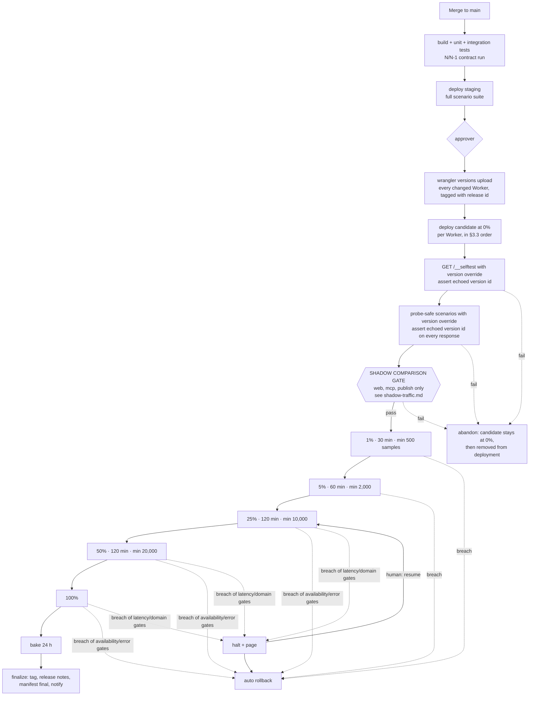

# PackServer release plan

Status: proposal, 2026-10-22. Builds on [research/cloudflare-release-and-shadowing.md](research/cloudflare-release-and-shadowing.md) (cited below as "research §X"); platform facts and prices are sourced there and not repeated. Shadow traffic (record on the live version, dry-run on the candidate, compare) is specified in [shadow-traffic.md](shadow-traffic.md); this plan only says where its gate sits. Monitoring numbers (SLOs, thresholds, burn rates) live in `docs/operations/monitoring.md` (PR #7); this plan refers to its gates by name. The test harness and the `probe-safe` scenarios are in `docs/testing/` (PR #9).

Vocabulary: a **version** is an uploaded Worker snapshot (code + bindings + compat settings, research §A.1); a **deployment** is the traffic split between at most two versions; a **release** is one git commit of the monorepo deployed across all seven Workers; the **candidate** (RC) is the version being released; the **incumbent** is the version it replaces.

## 1. Principles and goals

1. **Nobody sees a version before it has proven itself on the real hostname with real bindings.** Every candidate is deployed at 0%, self-tests itself, passes the probe-safe scenarios, and (for `web`, `mcp`, `publish`) passes the shadow comparison gate before the first percent of live traffic.
2. **Every stage is reversible in under five minutes, or it is flagged as not reversible and released on its own.** Code is reversible through `wrangler rollback`. Schema, DO class lifecycle, bucket/queue deletions and compat-date bumps are not, so they ship as separate releases with their own rules (§6).
3. **Blast radius is bounded by percentage and by Worker.** One Worker's gradual rollout at a time; the first stage exposes 1% of that Worker's traffic; version affinity keeps any one client on one version.
4. **Decisions are made by named gates, not by watching dashboards.** A stage advances only when `gate.availability`, `gate.error_rate`, `gate.p99_latency` and the stage's domain gates (e.g. `gate.domain.publish_success`, `gate.domain.mcp_search_success`, `gate.domain.index_fetch_success`) report `pass` for the candidate's version id. Gate names, definitions, thresholds and statistical floors are owned by monitoring.md §9; every gate answers `watching`, `pass`, `fail` or `insufficient` (below its floor), is evaluated only at decision points (the floor, each doubling of samples, stage end) with exact binomial/Fisher tests at α = 0.01, and the rollout script reads them from the gate judge's `GET /gates/<version_id>` (monitoring.md §9.5). Breach at an early stage rolls back automatically; breach at a late stage halts and pages; the zero-tolerance gates `gate.selftest`, `gate.synthetic`, `gate.domain.hash_integrity` and `gate.domain.index_fetch_success` roll back at every stage including 100%.
5. **The read path survives a bad release and a Cloudflare partial outage.** Immutable pack bytes and signed indexes are served from R2 through the CDN cache with stale-if-error; the Workers are not on the path for a cache hit (§7).
6. **Deploy and release are different events.** Behaviour changes that need coordination (a new MCP tool, a new index format) ship dark behind a flag and are switched on separately (§6.7).
7. **Everything is recorded.** Release id, per-Worker version ids, gate results, who approved, and what was rolled back are written to a manifest and the audit database (§9).

## 2. Environments

| Environment | What it is | Data | Who reaches it | Cost delta |
|---|---|---|---|---|
| **local** | `wrangler dev` with local D1/R2/KV/DO emulation; the integration-test harness with fakes behind the ports layer | Seeded fixtures | Developers | $0 |
| **PR preview** | Worker Previews per branch (research §A.8): isolated DO namespaces and Containers; D1 pointed at the shared `previews` database; KV/R2 rebound to `*-preview` namespaces | `previews` D1 (synthetic), `*-preview` buckets | Reviewers via the preview URL (Access-protected, `noindex`) | $0 (inside quotas) |
| **staging** | Wrangler environment `staging` in the production account: `web-staging`, `mcp-staging`, … on `staging.packserver.dev`, `mcp-staging.packserver.dev`, `cdn-staging.packserver.dev`; own D1 (`registry-staging`, `audit-staging`), own four R2 buckets, own KV, Queues, DO namespaces, Vectorize index, Workflows, own secrets (test-mode Stripe, a staging GitHub App) | Scrubbed copy of production D1 (§2.2), sample of public packs | Team via Access (IdP + MFA); CI via Access service token | ≈ $0–3/month (research §G.3) |
| **production** | The seven Workers on `packserver.dev`, `mcp.packserver.dev`, `cdn.packserver.dev`, `admin.packserver.dev` | Real | Public; `admin` and `/__selftest` behind Access | baseline |

### 2.1 Staging: justified, same account

Staging is needed because the things that break on release are exactly the things Worker Previews cannot run (research §A.8, §D): queue consumers, cron, Workflows with Sandbox, service bindings between the seven Workers (a Preview's service bindings call *production*), and D1 migrations against a realistic schema and row count. Three activities need a persistent environment with all of those wired together:

- **Migration rehearsal.** Every expand/contract migration runs on `registry-staging` (a scrubbed copy of production) before it runs on production, timed, so a `DROP COLUMN` rewrite on a large table is discovered at 2 GB and not on the single production writer.
- **Lifecycle rehearsal.** DO class lifecycle changes, queue/bucket binding removals, compat-date bumps and Workflow step changes are not gradual and not rollback-able across (research §A.5–A.6, §A.9); they are rehearsed on staging with the same wrangler commands CI will run on production.
- **Full-system scenario runs.** The whole scenario suite (not just `probe-safe`) runs against staging on every merge to `main`, including publish → validate → promote → index → MCP search, with the staging Sandbox, Stripe test mode and a staging GitHub App.

Same account rather than a separate account (research §D): $0 instead of $5–30/month, one zone, one wrangler config, one set of CI credentials. The risk a separate account removes (an operator running `wrangler deploy` against production by mistake) is mitigated instead by (a) humans never holding a production-deploy API token; only the GitHub Actions `production` environment has it, (b) wrangler profiles pinning the repo directory to the `staging` environment by default, (c) `wrangler.toml` requiring `--env production` explicitly for every production target. Revisit if an operator-error incident happens.

Access protection: one Access application per staging hostname, policy "team group via IdP with MFA" plus a Service Auth policy for the CI service token (research §D). The `web-staging` Worker additionally validates `Cf-Access-Jwt-Assertion` so a misconfigured Access app fails closed. Staging hostnames appear in certificate transparency logs; that is acceptable because nothing on staging is secret or real.

**Isolation inside one account.** Every staging resource is its own `*-staging` D1 database, R2 bucket, KV namespace, Vectorize index, Queue and DO namespace; nothing is shared with production, and a CI check fails if the `staging` block of any `wrangler.toml` names a production resource id. Cloudflare API tokens cannot be scoped to a single Worker or wrangler environment (Workers Scripts, D1, R2 and Queues permissions are account-wide; only R2 tokens can be limited to named buckets), so the boundary is who holds which credential, not the token's scope:

| Credential | Holder | Can |
|---|---|---|
| Production deploy API token | GitHub `production` environment only | upload/deploy Workers, run D1 migrations |
| Staging deploy API token (same permissions; the account cannot tell them apart) | GitHub `staging` environment, operators | same; used only with `--env staging`, audited via the account audit log |
| Staging test service token (Access) | nightly and per-merge test jobs | reach staging hostnames over HTTP only; the Access app that accepts it covers only `*staging.packserver.dev`; no Cloudflare API access at all |
| Probe service token (Access) | release pipeline, uptime monitor | `/__selftest*` and probe routes on production (§5.2) |

Nightly real-backend scenario runs (test plan, docs/testing §6) write under the `@probe` scope on staging and clean up after themselves; the monthly re-seed (§2.2) wipes anything left over.

### 2.2 Seeding staging without production PII

Monthly (cron in `admin-staging`, or by hand): `wrangler d1 export --remote registry --no-data` for schema, then a scrubbing script that exports only the tables needed for realistic behaviour (`scopes`, `packs`, `pack_versions`, `pack_stats`, `trusted_publishers` with repository fields intact), **restricted to rows of public packs** (`WHERE visibility = 'public'`; private pack names, summaries and version metadata are customer data and never leave production, nor do `packs-private` objects), and synthesises the rest: `users` replaced by generated handles with `@example.invalid` emails, `credentials`/`sessions`/`tokens`/`identities`/`grants`/`reviews`/`reports`/`credit_ledger`/`subscriptions` emptied and refilled from the fixture generator, `audit` not copied. R2: the public archives of the 1,000 most-installed packs plus every pack under the `@probe` and `@packserver-canary` scopes, copied with `rclone` between buckets. The export blocks other D1 requests while it runs (research §B.1), so it runs at the quietest hour and is capped to the lean tables.

### 2.3 PR previews

Workers Builds creates a Preview per non-production branch and posts the URL on the PR. Previews rebind D1 to `previews` (via `previews.d1_databases`), KV and R2 to `*-preview`, so a PR cannot write to production stores; service bindings still reach production Workers, which is why nothing in a PR preview is allowed to call `publish` or `billing` (the `web` Worker's preview build sets `PREVIEW=1` and those routes return 503). Previews are for looking at UI and API changes; they are not a gate.

## 3. Release unit, versioning and pipeline

### 3.1 Release id

`<semver>+<git sha7>`, e.g. `1.4.0+a1b2c3d`. Semver is bumped by the PR that merges (`changesets`-style `.changeset/*.md` files; `patch` by default, `minor` for new public behaviour, `major` only for breaking API/MCP changes). The git tag `v1.4.0` is created at finalisation, not at upload, so an abandoned release leaves no tag. This is PackServer's own release id; pack versions and `cn` versions are date-based `1.YMMDD.n` and never semver.

Every version upload is tagged with the release id (`wrangler versions upload --tag 1.4.0+a1b2c3d --message "<PR title>"`), so the dashboard, Workers Metrics release markers and Logpush `ScriptVersion.tag` all show it. The `CF_VERSION_METADATA` binding gives the Worker its own version id at runtime; every log line, Analytics Engine data point and shadow record carries both `version_id` and `release_id` (release id is baked in as a build-time constant).

### 3.2 Release manifest

Written by CI to R2 `ops/releases/<release-id>.json` (private bucket `ops`, also attached to the GitHub Release at finalisation) and updated at every stage:

```json
{
  "release_id": "1.4.0+a1b2c3d", "sha": "a1b2c3d…", "created_by": "ci", "approved_by": ["ariel"],
  "kind": "normal | hotfix | lifecycle-only | migration-only | compat-only",
  "workers": {
    "validator": {"version_id": "…", "mode": "all-at-once"},
    "publish":   {"version_id": "…", "mode": "gradual"},
    "web":       {"version_id": "…", "mode": "gradual"}
  },
  "migrations": {"registry": ["0042_add_pack_versions_tier"], "audit": []},
  "stages": [{"name": "selftest", "worker": "web", "at": "…", "result": "pass", "gates": {}}],
  "state": "uploading | verifying | shadowing | rolling | baking | final | rolled-back | abandoned",
  "rollback": {"to_release": null, "reason": null}
}
```

### 3.3 Worker order and the N/N-1 contract

Two Workers can be at different points of their rollouts, so the candidate of one may call the incumbent of another (research §A.7). Rule: **a callee must accept requests from the caller's previous *and* next release; a caller must accept responses from the callee's previous and next release** (the N/N-1 contract, enforced by the scenario suite running the caller at N against the callee at N-1 in CI, for every release candidate and for PRs touching a contract, §3.4). Service-binding requests carry `X-PackServer-Release` so a callee can log skew.

The N-1 bundles come from the previous release's build artifacts in the private `ops` R2 prefix. Each bundle's SHA-256 is recorded in the release manifest and in the annotated git tag; the contract job verifies the digest before loading a bundle and fails on mismatch. CI writes bundles with an R2 token scoped to that prefix and never overwrites an existing key (a re-run that finds the key already present compares digests instead).

Deploy order within one release, callees first:

| Step | Worker(s) | Mode | Why |
|---|---|---|---|
| 0 | D1 migrations (expand only) | `wrangler d1 migrations apply` | Schema must precede any code that reads the new shape |
| 1 | `validator` | all-at-once (0% → selftest → 100%) | Internal; called by Workflows, Queues and cron, whose split behaviour is undocumented (research §A.2); hosts no public route |
| 2 | `publish`, `github`, `billing` | `publish` gradual; `github`, `billing` all-at-once | `publish` is HTTP-facing with CI clients. Webhook receivers get too little traffic for percentages to mean anything; they rely on self-test, probe-safe scenarios and the N/N-1 contract |
| 3 | `mcp`, then `web` | gradual, one at a time | Highest traffic, highest blast radius; `web` last because it depends on all of the above |
| 4 | `admin` | all-at-once | Behind Access, internal users |

"All-at-once" still means `versions upload` → deploy at 0% → self-test → probe-safe scenarios → `versions deploy` 100% (a one-stage rollout), never `wrangler deploy`, except for lifecycle-only releases (§6.4) where `wrangler deploy` is the only command that applies the change.

### 3.4 CI pipeline

GitHub Actions, workflow `release.yml`, triggered by merge to `main`. Jobs:

1. `build-test`: typecheck, lint, unit tests, integration scenarios with fakes, the "test files unchanged unless requirements changed" check from the test plan. The N/N-1 contract run is **not** on every merge (it is the largest CI-minutes line, test plan §11): it runs when a release candidate is cut, and on PRs whose diff touches a service-binding interface (the shared contract types in `core/contracts/`, `X-PackServer-*` headers, queue message schemas). Free GitHub Actions minutes cover the result.
2. `deploy-staging`: `wrangler deploy --env staging` for all Workers (staging is not gradual), apply staging migrations, run the full scenario suite with `--driver=http` against staging. Failure stops here.
3. `upload-production` (GitHub environment `production`, requires one approver, §9): `wrangler versions upload --env production --tag <release-id>` for every Worker that changed (a Worker whose bundle hash is unchanged is skipped and keeps its version id); write the manifest.
4. `rollout-<worker>`: one job per Worker in §3.3 order, each running §4's stages through a small Node script (`scripts/release/rollout.ts`) that calls `wrangler versions deploy --env production --yes --percentage` and the gate judge (`GET /gates/<version_id>?window=<stage seconds>&source=<all|real>`, Access service token; monitoring.md §9.5). The script is **restartable from the manifest's `stages`** and is driven by a scheduled workflow that wakes every 10 minutes, reads the manifest, advances or rolls back, and exits (a job that sleeps for the whole rollout would exceed GitHub's 6-hour job limit once the shadow gate's 24 h minimum and the 4× low-traffic cap of §4.3 are counted, and costs ~5× more in minutes, §10). The run logs are the release log.
5. `bake` and `finalize`: the same scheduled workflow, 24 h after 100%.

Credentials and supply chain:

- One Cloudflare API token per GitHub environment (`staging`, `production`, `production-rollback`), each scoped to exactly the permissions its jobs use (`Workers Scripts: Edit`, `D1: Edit`, `Workers R2 Storage: Edit` restricted to the `ops` bucket, `Access: Service Tokens: Read`); the rollback token has `Workers Scripts: Edit` only. Cloudflare API tokens are static (there is no GitHub OIDC federation into Cloudflare), so they are rotated quarterly and on every off-boarding, and the token's own name appears in the Cloudflare audit log on every use. Nobody runs production wrangler commands from a laptop except in the rollback runbook (§6.1), with a token checked out from the password manager and logged.
- The `production` environment requires one reviewer (§9.1) and restricts deployment branches to `main` and `hotfix/*`; `production-rollback` has no reviewer (a rollback must not wait for approval, §6.1) but accepts only `main`, so a rollback runs the audited script, not arbitrary code.
- Every GitHub Action is pinned to a full commit SHA (`actions/checkout@<sha>`, `cloudflare/wrangler-action@<sha>`), not a tag; Dependabot keeps the pins fresh. No third-party action outside `actions/*` and `cloudflare/*` is used in `release.yml` or `rollback.yml`.
- Wrangler is a pinned dev dependency installed with `npm ci` from the lockfile (never `npx wrangler@latest`); the lockfile is validated by `lockfile-lint` (registry allowlist, HTTPS). Builds run with `--ignore-scripts` except for the explicit build step. Minimum `wrangler` 4.131.0 (research §A.6).
- Secrets never pass through `wrangler secret put` in CI; they live in Secrets Store and are referenced by binding, so a compromised CI token cannot read them (it can only deploy code that reads them, which the self-test `secrets` check names but never returns).

## 4. Pipeline stages, end to end



### 4.1 Pre-traffic verification (per Worker)

1. `wrangler versions deploy --percentage <incumbent>=100,<candidate>=0`. Wait 10 s (propagation "up to a couple of seconds", research §A.4).
2. `GET https://<host>/__selftest` with `Cloudflare-Workers-Version-Overrides: <worker>="<candidate id>"`, the Access service token headers and the HMAC header (§5.3). **The script asserts `version_id == candidate id` in the body.** The override is silently ignored on any mistake (wrong id, version not in deployment, malformed header), in which case the incumbent would answer and a green result would be meaningless. Retry three times at 10 s intervals before failing. Then assert `ok == true` and `release_id == <release id>`.
3. `npm run scenarios -- --driver=http --tag=probe-safe` with `PACKSERVER_BASE_URL=https://<host>`, `PACKSERVER_VERSION_OVERRIDE=<worker>="<candidate id>"`, `CF_ACCESS_CLIENT_ID/SECRET`, `SELFTEST_HMAC_KEY`, `PACKSERVER_PROBE_TENANT=@probe`. When the override is set the harness also signs every request with the `X-Selftest-Signature` HMAC of §5.2, because the candidate refuses unsigned traffic while it is gated (§4.5) and the edge strips the override header from requests that do not identify themselves as CI. Every response from PackServer carries `X-PackServer-Version: <version id>`; the harness asserts it equals the override on every call when the override is set. Non-zero exit or any mismatch fails the stage; the JUnit report is attached to the manifest.
4. For Workers that share one hostname (`web` and `publish` both under `packserver.dev`), the override header names both Workers so the scenarios exercise the candidate end to end: `web="<id>", publish="<id>"`.

Failure here leaves the candidate at 0% (no user affected); the script then redeploys the incumbent at 100% alone so the candidate is no longer reachable by anyone who guesses its id, and marks the release `abandoned`.

### 4.2 Shadow comparison gate

Runs for `web`, `mcp` and `publish` after §4.1 and before any live percentage. The candidate remains at 0%; the incumbent samples live requests, records its external invocations, and calls the candidate in dry-run mode through the version override; the comparison job reports `gate.shadow` per endpoint (its summary `gate.shadow.match_rate` lands on monitoring's dashboard in phase 2) against the live-vs-live noise floor. Sampling rate, record schema, duration, minimum samples per endpoint, the stopping rule and the classification of diffs (by design / acceptable / prohibitive) are defined in [shadow-traffic.md](shadow-traffic.md); its minimum recording window is 24 h, so a normal release takes about two days from approval to 100% (≈ 24 h shadow + ≈ 6 h of stages) and about three to finalise, and with one release in flight at a time (§7.3) that caps throughput at roughly 10–15 releases a month unless changes are batched. This plan's requirement is only: the gate reports `pass`, `fail` or `inconclusive`, and `inconclusive` is treated as `fail` for a normal release and may be waived by the approver for a hotfix (§8.6) with the waiver recorded in the manifest.

### 4.3 Gradual rollout stages

| Stage | Candidate % | Minimum duration | Minimum candidate samples (requests on the new version, `source = all`) | Gates checked every 60 s | Action on breach |
|---|---|---|---|---|---|
| S1 | 1% (skipped in low-traffic mode) | 30 min | 500, or the gate floor if larger | `gate.selftest`, `gate.synthetic`, `gate.availability`, `gate.error_rate`, `gate.p99_latency` (gates on p95 below 10k samples), `gate.domain.hash_integrity`, `gate.domain.index_fetch_success`, domain gates for the Worker | **auto-rollback** |
| S2 | 5% (skipped in low-traffic mode) | 60 min | 2,000 | same | **auto-rollback** |
| S3 | 25% | 120 min | 10,000 | same | availability/error_rate/zero-tolerance: **auto-rollback**; latency/other domain: **halt + page** |
| S4 | 50% (skipped in low-traffic mode) | 120 min | 20,000 | same, plus `gate.domain.*` compared candidate vs incumbent at equal share | same as S3 |
| S5 | 100% | — | — | same (candidate only, incumbent no longer serving) | zero-tolerance gates: **auto-rollback**; others: **halt + page**, rollback by human (§6.1) |
| Bake | 100% | 24 h | — | same, plus `gate.queue.backlog`; phase-2 gates (`gate.domain.rollup_success`, `gate.domain.webhook_ack`, `gate.budget`, `gate.cpu`) join once monitoring.md §9 (PR #7, release notes in §9.6) enables them | halt + page |

Rules:

- A stage advances only when **both** the minimum duration and the minimum sample size are met and every gate reports `pass` at that moment. `insufficient` never advances a stage and never rolls one back; it means "wait or add traffic". The stage sample minimum is "the number in the table or the gate's statistical floor (monitoring.md §9.2), whichever is larger".
- **Low-traffic mode** (monitoring.md §9.3). At launch the Workers see ~280 real requests an hour, so the table's minimums would take 144–180 h from real traffic alone. While the gate judge reports a real request rate under **1 req/s** (`budget.usage`, meter `request_rate`), the rollout script: (a) runs the synthetic prober's probe-safe scenarios every minute **pinned to the candidate** (override header plus HMAC before S1; `Cloudflare-Workers-Version-Key` affinity during the split), which yields ~1,800 candidate requests an hour whatever the stage percentage, and evaluates gates with `source = all`; (b) uses the ladder **S3 (25%) → S5 (100%) → bake**, because with synthetic load the percentage controls blast radius only, and 1% of launch traffic is a handful of users; (c) keeps the zero-tolerance gates at every stage and auto-rollback on; (d) records `low_traffic: true` in the manifest. The full ladder returns automatically once real traffic crosses 1 req/s, at which point the mid-scale row of monitoring.md §9.3 (1.5–2 h per stage) makes it satisfiable. If a stage stays `insufficient` for 4× its minimum duration even with synthetic load, the script halts and pages rather than advancing.
- The sample minimums above are sized for `web` and `mcp`. `publish` sees ~40k publishes a month (≈ 1 request/minute, three Worker requests each), so 1% for 30 minutes yields under one candidate request and the table would always end in "low-traffic advance". `publish` therefore uses the compressed schedule 10% (30 min, 50 samples) → 50% (60 min, 200 samples) → 100%, with the domain gate `gate.domain.publish_success` and the probe-safe canary publish as the real evidence. Minimums are per-Worker constants in `rollout.ts`, reviewed when traffic changes.
- Auto-rollback is `wrangler rollback <incumbent id>` executed by the script within 60 s of a red gate; it is safe because the incumbent was serving 100% minutes earlier and nothing non-reversible is in the release. Halt means the split is frozen and the on-call is paged; the on-call either rolls back or, after diagnosing (e.g. a latency gate tripped by an unrelated Cloudflare incident), resumes.
- Stickiness: `Cloudflare-Workers-Version-Key` (research §A.3). Our own clients set it where they can: `publish-action` its GitHub run id, the MCP client library the OAuth client id. `cn` sends no repo id today, and its update fetches are CDN reads that reach no Worker anyway; making it send one would be an engine change and a new disclosure of which repo fetches which pack, so it is **open** (owner decision, with the engine). A Transform Rule on each zone hostname sets it from the session cookie, else from `ip.src`, for everything else. Affinity means one client's multi-step flow (OIDC exchange → upload → publish) lands on one version, and a user who hits a bug stays on the bad version until rollback rather than flapping; that is the intended trade.
- Static assets are content-hashed per version; the `web` Worker serves its assets with `immutable` caching and both versions' asset manifests are retained in the build output, so a page rendered by the candidate never asks the incumbent for an asset it does not have (research §A.3). `gate.error_rate` for `web` includes asset 404s.
- Only one Worker is in S1–S5 at any time. The next Worker's rollout starts when the previous one is at 100% (not after its bake; bakes overlap).

### 4.4 Bake and finalise

Bake: 24 h at 100% covering one full cron cycle (hourly rollups, nightly re-validation, monthly domain re-check does not fit; it is covered by the staging run). Finalise: tag `v<semver>`, create the GitHub Release with notes (§9.3), set manifest `state: final`, remove the previous release's versions from any deployment (they remain rollback targets among the last 100), post to the release channel.

### 4.5 Who can use the version-override header

`Cloudflare-Workers-Version-Overrides` is honoured for any request that reaches the Workers router with a version id that is in the current deployment; Cloudflare neither strips it from internet clients nor documents any access control on it (verified against the version-overrides page, 2026-10-22). Without controls, during a rollout any user could pin themselves to the **candidate** (unreleased code at 0%) or to the **incumbent** (for instance, to keep using behaviour a security fix removes), and the `X-PackServer-Version` response header tells them both ids. Versions that are not in the deployment are unreachable, so finalising (§4.4), which removes the previous version from the deployment, closes the window. Controls:

1. **Edge strip.** A Request Header Transform Rule on every zone hostname removes `Cloudflare-Workers-Version-Overrides`, `Cloudflare-Workers-Version-Key` and `X-PackServer-Shadow` from inbound requests unless the request carries the CI service token's `CF-Access-Client-Id` (the id is not secret; the matching secret is checked by Access on `/__selftest*` and by the HMAC header everywhere else, so the rule is a filter, not the authentication). Header Transform Rules may remove any header not prefixed `cf-`/`x-cf-` and run in `http_request_late_transform`, before Workers (ruleset phases list). The zone then sets `Cloudflare-Workers-Version-Key` itself (§4.3 stickiness), after the strip. Service-binding calls (`SELF` for shadowing, §4.2) do not pass through zone rules, so shadowing is unaffected. **Verify on staging** that a public request carrying the header lands on the incumbent before relying on this; the rule is managed as code (§8.9).
2. **RC gating in the Worker.** Each Worker compares `CF_VERSION_METADATA.id` with the `rc` ids in `shadow_releases` (read through the feature-flag path, §6.7). While its own id is the `rc` and the release state is `verifying` or `shadowing`, the version answers only requests that carry a valid HMAC (§5.2) or a valid signed shadow header; everything else gets the same 404 as an unknown route. The rollout script flips the state to `rolling` immediately before the S1 deploy. Fail-open: if the flag read fails, the version serves normally (an RC that is being deployed at 1% must not go dark because D1 is slow).
3. **Hotfix rule.** A security hotfix is rolled out with compressed stages (§8.6) precisely so the incumbent leaves the deployment within the hour.

## 5. Self-test endpoint

`GET /__selftest` exists on every Worker (including internal ones; `validator` and `admin` get a route on `internal.packserver.dev/<worker>/__selftest` for this purpose). It answers the question "can this exact version, with the bindings it was uploaded with, do its job right now?" without changing anything a user can see.

### 5.1 Checks

| Check name | Which Workers | What it does | Pass condition |
|---|---|---|---|
| `config` | all | Reads `CF_VERSION_METADATA`, compiled release id, compatibility date and flags, environment name | Version id present, environment = `production`/`staging` as expected, compat date equals the value compiled into the release |
| `secrets` | all | For each secret the Worker needs (`STRIPE_SECRET`, `GITHUB_APP_KEY`, `INDEX_SIGNING_KEY`, `AI_GATEWAY_TOKEN`, `SELFTEST_HMAC_KEY`, …): present and non-empty; Secrets Store fetch succeeds | All present; values never returned (detail = key names only) |
| `d1.registry` | web, mcp, publish, github, billing, validator, admin | `SELECT 1` with `first-primary`; read `d1_migrations` head | Query ok; head within `[min_schema, max_schema]` compiled into the code (§6.2) |
| `d1.replica` | web, mcp | `SELECT 1` with `first-unconstrained` | Query ok; reports replica region in detail |
| `d1.audit` | all that write audit | `SELECT 1`; migrations head in range | as above |
| `r2.<bucket>` | per binding | `HEAD` of the canary object `_canary/ping.txt` in each bound bucket | Object exists; etag matches the known value |
| `kv.<namespace>` | mcp, publish, web | `get("_canary")` | Value equals `"ok"` |
| `do.scope_coordinator` | publish, mcp | `stub.ping()` on the reserved scope `@packserver-canary` | Returns `{ok, schema_version}`; schema_version within the range the code supports |
| `queue.<name>` | producers | Send `{type: "selftest-noop", version_id}` to the canary queue `selftest` whose consumer discards | Send resolved |
| `vectorize` | mcp, validator | `describe()` | Index name and dimensions match |
| `workflows` | publish, github, billing, web | `get(instanceId)` of the permanent canary instance | Status readable |
| `analytics_engine` | web, mcp | Binding present (no write; AE writes are fire-and-forget and invisible) | Binding object exists |
| `outbound.github` | publish, github | `GET https://token.actions.githubusercontent.com/.well-known/openid-configuration` (no auth, no side effect) | 200 within 2 s |
| `outbound.stripe` | billing | `GET /v1/balance` with the restricted read-only key | 200 within 2 s |
| `outbound.ai_gateway` | validator | `GET` gateway metadata endpoint, no model call | 200 |
| `service.<binding>` | callers | `GET /__selftest?shallow=1` on each bound Worker, forwarding the inbound override header (so a candidate-to-candidate check is possible) | Callee answers `ok` with its own version id; shallow mode skips the callee's own outbound checks to bound total time |
| `domain.read` | web, mcp | Load pack `@packserver-canary/ping` via the normal read path (D1 → R2 meta.json), run the ranking function on a fixed fixture | Expected pack returned; ranking output equals the stored expected value |
| `domain.index` | web | Verify the signature on `index/v1/@packserver-canary.json` with the public key | Valid |

### 5.2 Rules

- **Read-only.** No D1 writes, no R2 puts, no DO mutation, no queue sends except to the canary queue, no outbound call that creates anything. The `ScopeCoordinator.ping()` method touches no state. Analytics Engine, audit and rate-limit side effects are suppressed for self-test requests (the request is flagged internally after auth).
- **Format** (the contract agreed with monitoring): `{version_id, release_id, ok, checks:[{name, ok, ms, detail}]}`. `ok` is the AND of all checks. `detail` is a short string or small object, never a secret value, never a row of user data. HTTP 200 when `ok`, 503 when not, 404 when unauthenticated (indistinguishable from an unknown route), 429 when rate-limited.
- **Timeouts.** 2 s per check (`Promise.race` with a timer; a timeout is a failed check with `detail: "timeout"`), 10 s for the whole endpoint, checks run concurrently. `?shallow=1` skips `outbound.*` and `service.*`.
- **Rate limit.** 10 requests per minute per Worker via the Rate Limiting binding, applied **after** authentication and keyed on the authenticated principal (service-token id or HMAC key id); unauthenticated requests get the 404 below without touching the limiter, so an outsider cannot exhaust the budget and block CI or the synthetic probe. The pipeline needs at most a handful per stage; the probe uses 3 per minute per Worker (§7.4).
- **Not reachable from the public.** Three layers: (1) a Cloudflare Access application on `/__selftest*` for every hostname, Service Auth policy for a dedicated probe service token plus the team group (the probe token is not accepted by the `admin` application or any other); (2) the Worker validates `Cf-Access-Jwt-Assertion` (`iss`, `aud`, `kid` against the team certs endpoint, cached in-isolate; research §F); (3) if Access is unavailable (it failed in both 2025 global outages, research §C.2) the Worker accepts an `X-Selftest-Signature: t=<unix>, n=<nonce>, k=<key id>, v1=<hex>` header where `v1 = HMAC-SHA256(SELFTEST_HMAC_KEY, method|path|t|n)`, `t` within ±5 minutes, nonce unique within that window (kept in isolate memory; replay across isolates is bounded by the 5-minute window and the read-only nature of the endpoint). CI always sends both. Without a valid Access JWT or HMAC the Worker returns the same 404 as any unknown route and logs nothing that identifies the path. Two consequences to accept: the Access application itself answers unauthenticated requests to `/__selftest*` with its own 401/403 (strict mode) or login page, so the path's existence is not hidden from the internet, only its content; and the HMAC path is accepted at all times, not only during an Access outage (a Worker cannot tell), so `SELFTEST_HMAC_KEY` is as powerful as the Access service token: it lives only in Secrets Store, the CI environments and the uptime monitor, is identified by `k` so a leaked key can be revoked individually, and is rotated quarterly with overlap.
- **Also used by monitoring.** The same endpoint (shallow mode, HMAC auth, no override header) is the external synthetic probe's target every minute per Worker (§7.4), so it must stay cheap.

### 5.3 Implementation note

`/__selftest` is a module in `core` (`core/selftest.ts`) that takes a list of check functions; each Worker registers its checks next to its bindings so a new binding without a check fails a lint rule (`every binding in wrangler.toml has a selftest check`). The probe-safe scenarios cover what the self-test cannot: multi-request flows with real auth.

## 6. Rollback and non-reversible changes

### 6.1 What `wrangler rollback` does and the runbook

Rollback creates a new deployment with 100% of a chosen earlier version (any of the last 100 published; research §A.5). It restores code, bindings and compat settings of that version. It does **not** restore D1 rows or schema, KV, R2, DO storage, secrets, or queue contents, and it is **refused** if a DO class lifecycle change or a deleted KV/R2/queue binding sits between the two versions.

Target: **≤ 5 minutes from decision to 100% incumbent** for a human rollback, **≤ 2 minutes from gate breach** for an automatic one. Runbook (`docs/runbooks/rollback.md`, summarised):

1. Identify the Worker(s) and the release from the alert (every alert carries `version_id`, `release_id`, Worker name).
2. Preferred path: run the `rollback` GitHub Actions workflow (`workflow_dispatch`, environment `production-rollback`, no reviewer gate, §3.4) with the release id; it executes `wrangler rollback <incumbent id> --name <worker> --env production --message "rollback <release id>: <reason>"` for each Worker in **reverse** §3.3 order (callers first, then callees), writes `rollback` into the manifest, and posts to the channel. ~90 s. (`wrangler rollback` has no `--yes`; passing `--message` skips its confirmation prompt, verified against the wrangler commands page 2026-10-22.) The script accepts only the **incumbent recorded in the manifest** (the last finalised release) as the target; rolling back to anything older, which could reintroduce a fixed vulnerability, needs the `production` environment's reviewer plus a second approver (§9.1) and is a `kind: rollback-deep` release of its own.
3. If GitHub Actions is unavailable: dashboard → Worker → Deployments → Rollback, or `wrangler rollback` from a laptop with the break-glass token (logged to audit by the token's own name). Then record the manifest by hand within the hour.
4. After rollback: the shadow recordings of the failed candidate stay in R2 (14 days) for diagnosis; open an incident note; the next attempt is a new release id.
5. If the rollback is refused (lifecycle change in between): the release was mis-classified. Follow §6.4's forward-fix rule; never try to re-apply an old DO class by hand.

Data that the bad version wrote is not undone by rollback. For D1 the response is a forward fix (a corrective migration or script) with Time Travel reserved for the case "the candidate corrupted rows in a way we cannot enumerate": `wrangler d1 time-travel restore --timestamp` is in-place, cancels in-flight queries, and discards every legitimate write after the timestamp (research §B.2). It needs two people to agree, a freeze of `publish` (deployed to a maintenance version that returns 503 with `Retry-After`), and the output bookmark kept so the restore itself can be undone.

### 6.2 D1 schema: expand/contract as separate releases

Every schema change is its own `migration-only` release (no code change) or is split so that each release is reversible by `wrangler rollback`:

1. **Expand release**: add columns (with defaults), tables, indexes. Code is not touched. The current code ignores the new shape. Reversible by leaving the column in place; nothing to roll back.
2. **Code release** (normal pipeline): code reads both shapes, writes the new shape (and the old, if the old code still reads it). Rolling back this code is safe because the schema supports both.
3. **Backfill**: a job (admin cron or one-off Workflow) fills the new column in batches of ≤ 1,000 rows with `first-primary`, resumable, off-peak.
4. **Code release**: code reads only the new shape. Still safe to roll back one step, because the old column is still written... only if step 2's code kept dual-writing; if it did not, step 4 can roll back only to step 2's code, which the manifest records as `rollback_floor`.
5. **Contract release** (`migration-only`, after at least one bake and a confirmed-quiet week): drop the old column. **Not reversible**; recorded as such, run off-peak because a column drop rewrites the table on the single writer (research §B.1).

The code declares `SCHEMA_MIN`/`SCHEMA_MAX` (migration numbers it can run against); self-test fails if the live `d1_migrations` head is outside the range, which catches "code deployed before its expand migration" and "contract migration applied while old code is still a rollback target".

### 6.3 Workflows

Step names are the cache key and a resumed instance may run new code against old step history (research §A.9). Rules: never rename, remove or reorder a step of a released Workflow; add steps only at the end or behind a payload field; change a step's output shape only additively; when a Workflow needs restructuring, create `ValidatePackWorkflowV2` as a new class, point new instances at it, let V1 drain (instances complete within days; `waitForEvent` for human review can hold an instance for longer, so V1 stays deployed until `admin` reports zero running V1 instances), then remove V1 in a later release. The `validator` Worker is deployed at a quiet hour with step retries configured, and the probe-safe scenario that starts a canary validation (`@probe` scope, sandbox job that exits immediately) must pass before 100%.

### 6.4 Durable Object lifecycle changes

New, renamed, deleted or transferred DO classes cannot be uploaded as versions, cannot be gradual, and block rollback across them (research §A.6). They ship as **`lifecycle-only` releases**: a release whose only change is the `exports`/migrations entry (plus the empty class body if new), deployed with `wrangler deploy --env production` after a staging rehearsal and a self-test on staging, with the manifest marked `reversible: false` and a forward-fix plan written before the deploy. Feature code that uses the new class comes in the following normal release. Renames use the documented three-deploy pattern, transfers the four-deploy pattern; deletions are permanent and need the approver plus a second person.

`ScopeCoordinator` internal API: a DO runs exactly one version, assigned per deployment (research §A.6), so during a `publish` split the candidate Worker may talk to a DO on the incumbent code and vice versa. The stub interface is versioned like a public API: new RPC methods and new optional fields are added one release before they are relied on; nothing is removed until the release after the last caller is gone; every method returns `schema_version`. DO SQLite schema upgrades run on first touch inside `blockConcurrencyWhile` and are never downgraded; the incumbent code must tolerate the upgraded schema in case of rollback (research §B.4). The `dryRun` path needed by shadowing (shadow-traffic.md) follows the same rule and ships one release ahead.

### 6.5 Queues, KV and R2 formats

- **Queue messages** carry `schema: <n>`, and a consumer accepts `n` and `n+1`. Concretely: a release that changes a message adds the new fields and keeps the old ones (producer writes both); the consumer handles both; the next release drops the old fields. Consumers are already idempotent on `(version id, event type)`.
- **KV** values carry a format version in the key (`cache:v2:jwks`), so incumbent and candidate never read each other's cache shape; OAuth storage is owned by `workers-oauth-provider` and follows its upgrade notes.
- **R2** objects are immutable per key; a new `meta.json` or index format gets a new path (`index/v2/…`) and the old one is written in parallel until every client version in the field has moved (measured from the User-Agent `cn` sends on its CDN fetches, if it sends `cn/<version>`; **open**: confirm the engine sets it before relying on this). Nothing in R2 is ever rewritten in place by a release.

### 6.6 Secrets, compat dates, dependencies

- **Secrets rotation** is not a release. Secrets live in Secrets Store and are read at startup (data-stores.md), so rotation is: add the new value under a new name, deploy a normal release that reads the new name with fallback to the old, confirm via `secrets` self-test check, then remove the old. Signing keys (index, attestation) are rotated with overlap: the public key set in the client includes both for one client release.
- **Compatibility date/flag bumps** are `compat-only` releases with no code change, through the full pipeline including shadow, because runtime behaviour changes are exactly what shadowing catches.
- **Dependency updates** (Hono, Drizzle, `workers-oauth-provider`, `@modelcontextprotocol/*`, `agents`) ship on their own, one package family per release, so a regression's cause is unambiguous. Security advisories follow the hotfix path (§8.6).

### 6.7 Feature flags

Mechanism: a `feature_flags` table in D1 `registry` (`name, value_json, updated_by, updated_at`), read once per isolate per 60 s through the ports layer, with **compiled-in defaults used when the read fails** (so D1 trouble never changes behaviour), plus the audit row on every change via `admin`. Flags are typed in `core/flags.ts` and removed within two releases of being fully on. Cost: $0 (a few thousand D1 reads a day). Not KV (consistency delay and the 2025-06 outage), not a third-party flag service (an external dependency on the hot path for ~$0 of benefit). Flags are for *release* decisions (turn on the new MCP tool for 10% of clients, enable `index/v2` for `cn` ≥ 1.61104.1); kill switches for third-party dependencies (Turnstile off → rate-limit only; Vectorize off → FTS only) are the same table.

Tampering: D1 has no read-only binding, so any Worker bound to `registry` can technically write `feature_flags`. The write path is the `admin` internal API only (lint: no `feature_flags` in a write statement outside `admin`), every change is an audit row, and `admin` emits an alert on any flag change and on any row whose `updated_by` is not an Access identity. A flag that weakens security (a kill switch for Turnstile or rate limits, the shadow `rate`, the RC gate) is typed `security: true` and ignored by readers unless its row carries an HMAC over `(name, value_json, updated_at)` made with an `admin`-only key from Secrets Store, so a SQL-injection or compromised non-admin Worker cannot flip it. The flag interface follows the OpenFeature evaluation API shape (`getBooleanValue(name, default, context)`) so a managed provider can replace the table later without touching call sites.

## 7. High availability

### 7.1 What the platform gives, and what it does not

Anycast Workers in every location, free unlimited static asset requests, R2 behind the CDN with free egress, D1 read replicas in six regions (beta), SQLite DOs colocated with their storage (research §C.1). What it does not give: a second region for the D1 primary or a DO, request mirroring, or an origin to fall back to. The outages that matter were global control-plane and shared-dependency failures (research §C.2): KV and Access went down together twice in 2025; regional DO/R2/D1 incidents of 1–3 h happen a few times a year.

### 7.2 Mitigations for PackServer

| Risk | Mitigation | Owner |
|---|---|---|
| A bad Worker release breaks update checks and downloads | `cdn.packserver.dev` is an R2 custom domain: cache hits for immutable archives and `index/v1/*.json` never execute a Worker. Indexes are served with `Cache-Control: max-age=60, stale-while-revalidate=300, stale-if-error=86400`, archives `immutable`. `cn`'s update reads the CDN first and the `vendored` branch of the public packs repo while the CDN does not answer; member repos keep the packs they have vendored, and sessions and CI never fetch | web, validator |
| D1 down or degraded (22% errors in 2025-06) | Read path degrades: pack pages render from R2 `meta.json` without stats, search falls back to the cached top-N listing, MCP `search_packs` returns FTS-less results from a Vectorize-only query or a cached result set with a `degraded: true` field; `get_download` for public packs needs only R2. Writes (publish, sign-in) return 503 with `Retry-After`. Implemented as binding-error catches in the ports layer, exercised by an integration scenario tagged `degraded` | web, mcp |
| KV down (90% errors in 2025-06) | Since the 2026-10-22 data-stores revision, KV holds web sessions (≈60 s revocation delay accepted) as well as OAuth storage and caches, so a KV outage signs users out of the website: anonymous browsing and downloads keep working, signed-in pages and publishing return 503 with `Retry-After`, and sensitive actions still need a fresh passkey assertion. Anonymous reads never touch KV. MCP anonymous reads do not touch KV. For authenticated MCP, access tokens are validated from KV; on KV error the Worker **fails closed** for write tools and fails open for `packs:read` on public packs only (nothing private is exposed because private reads need `effective_access` from D1 anyway). JWKS cache miss falls back to a direct fetch of GitHub's keys | mcp, publish |
| Access down (100% login failure in both 2025 outages) | Access protects only `admin`, staging and `/__selftest`. Nothing user-facing depends on it. `/__selftest` has the HMAC path (§5.2). `admin` has no bypass by design; moderation waits | admin |
| Turnstile fails to load | Login and signup fall back to the stricter per-IP rate limit rather than refusing (research §C.2(c)) | web |
| Regional DO incident | Publishing in affected scopes fails with 503 and a clear message; reads unaffected. No automatic DO relocation exists; accept | publish |
| Stripe or GitHub unreachable | Webhooks retry on their side; our Workflows `waitForEvent` with long timeouts; the publish path does not call Stripe synchronously | billing, github |
| Cloudflare's own status page down (2025-11-18) | External synthetic monitoring (§7.4) from outside Cloudflare, alerting through a channel that is not behind Cloudflare | ops |
| Our own release during a Cloudflare incident | Freeze rule (§7.3) | release captain |

### 7.3 Freeze windows and pacing

- No production rollout starts Friday after 14:00 UTC, on the day before a public holiday for the on-call, or while cloudflarestatus.com reports an active incident on Workers, D1, DO, R2, KV, Queues or Access (the rollout script checks the status API before each stage advance and halts, not rolls back, on an active incident).
- One Worker in gradual rollout at a time; one release in flight at a time (the next release queues behind the bake of the previous one unless it is a hotfix).
- Lifecycle-only, migration-only and contract releases run Tuesday–Thursday mornings UTC.

### 7.4 External monitoring

Two layers, both owned by monitoring.md §10. Inside Cloudflare, the **synthetic prober** (a cron Worker, every 5 minutes at launch, every minute during a rollout and once there is traffic to compare against) runs the probe-safe scenarios as the synthetic tenant against every staged and live version, including `/__selftest?shallow=1` with the HMAC header, and writes `synthetic.probe` and `selftest.result` points that feed `gate.synthetic` and `gate.selftest`. Outside Cloudflare, the **witness** is Upptime on GitHub Actions ($0): it probes `packserver.dev`, `cdn.packserver.dev/index/v1/root.json` (keyword match on a known scope), `mcp.packserver.dev/.well-known/oauth-protected-resource` and the gate judge's heartbeat every 5 minutes, publishes the status page, and alerts through a path that does not depend on Cloudflare (alert router, then Pushover directly). It is the only check that does not share Cloudflare's failure domain, and the only one that notices when the gate judge itself has stopped (dead man's switch).

## 8. Special cases

| Case | Rule |
|---|---|
| **8.1 `ScopeCoordinator` rollouts** | Hosted in `publish` (architecture §2 table). `publish` rolls out gradually; each DO is pinned to one version per deployment and never moves back within the rollout (research §A.6), so a rollback resets DOs once. The `ping()` and `dryRun` RPCs and the N/N-1 field rules of §6.4 apply. Lifecycle changes: `lifecycle-only` release. No Version URLs for `publish` (it hosts a DO); the override header is the only pre-traffic path, which is why the plan uses the header everywhere |
| **8.2 Workflows / `validator`** | All-at-once after self-test and the canary validation scenario; step-stability rules of §6.3; deploy at a quiet hour; if `admin` shows running instances of a class being removed, the release waits |
| **8.3 Cron** | Cron handlers live in `admin` (rollups, re-validation, staging seed) and `validator` (rescans). Split behaviour under gradual deployment is undocumented (research §A.2), which is one reason those Workers are all-at-once. Every cron handler is idempotent per `(job, hour)` via a D1 `job_runs` row so a double-fire during a deployment is harmless; the bake stage's `gate.domain.rollup_success` (phase 2; until then a manual check of the `job_runs` row) confirms the first cycle |
| **8.4 Queue consumers** | Consumers in `validator` and `admin` (all-at-once). Message schema rules of §6.5. Before a consumer release, `gate.queue.backlog` must be green so a bad consumer cannot stall a large backlog; on rollback, messages retried by the platform are processed by the restored version, which the N/N-1 rule guarantees |
| **8.5 Secrets rotation** | §6.6. Never bundled with code changes |
| **8.6 Emergency hotfix** | Branch from the last finalised tag, cherry-pick, PR with the `hotfix` label, one approver (may be the author's on-call partner). Pipeline differences: staging scenario suite reduced to `probe-safe` + the regression test for the bug; **self-test and probe-safe against the 0% candidate are never skipped**; shadow gate may be waived (recorded); stages compressed to 10% (10 min, 200 samples) → 100%; bake 24 h unchanged. Nothing non-reversible is ever a hotfix |
| **8.7 Compat-date bumps, dependency updates** | §6.6; full pipeline, no feature code in the same release |
| **8.8 Static asset only changes** | Still a version (assets are part of it); gradual rollout for `web` with the asset-404 gate; no shadow needed when the API is untouched (CI detects "assets only" from the diff and records the skip) |
| **8.9 Zone-level changes** (WAF rules, Transform Rules, cache rules, Access policies) | Not Worker versions, not covered by rollback. Managed as code (Terraform or the Cloudflare API in `infra/`) with a PR, applied to staging hostnames first, then production, with a copy of the previous rule set attached to the PR for manual revert. Treated as `reversible: manual` in the manifest |

## 9. Roles, approvals, audit and release notes

### 9.1 Roles

| Role | Who (initially) | Does |
|---|---|---|
| Author | any engineer | Writes the PR, the changeset, and the release-notes line |
| Release captain | rotating weekly; Ariel until there is a rotation | Approves the `production` GitHub environment deploy, answers halts and pages during the rollout, decides hotfix waivers |
| Second approver | required only for non-reversible releases (contract migrations, lifecycle-only, DO deletion, Time Travel restore) and for a rollback to anything older than the last finalised release (§6.1) | Confirms the forward-fix plan exists |
| CI | GitHub Actions with the production token | The only identity that runs production wrangler commands outside break-glass |
| Break-glass | token in the password manager, named per person | Laptop rollback when CI is down; every use is reviewed the next working day |

### 9.2 Audit

Every stage transition writes a row to D1 `audit` (`actor: ci|<person>`, `action: release.<stage>`, `target: <release id>/<worker>/<version id>`, `detail_json` with gate values) through the `admin` Worker's internal API, and updates the manifest. Cloudflare's own version messages/tags and the Workers Metrics release markers are the platform-side record. GitHub's environment protection log records who approved. The combination answers "what was serving at time T, who put it there, and what did the gates say" without reading dashboards. The same manifests give the four DORA measures for free (deployment frequency, lead time from merge to `final`, change failure rate = releases ending `rolled-back`/`abandoned` after S1, time to restore = breach-to-rollback), reported monthly from `ops/releases/*.json`. Logs and Analytics Engine points carry `version_id`/`release_id` under the OpenTelemetry attribute names `service.version` and `deployment.id` so a later move to an OTel exporter needs no renaming.

### 9.3 Release notes

Generated from the changesets at finalise into the GitHub Release and `CHANGELOG.md`, grouped by Worker and by audience (publishers, members (`cn` update and adopt), MCP clients, site, internal). A `major`/`minor` change to the MCP tools or the index format also appends to `docs/changelog/clients.md`, which the cn engine's release notes link. Rollbacks and hotfixes get a line with the incident reference.

## 10. Cost analysis

Marginal monthly cost of this plan over the production baseline (~$30/month, architecture §1). Prices from research §G.1.

| Line | Assumption | Monthly delta |
|---|---|---|
| Staging environment (same account) | second D1 < 1 GB, four R2 buckets ~5 GB, Queues/DO/Workflows/Sandbox inside included quotas, nightly full scenario run | $0–3 |
| Staging seed export | monthly D1 export, R2 copy of ~1,000 packs (25 MB) | $0 |
| PR previews | inside Workers Paid quotas; no published price | $0 |
| CI minutes (GitHub Actions) | ~10–15 releases/month at the throughput of §4.2 × (build 10 min + staging 15 min) + the 10-minute poll workflow (~2 min per run × ~300 runs per release over ~2 days) ≈ 1,000–1,500 min; GitHub free tier 2,000 min for private repos, then $0.008/min on Linux | $0–10 (the sleeping 6-hour job of an earlier draft, ~9,000 min, is not used, §3.4) |
| Workers Builds (if used instead of Actions for building) | 6,000 min included | $0 |
| Cloudflare Access | team ≤ 50 users free; probe service token (only the `/__selftest*` and probe-route Access applications, never `admin`) and a separate gate-judge token; no extra seats | $0 |
| Shadow traffic at shadow-traffic.md's recommended profile | 1% permanent live-vs-live noise floor + the per-route profile (≈ 5% effective) during a release window (~2 days × 10–15 releases ≈ the whole month at 5%) | ≈ $4 (shadow-traffic.md §10; ≈ $0.30 per release) |
| Shadow recordings storage | included in the line above (14-day lifecycle) | — |
| Feature flags | D1 table, a few thousand reads/day | $0 |
| Self-test and probe-safe runs | ~20 requests per stage × 7 stages × 7 Workers × 25 releases ≈ 25k requests | $0 |
| External witness | Upptime on GitHub Actions, 4 checks every 5 min (monitoring.md §10.2, §14) | $0 (optional $15–20 for a status page on a custom domain) |
| Synthetic prober and gate judge | two cron Workers inside included quotas; ~1,800 req/h against the candidate during a rollout ≈ 90k requests per release | $0 (monitoring.md §14) |
| Observability for per-version gates (from 2026-12-01 volume pricing) | 50 GB ingest included; version-tagged logs at the sampling monitoring.md chooses | $0–13 (research §G.1; owned by monitoring.md) |
| Ops R2 bucket for manifests | KB per release | $0 |
| **Total** | | **≈ $5–30/month** for the release plan's own lines; monitoring.md §14 carries the observability total (≈ $0 at launch, ≈ $9–12 at mid scale) |

Not included: a separate Cloudflare account for staging (+$5–30, rejected in §2.1); Load Balancing or Health Checks (not applicable to a Workers-only stack, research §C.3); a managed feature-flag SaaS (rejected in §6.7).

## 11. Open questions for Ariel

1. **Approval model.** One approver (you, then a rotation) on the `production` GitHub environment for normal releases, two for non-reversible ones (§9.1). Acceptable, or do you want every release to need two people at the start?
2. **Auto-rollback authority.** The plan lets CI roll back without a human at S1/S2 and on availability/error-rate breaches at S3+ (§4.3). Confirm you are comfortable with an automated rollback at 50%.
3. **Low-traffic mode.** Resolved with monitoring: synthetic load pinned to the candidate, counted with `source = all`, and a 25% → 100% ladder while real traffic is under 1 req/s (§4.3). Remaining question: is 25% an acceptable first exposure at launch, or do you want 10%?
4. **KV fail-open for MCP public reads** during a KV outage (§7.2). The alternative is fail-closed for all authenticated MCP calls. Public packs are public either way; the question is whether a caller with a possibly-revoked token should still get public results.
5. **Release throughput.** With a 24 h shadow window, ~6 h of stages and one release in flight at a time, the pipeline supports roughly 10–15 releases a month (§4.2). Is that enough, or should the shadow minimum be shorter (say 6 h, with a weaker statistical floor) for releases that touch only read paths?
6. **Hostname for internal self-tests** (`internal.packserver.dev/<worker>/__selftest` for `validator` and `admin`, §5) versus giving each internal Worker its own `*.packserver.dev` subdomain. Either works; the first adds fewer DNS names to certificate transparency.
7. **Response header `X-PackServer-Version` on every response** (§4.1) is needed so the probe-safe harness can assert it reached the candidate. It exposes the Cloudflare version id publicly (harmless: it is a UUID, not a secret, and anyone can already guess that a 0% candidate exists). Confirm, or restrict it to requests carrying the Access/HMAC auth.
8. **Engine-side assumptions (open, raised by the Claudinite alignment review).** Three things this plan would like from `cn` are engine changes, not PackServer ones: a version-affinity key from `cn` (§4.3), a `cn/<version>` User-Agent on fetches (§6.5), and which index layout PackServer serves (`index/v1` here versus the engine's per-pack `packs/<id>/index.json`). The scope names `@probe` and `@packserver-canary` follow the provisional `@scope/pack` grammar and will follow whatever pack id grammar is agreed with the engine.
