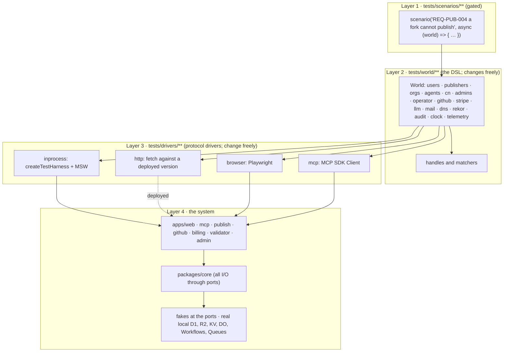

# PackServer test plan

Status: proposal, 2026-10-22, revised the same day after a practice review, a security review, and the architecture decisions Ariel made that day (sessions stay in KV with a ~60 s revocation delay; step-up is a passkey assertion per action; PackServer is its own IdP with no Google sign-in; the audit record is a locked R2 log in a second account anchored in Sigstore Rekor; PackServer never writes to GitHub). Depends on the architecture PR (`docs/architecture/README.md`, `data-stores.md`), the UI flows PR (`docs/ui/flows.md`), the release plan (PR #8, `docs/release/README.md`, `docs/release/shadow-traffic.md`) and the monitoring plan (`docs/operations/monitoring.md`, branch `claude/project-thread-bwothd`); sections that depend on them say so. Nothing here is implemented yet; §13 says what gets built first.

> **What you get**
>
> - Scenarios read as `const u = await world.users.create(); await u.signIn();`. Four layers: scenarios → World DSL → protocol drivers → the system. Only the first layer is gated.
> - One invariant: **what a scenario asserts changes only when its requirement changes.** Everything else (DSL, drivers, fakes, production code) changes freely. [stability-checks.md](stability-checks.md) enforces it in CI, from the base branch, so a PR cannot switch the gate off.
> - All seven Workers run as production bundles in one local `workerd`; D1, R2, KV, Durable Objects, Workflows and Queues are the real local implementations; everything else is faked at a port and an unfaked outbound call fails the test.
> - Coverage = every active requirement in [../requirements/](../requirements/README.md) has at least one green scenario naming its ID. That is a traceability measure, not proof that the scenario proves the statement; review and the see-it-fail job are the defence.
> - PR lane ~10 minutes wall-clock; ~$30–35/month of CI on a private repo. The tooling bet is proven by [a spike](../../spike/test-dsl/RESULTS.md): harness, MSW, DSL, http driver, Recorder and N/N-1 all ran.
> - Decisions that block the first scenarios: the five remaining architecture/UI conflicts, a CI-only Cloudflare account, repo visibility, and confirming the 29 security-review requirements (§14).

Companion documents: [dsl.md](dsl.md) (the World DSL and example scenarios), [stability-checks.md](stability-checks.md) (the gate and the hatches), [../requirements/](../requirements/README.md) (the register), [research/tooling.md](research/tooling.md) and [research/dsl-patterns.md](research/dsl-patterns.md) (sources for every tool claim), [../../spike/test-dsl/](../../spike/test-dsl/README.md) (the runnable proof and its measured numbers). The sibling plans are cited by path until they merge; the agreements with them are restated here where they bind this plan.

## 1. Goals

Ariel's brief, verbatim: "mainly integration tests for a complete system, with any outside dependency mocked … written in the most simplified, readable, and comprehensible way, in the language of our domain … There should be a test-level intermediary. Test files (code or comments) should rarely change unless there's a change in requirements. Add checks for this. Feel free to write as many unit tests, but the integration tests should be the ones we care about full coverage of requirements."

| # | Property | How this plan delivers it | Where |
|---|---|---|---|
| G1 | The whole system runs in a test, with every outside dependency faked | seven Workers as production bundles in one local `workerd` under Wrangler's `createTestHarness`; Cloudflare storage real and local; everything outside Cloudflare, and the three Cloudflare products with no local simulation, faked behind ports | §4, §6 |
| G2 | Scenarios read in the domain's language | a typed TypeScript World DSL; four layers so a scenario never sees a URL, header, SQL or selector | §3, [dsl.md](dsl.md) |
| G3 | A test-level intermediary | the World (layer 2) and its drivers (layer 3); the same scenario runs in-process, against a deployed version, in a browser, or as an MCP client | §3, §4 |
| G4 | Scenario files rarely change unless a requirement changes | scenario churn is gated against the register; a mechanical-refactor lane exists for DSL renames so the DSL can evolve without loosening the gate | [stability-checks.md](stability-checks.md) |
| G5 | Integration scenarios carry full coverage of requirements | a register with stable IDs; every scenario names its IDs; a matrix per run; a watermark that only ratchets up. "Covered" means "at least one green scenario names the ID"; whether the scenario proves the statement is a review question, helped by see-it-fail | §8 |
| G6 | Unit tests are free and unlimited | `packages/core` is plain functions; unit tests live beside them and are gated by nothing but review | §2 |
| G7 | Fast, deterministic, cheap | injected clock and RNG, no sleeps, hermetic per-test state, sharded CI, ~10 min per PR, tens of dollars a month | §7, §9, §11 |

Non-goals: load testing (release plan, canary stage), penetration testing (a separate review), testing Cloudflare's own products (we test our use of them).

## 2. The shape: integration-first

The suite is a honeycomb, not a pyramid: integration scenarios are the widest layer and the only layer that carries requirements coverage; unit tests are many but cheap and uncounted; a thin end-to-end layer (browser, deployed-version probes) exists for the few things only they can see ([web.dev](https://web.dev/articles/ta-strategies), [Augment Code](https://www.augmentcode.com/guides/is-the-test-pyramid-dead)). PackServer is seven small Workers around one `core` package; the interesting bugs are in the hand-offs (upload → workflow → sandbox → promote → index → MCP), which only an integration test sees.

| Kind | What it proves | Carries coverage | Runs | Who writes it |
|---|---|---|---|---|
| Integration scenario (`tests/scenarios/**/*.scenario.ts`) | an actor observes the behaviour a requirement promises, through the whole system | yes | every PR, in-process driver | whoever changes the requirement |
| Browser flow (scenario tagged `ui`) | the page does what the scenario says, including passkey ceremonies | yes, for requirements with `coverage: scenario+ui`, counted from the nightly browser run | nightly and on `apps/web` changes | same |
| Unit test (`packages/*/src/**/*.test.ts`, `apps/*/src/**/*.test.ts`) | a function or a Durable Object does what its author meant | no | every PR | whoever writes the code |
| Contract test (`tests/contracts/<port>/*.contract.ts`) | a fake and the real service behave the same for the calls we make | no | fake on every PR, real nightly | whoever writes a fake |
| Probe (scenario tagged `probe-safe`) | a deployed version answers correctly before it gets traffic | no (a subset, not new coverage) | pre-traffic in the release flow; periodically by monitoring | same as scenarios |
| Mutation run (StrykerJS on `packages/core` unit tests) | the unit tests would notice if `core` logic were wrong | no; a strength report | nightly, incremental on PRs | nobody; it is a report |

Unit tests are for pure logic with a large input space (version ranges, the risk score, archive path checks, OIDC claim matching, the CSP string), Durable Object internals through `runInDurableObject`, Workflow step bodies, and anything a scenario would need thirty variants of. A unit test never stands in for a scenario: a requirement with only unit tests says `coverage: unit-only` with a reason, and that is reviewed.

The suite does not snapshot pages or JSON responses. A scenario asserts the fields the requirement names and nothing else.

## 3. The four layers

Dave Farley's acceptance-testing layering ([InfoQ](https://www.infoq.com/news/2017/04/acceptance-testing-delivery)): test cases speak the domain; a DSL turns that into calls on a protocol driver; only the driver knows HTTP, selectors or an MCP client.



| Layer | May change when | May import | May contain |
|---|---|---|---|
| 1 scenarios | a requirement is added, changed or retired; or in a mechanical refactor that leaves every assertion unchanged (see [stability-checks.md](stability-checks.md)) | `@packserver/world` only | actors, verbs, observations, `expect` lines; no `try`/`catch`, no `setTimeout`, no literal URLs, status codes, SQL, bindings or selectors, in code or comments |
| 2 world | the vocabulary grows, or a driver's contract changes | drivers, fakes, `core`'s types; never `process.env` (credentials enter through `tests/drivers/http/env.ts` only) | the mapping from domain verbs to driver calls; aliasing; builders and personas; matchers; Recorder-backed observations |
| 3 drivers | a protocol, a page, a tool name or a header changes | the harness, Playwright, MSW, the MCP SDK | everything that knows how the system is reached. Failure attachments strip `Authorization`, `CF-Access-*` and cookies before they reach the reporter |
| 4 system | always | — | production code, the ports, and the fakes (test doubles implementing the same port interfaces) |

The World is one object per scenario. It owns the driver, the fakes, the clock, the aliasing table ("acme" → "acme-7f3a", so scenarios can run in parallel against one deployment) and a disposal that resets everything. It is the Cucumber "World" idea without Gherkin ([research/dsl-patterns.md §1.1](research/dsl-patterns.md)).

## 4. Drivers

A driver implements one interface the World calls (`tests/drivers/driver.ts`, shown in [dsl.md §4](dsl.md)). The run picks one with `--driver=<name>`; the default is `inprocess`. A scenario that needs a capability the active driver lacks is skipped with the reason in the JUnit output, never silently passed; tags make this predictable (`probe-safe` needs no fakes or clock, `ui` needs `ui`, `agent` needs `mcp`).

### 4.1 `inprocess` (default; carries coverage)

Wrangler's `createTestHarness()` boots the production build output of all seven Workers in one local `workerd`, routes requests between them, exposes `getEnv()`, `applyD1Migrations()`, `introspectWorkflow()`, `getLogs()` and `reset()`, and routes every Worker's outbound `fetch()` through Node (`dev.outboundService = globalThis.fetch`, verified in wrangler's source), so one MSW server intercepts every Worker's egress ([harness docs](https://developers.cloudflare.com/workers/testing/test-harness/), [integrations page](https://developers.cloudflare.com/workers/testing/test-harness/integrations/), [API reference](https://developers.cloudflare.com/workers/wrangler/api/index.md)). The spike ([../../spike/test-dsl/](../../spike/test-dsl/README.md), results in [RESULTS.md](../../spike/test-dsl/RESULTS.md), wrangler 4.151.3) confirmed it with two Workers sharing D1 and R2, MSW fail-closed, the layered DSL, an `http` driver against `wrangler dev`, the Recorder, and N/N-1 composition (8/8 including a negative run). Measured: harness boot 2.2–2.5 s per file, `server.reset()` + `applyD1Migrations()` 1.1–1.8 s, scenario bodies 190–460 ms, ~60–100 ms per request through the harness.

Why not `@cloudflare/vitest-plugin` (ex `vitest-pool-workers`, renamed 2026-08 ([migration guide](https://developers.cloudflare.com/workers/testing/vitest-integration/migration-guides/migrate-to-vitest-plugin/))): only one Worker is "main" per project; the other six are auxiliary and their egress escapes MSW. The plugin stays for white-box unit tests of Durable Objects and Workflow steps.

```ts
// tests/drivers/inprocess/harness.ts
import { createTestHarness } from 'wrangler';
import { setupServer } from 'msw/node';

export const net = setupServer();                                  // handlers registered per scenario by the fakes
export const server = createTestHarness({
  root: repoRoot,
  workers: [
    ...['web', 'mcp', 'publish', 'github', 'billing', 'validator', 'admin'].map(name =>
      ({ configPath: `apps/${name}/wrangler.jsonc`, env: 'test', prebuiltWorkerDir: `dist/${name}` })),
    ...['sandbox', 'vectorize', 'embedder', 'clock'].map(name =>
      ({ config: { name: `fake-${name}`, main: `tests/drivers/inprocess/fake-workers/${name}.ts`, compatibility_date: '2026-10-01' } })),
  ],
});
net.listen({ onUnhandledFrame: 'error' });                         // MSW 3 name (MSW 2: onUnhandledRequest); confirmed by the spike
```

`env: 'test'` selects the `env.test` block of each `wrangler.jsonc`, which is the only place test-only vars, test secrets and `bindingOverrides` (service-binding names rerouted to the `fake-*` Workers) exist; see §5 "Seams that must not reach production". `prebuiltWorkerDir` (relative to `root`; build with an absolute `--outdir`) loads a built bundle per Worker; the spike verified it, though it is not on the API reference page as of 2026-10-22, so the driver is the one place that knows the option name.

Not yet proven by the spike, and the next spike items before M2/M5: Durable Objects, Workflows, Queues and KV under the harness; `bindingOverrides` rerouting to the fake Vectorize/AI Workers; Containers; Playwright against the harness; issue [#16268](https://github.com/cloudflare/workers-sdk/issues/16268).

Isolation, as the spike's timings dictate: `server.reset()` + migrations once **per file** (the harness boots per file anyway), and **aliased names per scenario** (every scope, user and pack name is unique per scenario, so scenarios in one file never see each other's data). A scenario that truly needs an empty world declares `needs: ['reset']` and pays the 1.1–1.8 s. With a reset per scenario, 500 scenarios would spend ~12 min single-threaded on resets alone; with alias isolation they spend ~2.5 min on bodies. Per scenario the driver still does `net.resetHandlers()` and clears the fakes, the clock and the Recorder.

`onUnhandledFrame: 'error'` is the enforcement of "every outside dependency is mocked": a call to a host no fake handles fails with the URL in the message. Two things the spike learned about it: the failure reaches the Worker as a `500` from Miniflare's loopback, not a thrown error, so every dependency call in production code checks `res.ok` (a `SyntaxError` from `res.json()` is the symptom when it does not); and `import 'wrangler'` installs undici's `EnvHttpProxyAgent` as the global dispatcher whenever `HTTPS_PROXY` is set, which makes MSW see CONNECT frames instead of requests, so the driver calls `setGlobalDispatcher(new Agent())` before `net.listen()`. Any CI runner behind an egress proxy hits this.

Workflows are driven through `introspectWorkflow()`: `disableSleeps()`, `disableRetryDelays()` always ([#16056](https://github.com/cloudflare/workers-sdk/issues/16056)), `mockEvent` for the review / payment / approve gates when the scenario is not about the gate, `waitForStatus('complete')` instead of polling. Queue dispatch inside the harness is unverified; if it does not fire, the consumer entrypoint is called through `getExport()`.

### 4.2 `http` (deployed version; the release flow's pre-traffic gate; monitoring's synthetic probes)

The same World, with `fetch` against a URL. Nothing can be injected into a deployed Worker, so this driver has no fakes, no clock, no reset and no telemetry sink; only `probe-safe` scenarios run under it, isolated by aliased names. The spike ran the same scenarios green against two `wrangler dev` processes (one per HTTP-reachable Worker: `wrangler dev -c a -c b` dispatches to the primary only). The contract agreed with the release plan and reused by monitoring is binding:

| Item | Value |
|---|---|
| Order in the release flow | the Worker's own `GET /__selftest` first (release plan §5), then this suite |
| Invocation | `npm run scenarios -- --driver=http --tag=probe-safe` |
| `PACKSERVER_BASE_URL` | the base URL to test against |
| `PACKSERVER_VERSION_OVERRIDE` | the value of the `Cloudflare-Workers-Version-Overrides` header ([gradual deployments](https://developers.cloudflare.com/workers/configuration/versions-and-deployments/gradual-deployments/)); empty means no header. When set, the driver asserts on **every** response that `X-PackServer-Version` equals it and fails the run otherwise, because Cloudflare silently ignores an invalid override. The edge strips the header from public requests (release plan §4.5) |
| `CF_ACCESS_CLIENT_ID`, `CF_ACCESS_CLIENT_SECRET` | the probe service token. The release plan (§5.2, §10) admits it only to the `/__selftest*` and probe-route Access applications, never the admin application. The driver attaches it only to the host named in `PACKSERVER_ACCESS_HOST`, never to every request |
| `PACKSERVER_PROBE_TENANT` | the synthetic scope probes may write to; default `@probe`. `@packserver-canary` holds the fixed canary objects `/__selftest` reads; probes read it and never write to it |
| Exit status, report | non-zero on any failure; JUnit XML at `reports/scenarios.xml`, each test annotated with the `X-PackServer-Version` it saw |

What `probe-safe` promises (the lint in stability-checks.md C10 checks the mechanical parts):

1. It needs no fake, no clock movement and no telemetry or recorder assertion.
2. Every write is inside `PACKSERVER_PROBE_TENANT`, under an aliased per-run name, and the scenario removes or supersedes what it created.
3. It spends no money and sends no mail outside the tenant; the tenant's publisher has credits pre-granted (release plan).
4. It completes in under 30 s with every await bounded, and is idempotent.
5. Its writes stay inside the synthetic scope **server-side**, not only by the driver's refusal. A synthetic scope (`kind = 'synthetic'`; `@probe` is one) is excluded from public search, browse, the public indexes, Vectorize, ranking, exploration, sitemaps, telemetry rollups and billing; synthetic publishes skip the LLM step and the human queue; synthetic versions expire after 24 h and their names may be recycled. The probe identity is a `pks_` token restricted to the synthetic scope with `publish:update` only, never a human session. These are register entries REQ-OPS-001 and REQ-OPS-002 ([../requirements/operations.md](../requirements/operations.md)); the architecture PR owns the `kind`, monitoring owns the retention job. The driver-side guard (refuse any write outside the tenant) stays as a convenience.

The probes are a liveness check of a deployment, not coverage: the requirements they touch are still covered in-process.

### 4.3 `browser` (Playwright; `ui`-tagged scenarios)

Playwright against the in-process harness, per Cloudflare's [integrations page](https://developers.cloudflare.com/workers/testing/test-harness/integrations/): a worker-scoped fixture starts the harness, `baseURL` comes from `listen().url`, MSW and the harness reset after each test. Setup goes through `http` (Cypress's "app actions" rule); only the step the scenario is about goes through the page.

Passkeys: Playwright ≥ 1.61 has `browserContext.credentials` with `install()`, `get({ rpId })` and `create()` ([class docs](https://playwright.dev/docs/api/class-credentials)); underneath is Chromium's CDP `WebAuthn` virtual authenticator, through which negative paths (`isUserVerified: false`, a bogus signature, a pending ceremony) are reachable. Chromium only; do not mix the `credentials` API and raw CDP in one context. Turnstile uses Cloudflare's always-pass test site key in the browser driver and an MSW handler on `siteverify` server-side; both keys are on the production grep list in §5.

Most passkey scenarios need no browser: `@simplewebauthn/server` 14.x verifies on WebCrypto and its helpers mint registration and assertion responses, so `user.mfa.enrollPasskey()` is the same call in both drivers.

### 4.4 `mcp` (`agent`-tagged scenarios)

An `@modelcontextprotocol/sdk` `Client` whose transport's `fetch` is `server.fetch` ([SDK testing guide](https://ts.sdk.modelcontextprotocol.io/v2/testing.md)). `agent.search(...)` becomes `callTool('search_packs', …)` inside the driver; the tool names live there (the architecture and UI docs disagree on them, and no scenario cares). Under `inprocess` the `mcp` driver is composed in; under `http` the client talks to the deployed endpoint.

### 4.5 N/N-1 compatibility (release plan owns it)

A gradual rollout has Workers of two builds talking to each other, so the release plan runs, on `main` after each merge, the `compat`-tagged scenarios with callers at build N and callees at N-1 and the mirror image, one topology per service-binding edge generated from the `services` and `workflows` entries of the seven `wrangler.jsonc` files. This plan supplies the pieces: the in-process driver loads a callee from another build by pointing its `prebuiltWorkerDir` at the unpacked N-1 artifact (the spike's `test:compat` does exactly that: two dry-run builds in 5 s, the suite in 13.6 s, and the negative run fails as it should), and the `compat` tag. The N-1 bundle is fetched from R2 and verified against the SHA-256 recorded in the release manifest and the annotated tag before it is unpacked, and nothing from inside the unpacked directory is executed outside `workerd` (release plan §3.3 owns the writer side: prefix-scoped, no-overwrite token). The harness applies N's migrations, which is the real deploy window (migrations run before the Worker swap). Costs, topology lists and the "not N-1-compatible" decision are in the release plan.

## 5. The ports layer and the Recorder

`packages/core` does all I/O through ports: `Clock`, `Rng`, `Stripe`, `GitHub` (read-only by construction: the interface has no method that writes, so "PackServer never writes to GitHub" is a type, and the fake records any call that would), `OidcVerifier`, `VectorIndex`, `Embedder`, `Sandbox`, `LlmReviewer`, `Mail`, `Dns`, `Turnstile`, `AccessIdentity`, `Stats`, `Cache`, `Uploads`, `AuditSink` (the append-only batch writer to the audit bucket), `Transparency` (the Rekor client), and thin wrappers around the Cloudflare bindings. Production adapters are constructed from `env` in each Worker's entry; test doubles implement the same interfaces.

The release plan's shadow-traffic design needs the same layer, and the two were agreed as one thing: every port call goes through one pluggable `Recorder`. The release thread's schema (`docs/release/shadow-traffic.md`, pending Ariel's confirmation) is the source of truth; restated so the test side cannot drift:

```ts
interface Invocation { seq: number; kind: 'd1' | 'r2' | 'kv' | 'do' | 'vectorize' | 'queue' | 'http'; target: string; op: string;
                       request: unknown; result: unknown; effect: 'read' | 'write' | 'external_side_effect'; ms: number }
interface Envelope   { request_id: string; version_id: string; mode: 'wet' | 'dry'; request: unknown; response: unknown; invocations: Invocation[] }
```

In production the Recorder redacts before it stores and keeps envelopes 14 days (shadow-traffic.md §5.1–5.2). In tests it is always on and un-redacted, in-process only, and the World reads it: `world.recorder.invocations({ kind: 'http', target: 'api.stripe.com' })`, `expect(world.stripe).not.toHaveBeenAskedBefore(validation)`. The fakes implement the same ports, so the records a scenario asserts on are the records a shadow run compares.

**Consequence for production code** (architecture PR): Vectorize, Workers AI and the Sandbox are reached through a service binding to a tiny internal Worker or a `WorkerEntrypoint`, not the native binding, because the harness's `bindingOverrides` are documented as test-only **service binding** overrides ([API reference](https://developers.cloudflare.com/workers/wrangler/api/index.md)). There is no `TEST_MODE` switch and no ports factory keyed on a var.

**Seams that must not reach production.** Everything the harness injects is a test seam; each is kept out of the production bundle and configuration like this:

1. The OIDC issuer and JWKS URL are constants in `core`'s production adapter. The fake issuer is read from a var that exists only in `env.test`, and the adapter refuses any issuer other than `https://token.actions.githubusercontent.com` when `ENVIRONMENT=production`. Same rule for the fake-clock binding, every `*_PORT` override, the Turnstile test keys and any `fake-*` binding name.
2. `fireAlarm()` and other test entrypoints are exported only from `tests/drivers/inprocess/fake-workers/`, never from a production Worker.
3. Test secrets (`whsec_test`, …) exist only in the harness config; production reads Secrets Store. The Stripe adapter refuses a webhook secret shorter than 32 characters or ending in `_test` under `ENVIRONMENT=production`.
4. CI stage 2 greps every `dist/*/wrangler.json` and bundle for `oidc.test`, `fake-`, `whsec_test`, `TEST_MODE`, `fireAlarm`, the Turnstile always-pass site key (`1x00000000000000000000AA`) and secret key (`1x0000000000000000000000000000000AA`), and fails on a hit.
5. REQ-OPS-003 ([operations.md](../requirements/operations.md)) makes it a requirement: a scenario boots the production-env config in the harness and proves a token from `https://oidc.test` is refused; a unit test checks the grep list.

## 6. What is real and what is faked

| Dependency | In the in-process driver | Why |
|---|---|---|
| D1 (`registry`, FTS5), R2, KV, Durable Objects, Workflows, Queues | real, local, in `workerd`; migrations applied per reset | fully simulated ([bindings per environment](https://developers.cloudflare.com/workers/local-development/bindings-per-env/)). KV TTLs do not move with the fake clock, so every lifetime is an `expires_at` read through the clock port; local KV is strongly consistent, so the ~60 s revocation delay of production sessions is not reproduced and REQ-ACC-012 asserts its bound with `world.clock`, never with a sleep; DO alarms fire through `fireAlarm()` on the fake-worker shim; presigned R2 uploads go through the `Uploads` port whose local adapter writes directly |
| Audit record (bucket-locked R2 in a second Cloudflare account) | a local R2 bucket `audit-log` behind the `AuditSink` port, chained the same way; `world.audit.batches()`, `.tamper()`, `.verify()` | the lock, the second account and the put-only token are deployment properties on the release checklist (REQ-AUDIT-005 `scenario+manual`) |
| Sigstore Rekor (audit chain head) | **faked** by MSW behind the `Transparency` port; `world.rekor.entries()` | HTTP; the real-backend suite writes to Rekor's public staging instance |
| Analytics Engine | the `Stats` port; the fake is a list the rollup job reads | local sink has no query API |
| Cron Triggers | `world.cron.run('domain-rechecks')` calls the scheduled handler | — |
| Rate Limiting binding | local, approximate; scenarios assert "refused after the limit", not counts | — |
| Vectorize | **faked** Worker: brute-force cosine over an in-memory map | no local simulation |
| Workers AI (`bge-m3`) | **faked** Worker: deterministic hash → unit vector; a recorded table for ranking tests | always remote and billed |
| Sandbox / Containers | **faked** Worker implementing `Sandbox` (`run(archiveKey) → { report, exitCode, logs, egressAttempts }`), scripted per scenario | a 2–3 min image build does not belong on the PR path |
| AI Gateway → Anthropic | **faked** by MSW with canned structured reviews; the `cf-aig-authorization` header is asserted | HTTP |
| Stripe | **faked** by MSW for the ~5 API calls; webhook events built and signed in the World (`stripe.webhooks.generateTestHeaderString`, presence in stripe-node 23 unverified). `stripe-mock` rejected: stateless, ignores bodies | HTTP |
| GitHub OIDC | **faked**: an RSA keypair per run (`jose`), JWKS served by MSW, tokens minted with arbitrary claims | HTTP |
| GitHub REST / App / webhooks | **faked** by MSW, read endpoints only; webhooks signed with `X-Hub-Signature-256` in the World; any write-shaped request (check runs, releases, issues, comments, statuses) is recorded and surfaced by `world.github.writes()`, which every scenario may expect to be empty | HTTP |
| GitHub sign-in (the only external login), email provider, Turnstile, DNS (`_packserver-challenge` TXT over DoH) and `.well-known` | **faked** by MSW; `world.mail.inbox(user)` parses codes and links; `world.dns.publishTxt()`; there is no Google fake because there is no Google sign-in | HTTP |
| Cloudflare Access (admin) | **faked** `AccessIdentity` port: the fake verifies the `Cf-Access-Jwt-Assertion` signature against a test key the World holds, so a forged header is a tested negative (REQ-ADMIN-008) | Access is in front of the Worker, not in it |
| Clock, RNG | `Clock`/`Rng` ports; `world.clock.advance('25h')` moves the fake-clock Worker | §7 |
| Public CDN cache | the `Cache` port's fake with explicit purge | the harness has no CDN |

Every fake is a plain object owned by the World, reset per scenario, with the Recorder behind it so a scenario can assert what the system asked of the outside.

**Keeping the fakes honest.** Contract suites use the "same suite, two backends" pattern: one file per port, parametrised over `{ fake, real }`; `fake` on every PR, `real` on the schedule below with credentials from the `nightly` GitHub Environment, run in the CI-only Cloudflare account (never a preview that shares production data stores). Recorded real responses pass through `tests/contracts/redact.ts` before they are written (tokens by prefix `ghs_|ghp_|sk_|whsec_|pks_|psr_|eyJ`, `client_secret`, `email`, `Authorization` → `<redacted>`); the job fails if secret scanning finds anything in the diff; the drift PR is never auto-merged and `tests/contracts/fixtures/` is CODEOWNED. Pact is not used: Stripe, GitHub and Anthropic will not run our verification ([research/tooling.md §5.5](research/tooling.md)).

| Real-backend suite | Against | Schedule |
|---|---|---|
| Vectorize, Workers AI | `remote: true` bindings in the CI-only account | nightly |
| AI Gateway → Anthropic | the real gateway, $1 spend cap, Haiku | nightly |
| Stripe | a Stripe Sandbox via Stripe CLI `trigger` | nightly |
| GitHub OIDC, App, webhooks, OAuth login | a throwaway org and repo with a real App installed with read permissions only; OIDC exchange against the CI-only account's deployment; the suite asserts the App's token requests no write permission | nightly |
| Sigstore Rekor | the public staging log (`rekor.sigstage.dev`), one head entry a night, verified by inclusion proof | nightly |
| Mail, DNS proof, Access on the admin host | provider test mode; a real cheap test domain; the admin host with and without the probe token | nightly |
| Workflows, CDN index TTL, Analytics Engine rollup, presigned R2 PUT/GET | the CI-only account's deployment | nightly (Workflows), weekly (the rest) |
| Sandbox container | the real image on a Docker-capable runner; monthly against a deployed preview container. REQ-VAL-011 (no network, no secrets inside) is proven here, not in-process | weekly |

The Claudinite `cloudflare-workers` pack's `wire-bindings-seam` rule says D1, R2 and Workflows cannot be exercised locally; that premise is out of date (only Vectorize and Workers AI lack a local simulation), and a one-paragraph amendment goes to the pack's maintainers through the fleet process. The rule's advice (one seam, one place to swap) still holds and this plan follows it.

## 7. Determinism

- **Time is a port.** In production `Date.now()` is frozen during CPU work ([Performance API](https://developers.cloudflare.com/workers/runtime-apis/performance/)); Vitest fake timers do not touch KV TTLs, R2, DO alarms or Workflow sleeps ([known issues](https://developers.cloudflare.com/workers/testing/vitest-integration/known-issues/)). So `core` takes `Clock` from a port; every lifetime (session idle/absolute and the 15-minute last-seen throttle, the ~60 s session-revocation bound, the per-action assertion challenge's validity, token expiry and the hourly last-used write, the 24 h agent cooldown, the 72 h delete window, the 14-day staging lifetime, the 30-day domain re-check, the 90-day disclosure timer, the 90-day activity copy, the daily audit head) is computed from `clock.now()` against a stored instant. There is no step-up window to compute: an assertion is good for one action and nothing else.
- **IDs and randomness are a port.** ULIDs from a seeded PRNG in tests; `randomUUID`/`randomBytes` in production.
- **No sleeps, no polling against wall-clock.** A scenario waits on a condition the World observes (`waitForStatus`, a queue drained) or moves the clock. `setTimeout`, `sleep` and `Date.now` are banned in scenario files.
- **Hermetic state per file, aliased names per scenario.** `server.reset()` recreates storage once per file; within a file every scenario creates its own actors and entities under unique aliased names and never reads anything it did not create. `needs: ['reset']` buys an empty world for the few scenarios that need one (a global count, an empty index).
- **Parallelism by file;** scenario files split by requirement area and kept short, so a file's single reset is amortised over a dozen scenarios and Vitest's forks keep four harnesses busy.
- **Boundaries are tested on the boundary.** For every threshold a requirement names, one scenario sits exactly on it and one just past it.

## 8. Requirements coverage and traceability

- The register ([../requirements/](../requirements/README.md)) is the list of IDs: one file per area, one `##` heading per requirement, with `status` and `coverage` fields the tooling parses.
- A scenario names its requirement(s) first in its title: `scenario('REQ-PUB-004 a fork cannot publish through trusted publishing', …)`. The helper extracts the IDs, registers them as Vitest tags (`req/REQ-PUB-004`) and annotates the test so the IDs reach the JUnit, HTML and GitHub reporters ([test tags](https://vitest.dev/guide/test-tags), [annotations](https://vitest.dev/guide/test-annotations)). Vitest's tags are strict by default: the tag list is generated from the register at config load, so a scenario naming an unknown or retired ID fails at collection (the spike shows exactly that error). Playwright `ui` scenarios use the same title convention with Playwright's `tag`/`annotation`.
- `npm run requirements:matrix` is a static script run before tests, over Playwright files too: parse the register; scan titles; fail on a scenario naming an unknown or retired ID, and on a **regression** (an ID that had a scenario on the base branch and has none on head); join with JUnit into `reports/requirements-matrix.md` (ID, title, status, scenarios, last result per driver) posted as the job summary and a PR comment. IDs that never had a scenario are listed, not blocking: they are the watermark's job.
- **What coverage measures.** The percentage of active requirements with at least one green scenario: in-process greens from this run, plus `ui` greens from the latest nightly browser run for `coverage: scenario+ui` entries. It is gated by a high-watermark in `tests/scenarios/COVERAGE.watermark` that only ratchets up, and the ID set it was computed over is stored so a new requirement cannot drag the aggregate down. It does not measure whether a scenario proves its statement; that is review, helped by see-it-fail (stability-checks.md C5).
- The same script prints the churn line: scenario lines changed in the last 30 days, split by "with register change", "by `Scenario-Refactor`" and "by `Requirement-Change`", versus register entries changed. A trend for Ariel, not a gate.
- Tags: the one list is in [dsl.md §5](dsl.md).

## 9. CI pipeline

Per pull request (GitHub Actions, hosted Linux 2-core; stage 4 is extrapolated from the spike's 4-vCPU timings, the rest are estimates):

| Stage | What | Parallel with | Time |
|---|---|---|---|
| 1 lint + checks | ESLint (incl. the scenario override), typecheck, `requirements:matrix` static pass, `scenario-gate` (runs from the base branch, see stability-checks.md §4) | — | ~2 min |
| 2 build | `wrangler deploy --dry-run --outdir dist` for seven Workers, cached by lockfile + source hash; the production-seam grep (§5) | 1 | ~2 min |
| 3 unit | Vitest per Worker project with `@cloudflare/vitest-plugin` plus plain Node for `core` | 2 | ~2 min |
| 4 scenarios, in-process | `vitest --project scenarios --shard=i/3` on 3 runners; with reset-per-file and alias isolation, ~500 scenarios cost ~2.5 min of bodies plus ~2.4 s boot per file, so each shard is well inside the budget (spike timings) | 3 | ~2–3 min each |
| 5 contracts, fake backend | one runner | 4 | ~1 min |
| 6 browser (conditional) | `ui` scenarios, only when `apps/web/**` or `tests/drivers/browser/**` changed | 4 | ~4 min |
| 7 see-it-fail (conditional) | new scenarios run against the base commit's build; must fail | 4 | ~2 min |
| 8 mutation, incremental (conditional) | StrykerJS on changed `core` files, unit-test runner, report only | 4 | ~3 min |
| 9 matrix + summary | join JUnit from 4 and the latest nightly 6, publish the matrix, enforce the watermark | after 4 | <1 min |

Wall-clock target under 10 minutes; roughly 15–20 billable minutes per run. On `main` after a merge the release plan's compat stage (§4.5) and the self-test scenarios (REQ-OPS-005..011: full and shallow on every Worker through `world.operator.selfTest()`; a shallow run must make no outbound or service-binding call, asserted through the Recorder) add ~13 minutes.

Nightly, one scheduled workflow with `workflow_dispatch` for reruns: the real-backend suites (§6, ~20 min), `http` probes against the CI-only account's deployment (~3 min), every `ui` scenario (~6 min), the `slow` lane (~10 min), the full StrykerJS run over `packages/core` unit tests with the ratcheting watermark (~20 min), and the fixture-drift PR (~1 min).

**Workflow hardening.** The `nightly` environment restricts deployments to `main`, so a `workflow_dispatch` from another ref gets no secrets. Fork PRs run lint, unit and in-process scenarios with no secrets; nightly, browser-with-Turnstile-keys and compat never run on forks. Every workflow sets `permissions: { contents: read }` at the top and widens per job (`pull-requests: write` for the matrix comment; `contents: write, pull-requests: write` for the drift PR via a scoped GitHub App token, never a PAT). Nightly jobs run with an egress allowlist (`step-security/harden-runner` or equivalent) naming the Stripe, GitHub, Cloudflare, mail and Anthropic hosts, since MSW does not stop a dependency that uses `net` directly. No job on `pull_request_target` checks out or runs head code (stability-checks.md §4).

**Supply chain of the toolchain.** All test dependencies are exact versions; the lockfile is committed and CI installs with `--frozen-lockfile` and `ignore-scripts`, with `pnpm.onlyBuiltDependencies` listing `workerd`, `@playwright/test` and `esbuild`. Renovate: `minimumReleaseAge` 7 days (3 for the Cloudflare trio, given the harness churn), weekly, lockfile maintenance, no auto-merge. Every action is pinned to a commit SHA with a version comment. Playwright browsers are cached by Playwright version and installed with `npx playwright install --with-deps chromium`. The sandbox image is pinned by digest, the same digest the validator deploys. `knip` runs in report mode only; deletions of dead World verbs are human PRs. Pins at adoption (npm, 2026-10-22): `wrangler 4.151.3` (≥ 4.151; [#16181](https://github.com/cloudflare/workers-sdk/issues/16181) deadlocked 4.125–4.149), `@cloudflare/vitest-plugin 1.4.6`, `vitest 5.0.5`, `msw 3.0.3`, `@playwright/test 1.64.1`, `stripe 23.0.0`, `@simplewebauthn/server 14.0.3`, `jose 6.x` exact at adoption.

## 10. Flake policy

- **In-process scenarios are expected to be deterministic.** A failure that does not reproduce is a bug in the World, a fake or the harness, filed as such; `retry: 0` for the scenario project. Google's hermetic ephemeral environments are the precedent ([ICST 2023](https://conf.researchr.org/details/icst-2023/cciw-2023-papers/3/How-we-use-Hermetic-Ephemeral-Test-Environments-at-Google-to-reduce-Test-Flakiness)).
- **Browser, http and real-backend runs are the flaky tier.** One automatic retry, per-test timeouts, bounded awaits, `server.debug()` output on failure. A new `ui` scenario must be green twice in CI before it merges.
- **Quarantine, with an owner and a date.** A scenario that flakes twice in a week gets the `quarantined` tag (still runs nightly; reported, not gating) with an issue naming the suspected layer. Quarantine never covers a requirement's only scenario for more than 14 days; after that the matrix reports it uncovered. The tag change leaves every assertion untouched, so it goes through the `Scenario-Refactor: quarantine #issue` lane.
- **No `.skip`, `.only`, `.todo` in scenario files** (lint-blocked). A scenario the active driver cannot run is skipped by the capability check, with the reason in the report.

## 11. Cost analysis

Assumptions: a private repo with 3,000 included Actions minutes a month; hosted Linux 2-core at $0.006/minute ([GitHub Actions billing](https://docs.github.com/en/billing/concepts/product-billing/github-actions)); ~300 PR and `main` runs a month; Workers Paid ($5/month) already in place.

| Item | Minutes/month | Cost/month | Notes |
|---|---|---|---|
| PR + main runs: ~16 billable min × 300 | 4,800 | $11 after the free minutes | the three scenario shards are the bulk; reset-per-file keeps them short |
| Nightly: ~60 min × 30 | 1,800 | $11 | mutation on unit tests only; the scenario-killed variant would have added ~$6 and hours of runtime (§12) |
| Weekly Docker sandbox + monthly preview run | ~50 | <$1 | |
| Compat stage on `main` | ~500 | $3 | release plan's line; listed so the total is honest |
| **GitHub Actions total** | **~7,150** | **~$25** | on a Free plan add ~$6; on Enterprise Cloud $0; on a public repo $0 |
| Cloudflare: nightly `remote: true` Vectorize + Workers AI | — | cents | inside or near the Paid plan's included quota |
| Cloudflare: CI-only account | — | $5 | a second Workers Paid subscription so no CI token has production reach; recommended on security grounds (a `remote: true` token in the production account is a production credential) |
| Anthropic via AI Gateway, nightly | — | ≤ $1 | spend cap on the gateway |
| Stripe Sandbox, GitHub throwaway org, mail test mode | — | $0 | |
| DNS test domain | — | ~$1 | a real cheap domain; `.test` does not resolve |
| **Total** | | **~$30–35/month** | against the product's ~$30/month hosting estimate |

Not in the table: a few hours a month of driver maintenance while the harness and `miniflare 5.x-beta` settle. Workers Builds (no Docker, one concurrent build on Free) does not suit the sharded suite.

## 12. Risks

| Risk | Mitigation |
|---|---|
| `createTestHarness` is three months old on a beta Miniflare | the driver is the only code that knows the harness; pin and Renovate; Miniflare's own API is the fallback |
| [#16268](https://github.com/cloudflare/workers-sdk/issues/16268) multi-Worker `Origin`/protocol taken from the last-bundled Worker (breaks OAuth and WebAuthn origin checks) | the same `dev.upstream_protocol` on every Worker |
| [#16056](https://github.com/cloudflare/workers-sdk/issues/16056), [#16297](https://github.com/cloudflare/workers-sdk/issues/16297) local Workflows freeze on retry delays or stick in `waitForEvent` | `disableRetryDelays()`/`disableSleeps()` always; gates driven with `mockEvent`; the nightly real run proves the real path |
| [#15719](https://github.com/cloudflare/workers-sdk/issues/15719) `vitest run` never exits on a parked log | no `console.log` in Workflow steps or `waitUntil` under test |
| Queue dispatch in the harness is undocumented; DOs, Workflows, KV, `bindingOverrides` and Playwright under the harness are unproven | the next spike items (§4.1) run before M2 and M5 commit to them; consumer entrypoints called through `getExport()` if queues do not fire |
| A CI runner behind an egress proxy | `setGlobalDispatcher(new Agent())` in the driver (spike gotcha 1) |
| AI-written scenarios with weak oracles (80% of 86k AI test patches had weak or no oracle, per a 2025 study cited by [Augment](https://www.augmentcode.com/guides/is-the-test-pyramid-dead)) | the assertion-strength lint and the see-it-fail job; a mutation score killed by *scenarios* would be the stronger signal but needs a `buildCommand` plus an active-mutant bridge into `workerd` and hours per run, so it is a research item, not a check |
| A requirement the World cannot observe (CSP string contents, the bucket lock and second account behind the audit record) | `coverage:` kinds other than `scenario`, reviewed; the matrix lists them in their own section |
| The architecture and UI PRs disagree in five remaining places (the step-up window was resolved by removing it) | those entries are provisional; their scenarios change once when Ariel decides |

The remaining known upstream issues (DO RPC teardown noise, plugin snapshot size, Bun) are in [research/tooling.md §8](research/tooling.md).

## 13. Rollout

| Milestone | Delivers | Done when |
|---|---|---|
| M1 register and gates | `docs/requirements/**`, the register loader, the `requirements:matrix` script, the ESLint scenario override, the `scenario-gate` job on `pull_request_target`, the ruleset and CODEOWNERS, the bot identity for agent commits | a PR that changes a scenario's assertions without a register change is blocked; the matrix lists every ID with zero scenarios; the watermark starts at 0 |
| M2 harness and World skeleton | the in-process driver booting whichever Workers exist, MSW fail-closed, the Clock/Rng ports and fake-clock Worker, the Recorder interface, `world.users`, `world.visitor()`, `world.agents.anonymous()`, `world.telemetry`, the first matchers, the production-seam grep | the first ten scenarios (REQ-SEARCH-001..007, REQ-PRIV-001, REQ-DELIV-001, REQ-TELEM-001) green and each seen red on base |
| M3 http driver and probe-safe | the `http` driver with the env-var contract and the version assertion, JUnit output, `probe-safe` lint, a first probe set, `world.operator` and the self-test scenarios (REQ-OPS-005..011), REQ-OPS-* | the release plan's pre-traffic stage runs it against the CI-only account's deployment; monitoring runs it against production |
| M4 identity | the fake GitHub login, the virtual authenticator in the World (used by every sensitive verb for its per-action assertion), TOTP, mail inbox, the `browser` driver, REQ-ACC-* incl. the session, revocation-bound and per-action-assertion negatives (ACC-010, 012, 021..025) | accounts area at 100%; passkey `ui` scenarios green twice |
| M5 publish path | fake GitHub (OIDC, App, signed webhooks, read-only with a write-attempt recorder), fake Sandbox, Workflow introspection, the `Uploads` port, REQ-PUB-*, REQ-VAL-*, REQ-DELIV-*, REQ-SCOPE-016/017 | publishing, validation, delivery areas at 100%; the weekly Docker sandbox job exists |
| M6 payments and access | fake Stripe with signed webhooks, the billing contract suite, REQ-PAY-*, REQ-PRIV-* | payments and private areas at 100% |
| M7 community, moderation, admin, abuse, audit | fake Access identity with signature checks, admin actor, abuse and quarantine scenarios, the local audit bucket with chain, `world.audit.tamper()`/`verify()` and the Rekor fake, REQ-COMM/MOD/ADMIN/ABUSE/AUDIT-* | matrix at 100% of active + provisional |
| M8 honesty and strength | every real-backend suite wired with secrets in the `nightly` environment, redaction and drift PRs, the mutation watermark | a month of nightlies with no unexplained drift |

The default day-to-day flow under agents: Ariel names the requirement ID (or asks for a new one) in the session; the agent writes the register entry, the scenario, the World verbs and the implementation in one PR under the bot identity; Ariel reviews and merges. No role split is needed.

## 14. Open questions for Ariel

1. **The five remaining conflicts** between the architecture and UI documents ([../requirements/README.md](../requirements/README.md#conflicts-between-the-architecture-and-the-ui-flows)). Each freezes a scenario value. (CONFLICT-1, the step-up window, is closed: there is no window.)
6. **TOTP-only members and sensitive actions.** The revised architecture makes the per-action step-up a WebAuthn assertion. Can a member with only TOTP (no passkey) perform a sensitive action at all? The register leaves it unstated; a scenario needs the answer.
2. **The 29 security-review requirements** ([../requirements/README.md](../requirements/README.md#entries-from-the-security-review)) are the only register entries not derived from the design documents. Confirm them (they become architecture work) or strike any you do not want promised.
3. **CI-only Cloudflare account** ($5/month). This plan recommends it; say if the production account's preview environment must do instead.
4. **Public or private repository?** It removes the Actions cost and changes nothing else.
5. **Playwright scope.** `ui` scenarios only for flows that are about the page (passkey ceremonies, the wizard, step-up, Turnstile). Driving every flow in `docs/ui/flows.md` through a browser nightly grows the lane from ~6 to ~25 minutes.

## 15. Sources

Tool claims link to their source inline; the full list is in [research/tooling.md §8–9](research/tooling.md) and [research/dsl-patterns.md §8](research/dsl-patterns.md). Claims marked unverified are checked when the corresponding milestone starts.
