# PackServer Action Flows

Each flow: goal, steps, diagram, failure/edge states. Page IDs refer to `sitemap.md`. PackServer serves Claudinite packs; vocabulary and pack anatomy follow `/mnt/project-files/claudinite/claudinite-primer.md`. "Confirm with passkey" = a per-action confirmation: a fresh passkey assertion whose challenge is bound to that one action (or, for TOTP-only accounts, a fresh TOTP code typed into that action's dialog). There is no re-auth window: every sensitive action asks again.

Shared conventions:
- Sign-in methods: passkey (default), "Sign in with GitHub", and an emailed one-time code used only for sign-up and account recovery. No Google sign-in, no passwords.
- Sessions: opaque id in a `__Host-` cookie, state in Workers KV, 12 h idle / 7 day absolute. A revoked session can keep loading ordinary pages for about 60 s (KV propagation) but is refused at once for sensitive actions, which also check a revocation table in D1.
- All mutating actions are POST with CSRF token and idempotency key.
- PackServer never writes to GitHub: no Check Runs, no mirroring, no comments. An optional GitHub App only reads (repo tarballs, org membership, issue webhooks). Results go to the dashboard and email; "Report on GitHub" only opens a pre-filled issue the user files themselves.
- Async work (validation, payment webhooks) runs in Cloudflare Workers consuming a Queue; UI polls or uses SSE/WebSocket via a Durable Object per run.
- How a pack reaches a repo: a repo (a Claudinite *member*) declares the pack in its Claudinite settings (`packs.declared`, optional `version:` freeze) or runs `cn adopt <id>`; the pack is fetched as an immutable per-version archive, checked against the signed per-pack index, and vendored into `.claudinite/shared/packs/<id>/`, landing as a pull request. Nothing is fetched at session time and nothing is installed into Claude Code. Versions are semver `x.y.z` in whatever scheme the publisher chooses (e.g. `1.61021.1`, `2.3.0`), ordered by semver precedence. PackServer serves a version as soon as it passes validation and shows its publish time; how long a repo waits before its update takes a new version is a `cn` setting the repo owns, not a PackServer concern. PackServer replaces the engine's current repo-and-R2 serving, so that layout is prior art here, not a constraint; `cn adopt` will take PackServer's ids.
- "Member" below means a repo running Claudinite. A person with a session is a *signed-in user* or *account*.

---

## 1. Sign-up + MFA enrollment

**Goal**: new user gets an account; if they intend to publish, MFA is enrolled before anything else.

1. `signin` > Create account: "Sign in with GitHub", or enter an email and type the one-time code we send.
2. GitHub OAuth callback (or code accepted) → server creates `user` + `identity` rows, issues session.
3. First-login step: choose handle (checked for uniqueness and reserved names) and display name.
4. `mfa`: create a passkey (WebAuthn, resident key, user verification required), which becomes the default way to sign in. Fallback: TOTP (QR + manual secret, confirm one code). Signed-in users may skip; publishing is blocked until MFA exists.
5. Show recovery codes once (10 codes, download, "I saved them" checkbox).
6. Return to `account` or to the original destination.

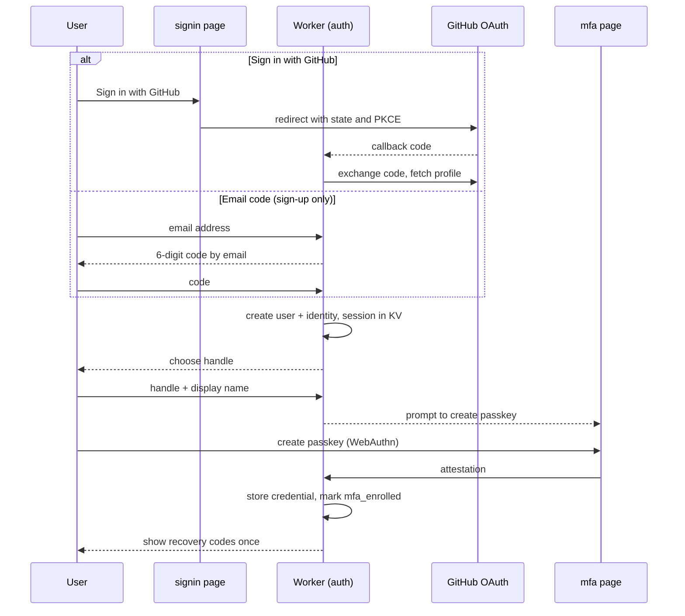

Failure / edge states:
- Email already linked to another identity → "Sign in with your passkey or GitHub instead, then link in Account > Security" (no silent account merging; prevents takeover via unverified email).
- WebAuthn unsupported → TOTP path offered automatically.
- Handle taken / reserved (`admin`, `claude`, `anthropic`, `claudinite`, `cn`, `fleet`, publisher names of verified orgs) → inline error.
- Email code expired (10 min) or wrong 5 times → "Send a new code".
- User closes recovery-codes screen without confirming → banner on `account` until confirmed.

---

## 2. Sign-in and per-action confirmation

**Goal**: returning user signs in; every sensitive action is confirmed on its own.

1. `signin`: "Sign in with a passkey" (default, discoverable credential) or "Sign in with GitHub". Email codes are not a sign-in method for existing accounts; they appear only under "Lost your passkey?" (recovery).
2. GitHub sign-in on an account with MFA → prompt for passkey or TOTP (or a recovery code) before the session is issued.
3. Later, user triggers a sensitive action: approve a publish awaiting approval, publish, revoke, change visibility, mint a token, change owners or org members, grant private access, edit trusted publishers, change billing, remove an MFA factor, change email.
4. A "Confirm with passkey" dialog names the action (e.g. "Approve and publish @google/vpc-review 1.61020.1"). The WebAuthn challenge is derived from that action's parameters, so the assertion cannot be replayed for anything else. TOTP-only accounts type a fresh code in the same dialog.
5. Worker verifies the assertion and checks the session against the D1 revocation table (not just cached KV), then performs the action. The next sensitive action asks again.

Failure / edge states:
- Lost all factors → "Lost your passkey?" → email code + recovery code; with no recovery code, a support flow with identity re-verification (publisher packs frozen meanwhile).
- Recovery code used → warn, offer regeneration.
- Session from new device or location → email notice (npm/GitHub pattern).
- Revoked session: ordinary pages may load for up to ~60 s; any sensitive action is refused immediately.
- Nothing outside a browser session (CI, a Claude Code session over MCP) can confirm an action → tokens are minted only in the browser.

---

## 3. Star, rate, review

**Goal**: signed-in users express approval (star) and quality judgment (1-5 rating + optional review). The pack-level rating stays (`sitemap.md` decision 15).

1. `pack`: click Star → toggles immediately (optimistic), count updates. Anonymous click → `signin` with return URL.
2. Click "Rate" or "Write a review" → `review`.
3. Choose version (default: newest version), 1-5 stars, optional title/body.
4. Submit → stored; pack rating recomputed (Bayesian average with prior to avoid 1-review 5-star packs ranking first).
5. Review appears in `pack` > Reviews with "verified adoption" badge if a repo of the account fetched the pack (optional, decision #8).
6. Publisher may reply once per review and flag for moderation.

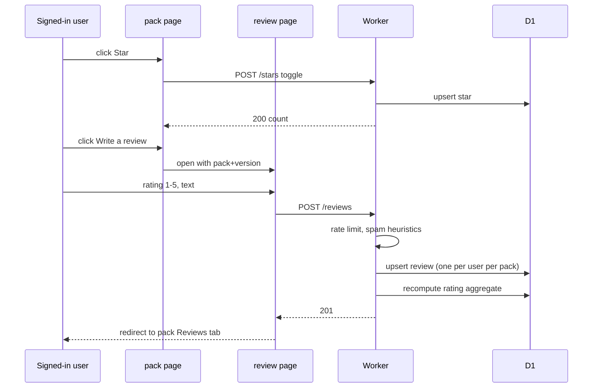

Failure / edge states:
- One review per user per pack; new submission edits the old one (version bump recorded).
- Cannot review own packs or packs of orgs you belong to.
- Rate limit: 10 reviews/day per account; accounts younger than 24h cannot review (anti-brigading).
- Review removed by moderation → author notified with reason.
- Every version of a pack revoked → reviews stay but pack shows "no version selectable".

---

## 4. File bug report (incl. private security report)

**Goal**: a signed-in user reports a defect; security issues go to publisher privately.

1. `pack` > Issues → "Report a bug". If the pack links a public repo, this opens a pre-filled GitHub issue in that repo (pack, version, environment) that the user files themselves; PackServer reads its status back through the read-only GitHub App's issue webhooks. Packs without a public repo use the in-site `report` form.
2. Fields: version, type (bug / docs / security), severity, repro steps, environment, attachments (≤5 MB, images/text only).
3. If type = security → toggle "Private security report" auto-on: report is visible only to pack owners/maintainers and PackServer security; not listed in Issues tab.
4. Submit → issue created; publisher notified (email + dashboard alert). Private security reports also create a 90-day disclosure timer (publisher-visible).
5. Publisher responds / sets status (open, acknowledged, fixed in x.y.z, won't fix, duplicate). Reporter notified.
6. Public issues appear in `pack` > Issues; private ones in `account` > My reports (reporter) and `dashboard` alerts (publisher).

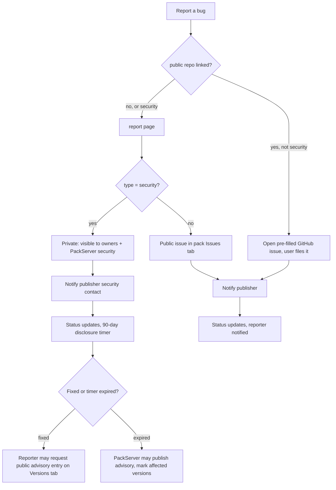

Failure / edge states:
- Pack has no security contact → routed to PackServer security only; publisher dashboard alert "Add a security contact".
- Reporter attaches a secret in repro → secret scan on attachments; blocked with explanation.
- Duplicate detection: suggest existing issues by title similarity before submit.
- Abuse (spam reports) → publisher can flag; moderation may block reporter.

---

## 5. Publish via upload

**Goal**: publisher uploads an archive, it is validated, listed, paid for, and published to R2. Upload is open to every pack (`sitemap.md` decision 14); a pack without a public repo is marked down: "No public repo" on cards and the pack page, lower score.

1. `publish` step 1 Source → "Upload archive" (`.tar.gz`/`.zip`, ≤ 3 MB). Browser uploads directly to R2 via a presigned URL (upload bucket, 24h TTL).
2. Step 2 Validate → Worker enqueues validation job; UI streams progress; links to `validation`.
3. On pass/warn → step 3 Listing details, pre-filled from `pack.json` (name, `pitch` as summary, category, repo URL if declared). Publisher confirms "No public repo" if none.
4. Step 4 Visibility → Public or Private (add the GitHub orgs allowed to adopt it). A new pack uses one $1 credit either way (credits come in bundles of 5 for $5), waived for Verified Publishers.
5. Step 5 Pay → Polar checkout (Polar is merchant of record). See flow 8.
6. Step 6 Publish → confirm with passkey → Worker copies the archive from the upload bucket to the public (or private) packs bucket as `packs/<id>/<version>.tar.gz` (never overwritten), rewrites and signs `packs/<id>/index.json` (versions, sha256, size, publishedAt, revoked, minEngineVersion, requires, sourceCommit, serial), then rewrites and signs `packs/catalog.json` as the last write; invalidates cache, emits "published" event. The version is served from that moment.

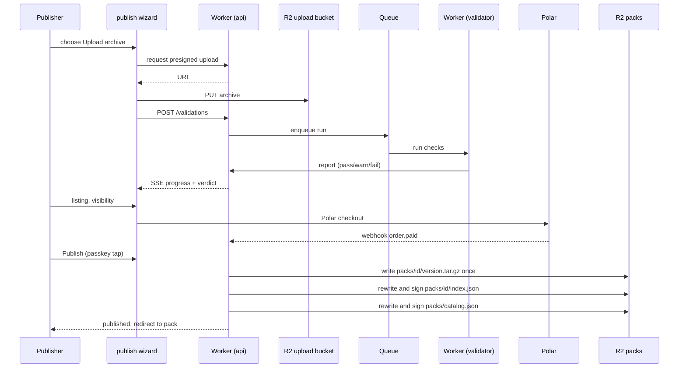

Failure / edge states:
- Upload interrupted → resumable multipart; draft persists on `dashboard` > Drafts.
- Validation fail → flow 7.
- Version already exists → hard error; an archive is written once and never overwritten (bump the build number: `1.61021.2`).
- Name collides with a verified org's domain or a reserved word → blocked; suggest a scoped name.
- Payment succeeded but publish step abandoned → credit held on account 30 days; dashboard alert "Finish publishing".
- Uploaded archive expired (24h) → re-upload required, validation re-run.

---

## 6. Publish via GitHub path with trusted publishing

**Goal**: a tag in a GitHub repo publishes `packs/gcp-ops/` with no long-lived secrets. The pack is read *from a repo* (the engine's publishing primitive, "packs from a repo"). Pattern: PyPI/npm trusted publishing (GitHub OIDC). PackServer never writes to GitHub; the workflow itself reports the result.

Setup (once, in `github`, each change confirmed with a passkey):
1. Add a trusted publisher: owner, repo, workflow file, optional environment, path, tag rule (the tag is the version, e.g. `1.61021.1`), target pack.
2. Choose release mode: publish automatically when validation passes, or hold for owner approval (default for verified orgs).
3. Copy the provided workflow YAML (`id-token: write`; it runs `cn vendor` so the archive is the vendored set, with `test/`, `docs/` and `provenance/` stripped, then uploads it with the OIDC token; first adoption and the update then give identical files). PackServer gets no write access to the repo.
   Alternative without a workflow: install the read-only PackServer GitHub App; a matching tag push webhook makes PackServer fetch that path's tarball, apply the same vendoring rule, and run the same validation. Results go to the dashboard and email only.

Per release:
4. Tag pushed → workflow runs → `cn vendor` → requests an OIDC token → `POST /api/publish/oidc` with the token and the pack archive built from the path at that ref.
5. Worker verifies the JWT against GitHub's JWKS and matches `repository`, `workflow_ref`, `environment` and `ref` claims to a trusted publisher → stores the archive in the R2 upload bucket, enqueues validation, returns a run id and status URL.
6. The workflow polls the status URL and prints the verdict and report link in its own job log; it exits non-zero on failure, so the GitHub run shows red or green without PackServer writing anything.
7. On pass: if the trusted publisher is in hold mode, the version becomes **Awaiting approval** and an owner approves it on `dashboard` with a passkey tap bound to that version. Otherwise, if the pack already has its credit (existing pack, new version) → publish directly. A new pack without a credit → "awaiting payment", dashboard alert and email; publisher completes flow 8. Publishing writes the archive once, re-signs the per-pack index with `sourceCommit` = the tagged commit, and re-signs the catalog (as in flow 5 step 6).
8. Version published; the status URL now links to `pack`. Each member repo's own settings decide when its update takes it.

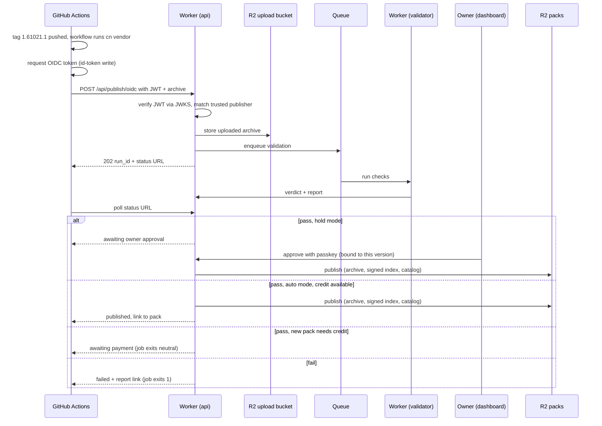

Failure / edge states:
- JWT claims mismatch (wrong workflow file, fork PR, environment missing) → 403 with the exact claim diff in the response, printed in the job log; nothing stored.
- Trusted publisher removed or disabled → 403 "No trusted publisher matches".
- Path has no manifest → validation fails with the expected file path in the report.
- Version in manifest ≠ tag → fail (prevents accidental republish); the tag is the version (e.g. `1.61021.1`).
- Workflow retries the upload → idempotent on (repo, sha, path).
- Version awaiting approval not approved in 14 days → expires; dashboard notice.
- Trusted publishing is preferred; a fallback "publish token" (scoped, 90-day expiry, shown once, minted with a passkey tap) exists for non-GitHub CI and is marked "less secure" in `github`.

---

## 7. Validation failure and resubmit

**Goal**: publisher understands what failed and resubmits quickly.

Check stages, in order (fail-fast on blocking checks):

| Check | Blocking | Advisory |
|---|---|---|
| Archive & size limits (≤3 MB, ≤5k files, no symlinks out) | ✓ | |
| Manifest schema (`pack.json`, `pack.yaml` or `pack.toml`; exactly one) | ✓ | |
| Manifest consistency (declared items exist on disk; version is semver `x.y.z`; `minEngineVersion` is a `cn` version; `requires` names published packs) | ✓ | |
| Secret scan (gitleaks-style rules) | ✓ | |
| Security scan (executables, path traversal; Go checks import only the check SDK and the standard library; task workers import only `@claudinite/sdk`) | ✓ for traversal / binaries / foreign imports | |
| Prompt-injection heuristics on `RULES.md` and `SKILL.md` (prose scanned as code) | | ✓ (human-readable excerpt) |
| Manifest of effects derived and shown (guards and the tool calls they judge, tasks and cadence, forced skills, GitHub actions requested) | ✓ if it cannot be derived | |
| Test run (the pack's `test/` folder, in a container; Go checks need Go, 10-min cap) | ✓ if declared tests fail | ✓ if no tests |
| License present | | ✓ |

1. `validation` shows verdict `fail`, failing checks first, each with file path, line, rule ID, and fix hint.
2. Publisher fixes source.
3. Upload path: re-upload in `publish` step 1 (draft retains listing fields). GitHub path: push a new tag (immutable tags; a tag cannot be reused; bump the build number on the same day: `1.61021.2`).
4. New run; previous runs listed on `validation` for comparison.
5. Advisory findings do not block publish but are shown on `pack` as "Published with warnings" (public: names of warned checks only).

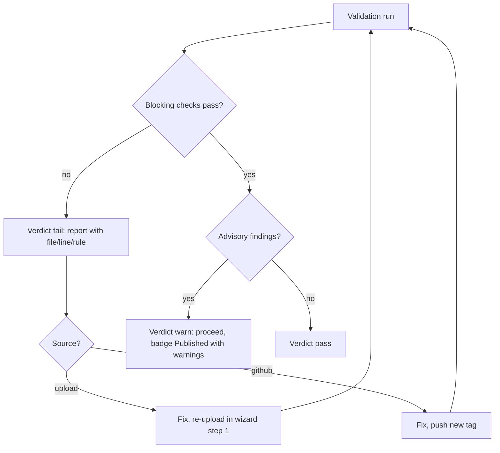

Failure / edge states:
- Validator timeout / infra error → verdict `error`, free automatic retry x2, then "Re-run" button; never counted against the publisher.
- Flaky declared tests → `pack.json` has no `allow_failure` field; a PackServer-only listing setting "tests advisory" (set in `dashboard`, shown as a warning on `pack`) covers this.
- Secret found → secret is redacted in report (show rule + file + line, not value); publisher reminded to rotate it.
- Repeated fails (≥10/day) → soft rate limit on validation runs to protect capacity.

---

## 8. Payment via Polar

**Goal**: collect $1 per new pack (anti-spam), from every publisher including open source, waived for Verified Publishers ($99/year), without charging for packs that cannot be published.

**Decision: charge after validation passes, before publish.** Rationale: the fee is anti-spam, not revenue; charging on submit would require refunds for every failed run (processing fees on refunds, support burden, bad first impression). Validation is cheap and rate-limited by account age + MFA + CAPTCHA, which already deters bulk spam. Payment is tied to the validated artifact hash, so a different archive cannot reuse it.

**Polar is merchant of record** (owner decision, 2026-10-22): Polar sells to the publisher, collects and remits sales tax and VAT, issues receipts and invoices, and handles disputes. PackServer never sees card data and keeps no tax logic; it reacts to Polar's signed webhooks.

1. `publish` step 5: if the account holds a credit, show "Uses 1 of your N credits" and skip checkout. Otherwise show the line item "Publish credits · bundle of 5: $5.00", pack name, artifact hash; one credit is used by this pack and four stay on the account. Single $1 sales are not offered: Polar's fee (5% + 50¢) would exceed the margin. Verified Publishers skip this step.
2. Click Pay → Worker creates a Polar checkout session for the "New pack" product, with metadata `{validation_run_id, pack, version, hash, user}` and the account's Polar customer; redirect.
3. Polar hosted checkout; Polar computes and shows tax for the publisher's country.
4. Success URL → wizard step 5 shows "Confirming…" until the signed webhook `order.paid` arrives (Durable Object notifies).
5. Five credits added to the account, one reserved for this run; step 6 unlocked.
6. Order listed in `billing` with a link to Polar's invoice; Polar emails the receipt.

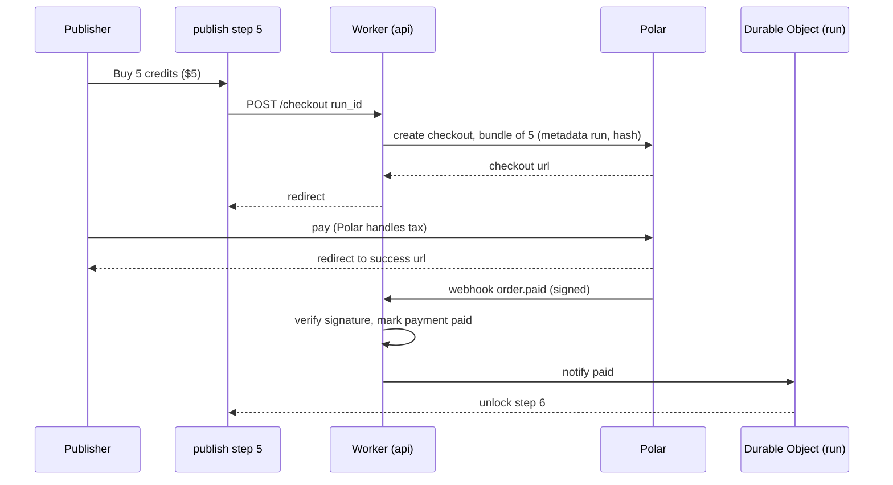

Failure / edge states:
- Webhook delayed > 60s → wizard shows "Still confirming, we'll email you"; draft stays; alert on `dashboard`.
- Payment succeeded, publish never completed → the reserved credit returns to the account after 30 days; credits do not expire.
- Dispute (handled by Polar as merchant of record) → version revoked, publisher account flagged, further publishes require manual review.
- Re-publishing a new version of an already-paid public pack: free (decision). Alternative considered: $1 per version — rejected as it taxes good maintenance.
- Verified Publishers ($99/year, a Polar subscription) pay nothing per pack (owner decision, 2026-10-22); open-source publishers pay the $1 like everyone else. A lapsed subscription (`subscription.revoked`) brings the per-pack fee back for new packs only.
- Publish credits (backend design, PR #3): sold through Polar in bundles, the smallest being 5 credits for $5, because Polar's fee (5% + 50¢) makes a single $1 sale lose money. Each new pack still costs one $1 credit. Holding credits up front also keeps CI publishes of new packs from stalling on checkout. One credit is consumed per new pack, never per version.

---

## 9. Verify organization

**Goal**: an org proves control of a domain and/or GitHub org, earning a verified badge so "@google/gcp" is trustworthy.

1. `org` > Create org: handle, display name. Creator becomes `owner` (confirm with passkey).
2. Verification tab → "Add domain": enter `example.com` → shown TXT record `_packserver-challenge.example.com  TXT  "<signed token>"`, or the alternative file `https://example.com/.well-known/packserver-auth` (MCP Registry model).
3. Click "Check now" → Worker resolves via DNS-over-HTTPS (1.1.1.1), accepts if token matches. Re-checks every 30 days; badge removed after 2 failed re-checks with email warning.
4. "Verify GitHub org": either install the read-only PackServer GitHub App on the org, or sign in with GitHub and we confirm the user is an org admin via the API. The scope name defaults to the org login.
5. Badges state exactly what was proven: "github.com/google" for a GitHub org, "google.com ✓" for a domain. **Verified Publisher** additionally needs domain proof + linked GitHub org + MFA enforced for all org members + manual review by PackServer.
6. Handle policy: a verified domain's label (e.g. `google`) can be claimed as handle even if squatted by an unverified user (user is renamed, notified; npm dispute-lite).

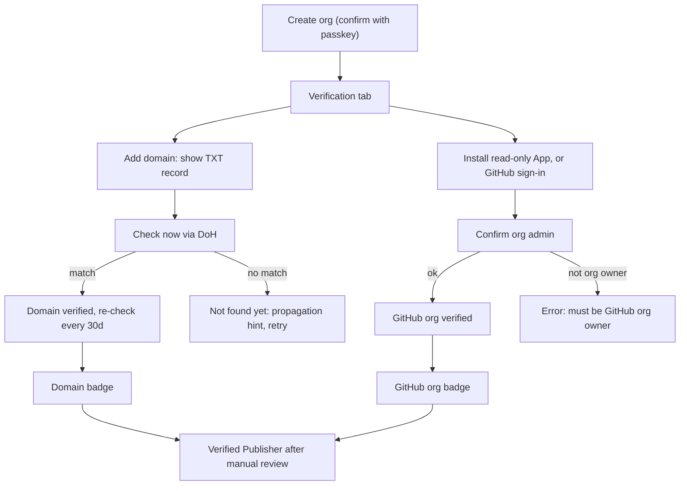

Failure / edge states:
- Domain already verified by another org → conflict; second org can trigger a re-check which revokes the first if the TXT now points to the second (domain owner wins).
- Public suffix (e.g. `github.io`) → rejected; subdomain allowed with warning (badge shows full host).
- GitHub App uninstalled and admin no longer confirmable → GitHub org badge revoked after 7 days, alert.
- Scope and pack names are never recycled after deletion (Hugging Face re-registration attack).
- Org deleted → packs must be transferred first (blocking).

---

## 10. Private pack access

**Goal**: let the repos of chosen GitHub orgs adopt a private pack, with no stored secret. Settled by the owner (2026-10-22): each private pack has an allowlist of GitHub orgs; `cn` proves its repo's org with the GitHub Actions OIDC token. The reader is a repo's scheduled update task or `cn adopt` running in Actions, never a session-time fetch.

1. `access` on the pack: the owner adds GitHub orgs to the allowlist (confirm with passkey). Each row shows the org, who added it, when, and the last fetch from one of its repos.
2. In a member repo's workflow, `cn` requests the GitHub Actions OIDC token (audience PackServer) and sends it with the fetch. Nothing is stored in CI secrets.
3. The Worker verifies the token against GitHub's OIDC keys, reads `repository_owner` (and the repository id), and checks it against the pack's allowlist; then it streams the archive and the signed per-pack index from private R2.
4. Removing an org takes effect on that org's next fetch. Repos that already vendor the pack keep what they hold.
5. Signed-in people from an allowlisted org (proven by GitHub sign-in or the org link) can read the pack on the site; everyone else gets 404.
6. Audit on `access`: fetches by org and repo, last seen, denied attempts.

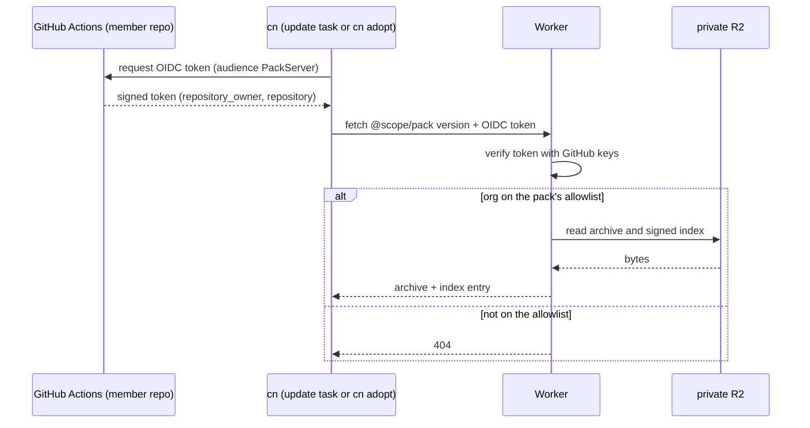

Edge states:
- Private packs are never listed in `browse` or `search_packs` for callers outside the allowlist; 404, not 403, so their existence does not leak.
- A run outside GitHub Actions (a laptop) has no OIDC token: `cn adopt` there can only read public packs; private adoption happens in the repo's workflow.
- A token for another audience, an expired token, or a fork's pull-request run → 404, logged as a denied attempt.
- Pricing for private packs is not part of this decision.

---

## 11. A Claude Code session discovering a pack via MCP

**Goal**: a Claude Code session asks what packs exist for a kind of work and suggests one to declare. The MCP endpoint is a discovery aid; delivery is `cn adopt <id>` (or a `packs.declared` entry), which vendors the pack and lands a PR. Nothing is fetched at session time. Documented on `claude-code`.

Tools: `list_categories()`, `search_packs(query, category?, content_type?, verified_only?, limit)` where `content_type` is one of `rules`, `skills`, `checks`, `guards`, `tasks`; `get_pack(id, version?)` → metadata, manifest of effects, publish time, `minEngineVersion`, `requires`, verified publisher (yes/no) and its verification source, adoption instructions; `get_pack_manifest(id, version)` → `pack.json`; `fetch_pack(id, version)` → the archive URL (`packs/<id>/<version>.tar.gz` on the public CDN) and the signed index entry (sha256, publishedAt, minEngineVersion, requires, revoked), for inspection.

Public:
1. The session connects to `https://mcp.packserver.dev` (Streamable HTTP MCP), no auth.
2. `search_packs("deploy to GCP Cloud Run", category="cloud")` → ranked list of compact summaries: `pitch` (from `pack.json`), manifest of effects, publish time, `minEngineVersion`, `requires`, verified publisher and source. Full content stays behind `get_pack` so a search costs the session little context.
3. `get_pack("@google/gcp")` → summary, warnings, validation verdict, newest version, manifest of effects.
4. The session proposes `cn adopt @google/gcp` (or the settings declaration, with an optional `version:` freeze); running it fetches the archive, checks it against the signed index, vendors it into `.claudinite/shared/packs/<id>/` and lands a PR for review. `fetch_pack` exists so a session (or a person) can read the archive before proposing; it is not the delivery path.

Private packs: the MCP endpoint lists public packs only. A private pack is adopted by name; the fetch happens in the member repo's GitHub Actions workflow, authorized by its OIDC token against the pack's org allowlist (§10).

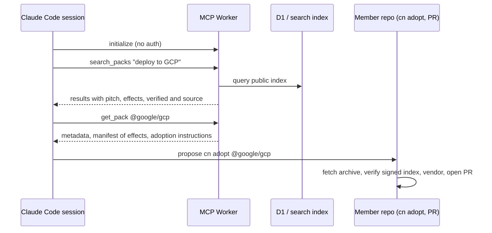

Failure / edge states:
- A private pack's id asked for over MCP → 404, the same as a pack that does not exist.
- Rate limits: 60 req/min per IP; archive fetches counted toward "member repos holding this pack" once per (repo or IP, version, day).
- Revoked version requested → `get_pack` returns it with `revoked: true` and reason; `fetch_pack` works only with exact version. Selection is the newest not-revoked version that fits the member's engine, after any wait the repo's own settings ask for; there is no "latest".
- The session asks for a category that doesn't exist → `list_categories` suggestion in error.
- Responses include `advisory` field when a public security advisory exists for the version.

---

## 12. Revoke a version

**Goal**: stop a bad version from being selected by any member's update without breaking reproducibility. The engine's model: a `revoked` flag in the signed per-pack index plus a signed per-pack revocation feed; a member never has a vendored version removed or downgraded, it reports what it holds. (npm's "deprecate" has no engine counterpart; an optional listing-only notice on the Versions tab covers that need.)

1. `pack` > Versions (publisher view) → version row menu → "Revoke".
2. Enter reason (shown publicly) and optional "security" flag (creates advisory stub).
3. Confirm with passkey (bound to this version).
4. Revoke: the index entry is marked `revoked` with the reason and re-signed; the revocation feed is appended and signed; the update never selects it again (selection is the newest eligible version, there is no "latest"); members already holding it keep it, and their next update reports the held version and its reason; exact-version fetch still works with `revoked: true`; search excludes it.
5. Notify users who starred the pack (opt-in digest) and open issues referencing the version.
6. Un-revoke possible by owner (confirm with passkey), logged; the index is re-signed.

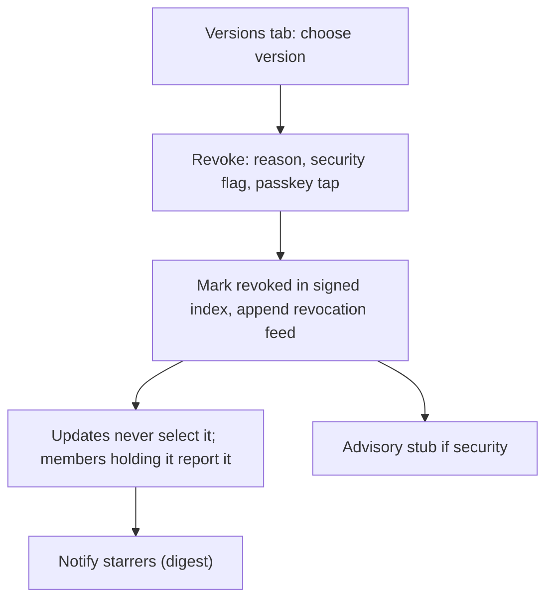

Failure / edge states:
- Revoking the only version → pack shows "no version selectable", stays listed with reason.
- Versions are never deleted; an archive is written once and member repos already vendor it. Revoke instead.
- Private packs: delete allowed any time (confirm with passkey), with 7-day soft-delete; repos holding a vendored copy keep it.
- Revocation initiated by moderation → reason prefixed "Removed by PackServer".

---

## 13. Report abuse / moderation

**Goal**: anyone can flag malicious or infringing packs, reviews or users; moderators act quickly with an audit trail.

1. "Report abuse" link in `pack` header menu, on each review, on `publisher` profile. Anonymous allowed with Turnstile; signed-in users pre-filled.
2. Form: category (malware / prompt injection / secrets leak / impersonation / spam / IP infringement / other), details, evidence URL.
3. Severity routing: malware / prompt injection / secrets → auto-quarantine if ≥3 independent reports or 1 report from a verified org → pack shows "Under review", `fetch_pack` and the archive URL return a 451-style hold with reason; moderators notified immediately.
4. Moderator reviews (admin UI, out of scope): dismiss, hide pack/review, revoke versions, suspend publisher, revoke verification.
5. Publisher notified with reason and appeal link; reporter notified of outcome (no details).
6. Audit log entries immutable; counts surfaced on publisher's `dashboard` alerts.

Failure / edge states:
- Report brigading → quarantine requires independent accounts (age > 7d, distinct IdPs) or a verified org; mass identical reports collapse into one.
- Quarantined pack already vendored in member repos → the signed index marks it revoked with the reason, so the next update reports it; `get_pack` returns `status: under_review`.
- Impersonation claims from a verified org (e.g. "google" squatting) → fast lane: handle reassigned per flow 9 step 6.
- Reporter identifies themselves as the copyright owner → DMCA-style counter-notice path (legal, out of scope).
