# PackServer Action Flows

Each flow: goal, steps, diagram, failure/edge states. Page IDs refer to `sitemap.md`. "Confirm with passkey" = a per-action confirmation: a fresh passkey assertion whose challenge is bound to that one action (or, for TOTP-only members, a fresh TOTP code typed into that action's dialog). There is no re-auth window: every sensitive action asks again.

Shared conventions:
- Sign-in methods: passkey (default), "Sign in with GitHub", and an emailed one-time code used only for sign-up and account recovery. No Google sign-in, no passwords.
- Sessions: opaque id in a `__Host-` cookie, state in Workers KV, 12 h idle / 7 day absolute. A revoked session can keep loading ordinary pages for about 60 s (KV propagation) but is refused at once for sensitive actions, which also check a revocation table in D1.
- All mutating actions are POST with CSRF token and idempotency key.
- PackServer never writes to GitHub: no Check Runs, no mirroring, no comments. An optional GitHub App only reads (repo tarballs, org membership, issue webhooks). Results go to the dashboard and email; "Report on GitHub" only opens a pre-filled issue the user files themselves.
- Async work (validation, payment webhooks) runs in Cloudflare Workers consuming a Queue; UI polls or uses SSE/WebSocket via a Durable Object per run.

---

## 1. Sign-up + MFA enrollment

**Goal**: new user gets an account; if they intend to publish, MFA is enrolled before anything else.

1. `signin` > Create account: "Sign in with GitHub", or enter an email and type the one-time code we send.
2. GitHub OAuth callback (or code accepted) → server creates `user` + `identity` rows, issues session.
3. First-login step: choose handle (checked for uniqueness and reserved names) and display name.
4. `mfa`: create a passkey (WebAuthn, resident key, user verification required), which becomes the default way to sign in. Fallback: TOTP (QR + manual secret, confirm one code). Members may skip; publishing is blocked until MFA exists.
5. Show recovery codes once (10 codes, download, "I saved them" checkbox).
6. Return to `account` or to the original destination.

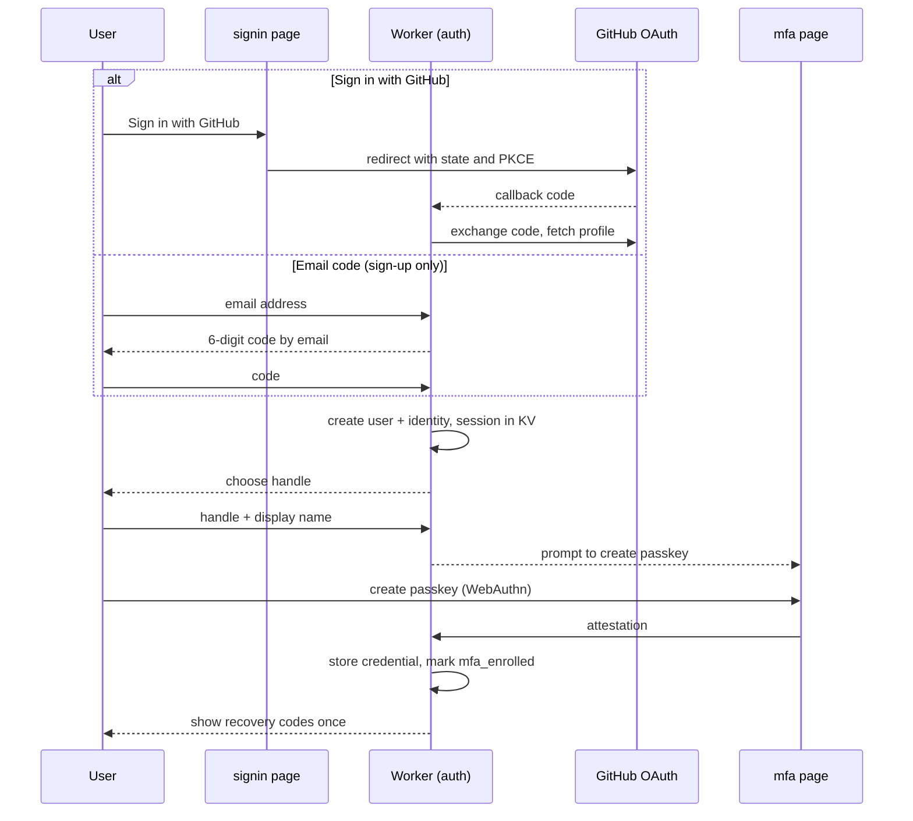

Failure / edge states:
- Email already linked to another identity → "Sign in with your passkey or GitHub instead, then link in Account > Security" (no silent account merging; prevents takeover via unverified email).
- WebAuthn unsupported → TOTP path offered automatically.
- Handle taken / reserved (`admin`, `claude`, `anthropic`, publisher names of verified orgs) → inline error.
- Email code expired (10 min) or wrong 5 times → "Send a new code".
- User closes recovery-codes screen without confirming → banner on `account` until confirmed.

---

## 2. Sign-in and per-action confirmation

**Goal**: returning user signs in; every sensitive action is confirmed on its own.

1. `signin`: "Sign in with a passkey" (default, discoverable credential) or "Sign in with GitHub". Email codes are not a sign-in method for existing accounts; they appear only under "Lost your passkey?" (recovery).
2. GitHub sign-in on an account with MFA → prompt for passkey or TOTP (or a recovery code) before the session is issued.
3. Later, user triggers a sensitive action: approve a staged publish, publish, yank, change visibility, mint a token, change owners or members, grant private access, edit trusted publishers, change billing, remove an MFA factor, change email.
4. A "Confirm with passkey" dialog names the action (e.g. "Approve @google/vpc-review 0.5.0"). The WebAuthn challenge is derived from that action's parameters, so the assertion cannot be replayed for anything else. TOTP-only members type a fresh code in the same dialog.
5. Worker verifies the assertion and checks the session against the D1 revocation table (not just cached KV), then performs the action. The next sensitive action asks again.

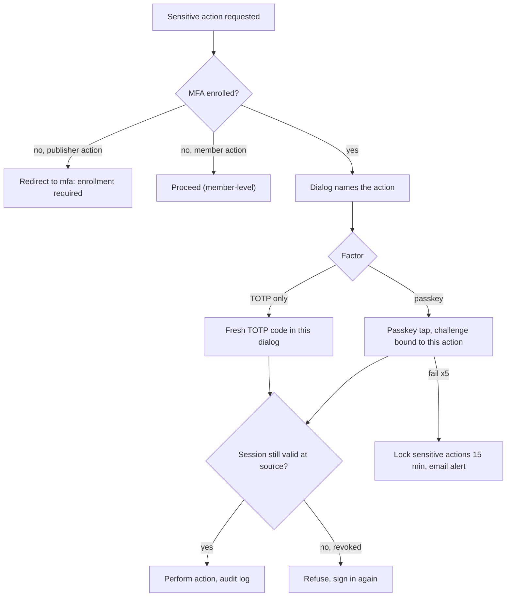

Failure / edge states:
- Lost all factors → "Lost your passkey?" → email code + recovery code; with no recovery code, a support flow with identity re-verification (publisher packs frozen meanwhile).
- Recovery code used → warn, offer regeneration.
- Session from new device or location → email notice (npm/GitHub pattern).
- Revoked session: ordinary pages may load for up to ~60 s; any sensitive action is refused immediately.
- Agents cannot confirm actions → tokens are minted only in the browser.

---

## 3. Star, rate, review

**Goal**: members express approval (star) and quality judgment (1-5 rating + optional review). Decision flagged in `sitemap.md` #1.

1. `pack`: click Star → toggles immediately (optimistic), count updates. Anonymous click → `signin` with return URL.
2. Click "Rate" or "Write a review" → `review`.
3. Choose version (default latest), 1-5 stars, optional title/body.
4. Submit → stored; pack rating recomputed (Bayesian average with prior to avoid 1-review 5-star packs ranking first).
5. Review appears in `pack` > Reviews with "verified fetch" badge if the account fetched the pack (optional, decision #8).
6. Publisher may reply once per review and flag for moderation.

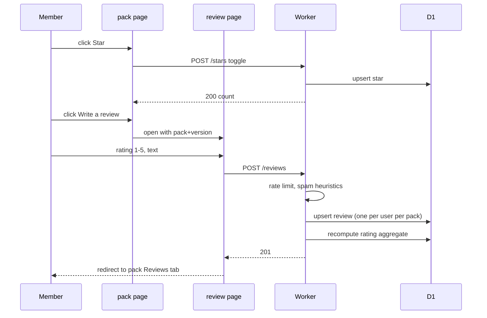

Failure / edge states:
- One review per user per pack; new submission edits the old one (version bump recorded).
- Cannot review own packs or packs of orgs you belong to.
- Rate limit: 10 reviews/day per account; accounts younger than 24h cannot review (anti-brigading).
- Review removed by moderation → author notified with reason.
- Pack yanked entirely → reviews stay but pack shows "unavailable".

---

## 4. File bug report (incl. private security report)

**Goal**: member reports a defect; security issues go to publisher privately.

1. `pack` > Issues → "Report a bug". If the pack links a public repo, this opens a pre-filled GitHub issue in that repo (pack, version, environment) that the user files themselves; PackServer reads its status back through the read-only GitHub App's issue webhooks. Packs without a public repo use the in-site `report` form.
2. Fields: version, type (bug / docs / security), severity, repro steps, environment, attachments (≤5 MB, images/text only).
3. If type = security → toggle "Private security report" auto-on: report is visible only to pack owners/maintainers and PackServer security; not listed in Issues tab.
4. Submit → issue created; publisher notified (email + dashboard alert). Private security reports also create a 90-day disclosure timer (publisher-visible).
5. Publisher responds / sets status (open, acknowledged, fixed in vX, won't fix, duplicate). Reporter notified.
6. Public issues appear in `pack` > Issues; private ones in `account` > My reports (reporter) and `dashboard` alerts (publisher).

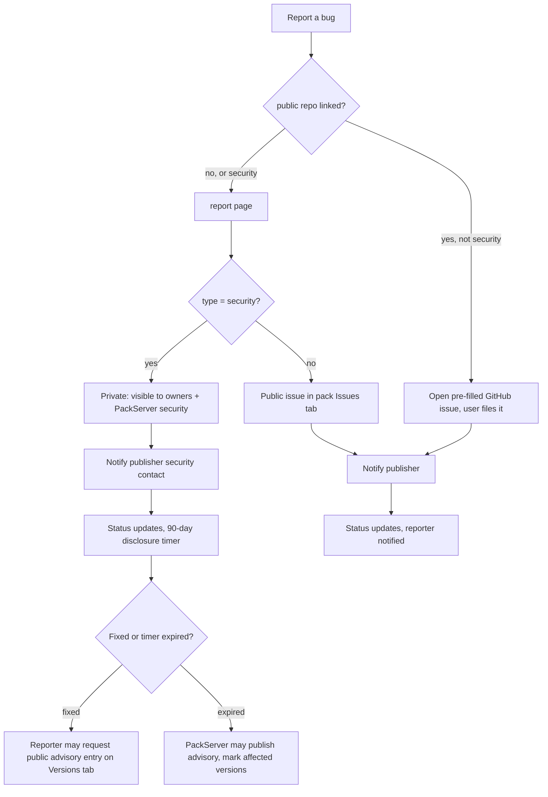

Failure / edge states:
- Pack has no security contact → routed to PackServer security only; publisher dashboard alert "Add a security contact".
- Reporter attaches a secret in repro → secret scan on attachments; blocked with explanation.
- Duplicate detection: suggest existing issues by title similarity before submit.
- Abuse (spam reports) → publisher can flag; moderation may block reporter.

---

## 5. Publish via upload

**Goal**: publisher uploads an archive, it is validated, listed, paid for, and published to R2.

1. `publish` step 1 Source → "Upload archive" (`.tar.gz`/`.zip`, ≤ 50 MB). Browser uploads directly to R2 via a presigned URL (staging bucket, 24h TTL).
2. Step 2 Validate → Worker enqueues validation job; UI streams progress; links to `validation`.
3. On pass/warn → step 3 Listing details, pre-filled from manifest (name, summary, category, repo URL if declared). Publisher confirms "No public repo" if none.
4. Step 4 Visibility & price → Public ($1) or Private (TBD price, pick access model).
5. Step 5 Pay → Stripe Checkout (or one-click with saved method). See flow 8.
6. Step 6 Publish → confirm with passkey → Worker copies archive from staging to the public (or private) R2 bucket under `packs/{publisher}/{pack}/{version}/`, writes `version` row, invalidates cache, emits "published" event.

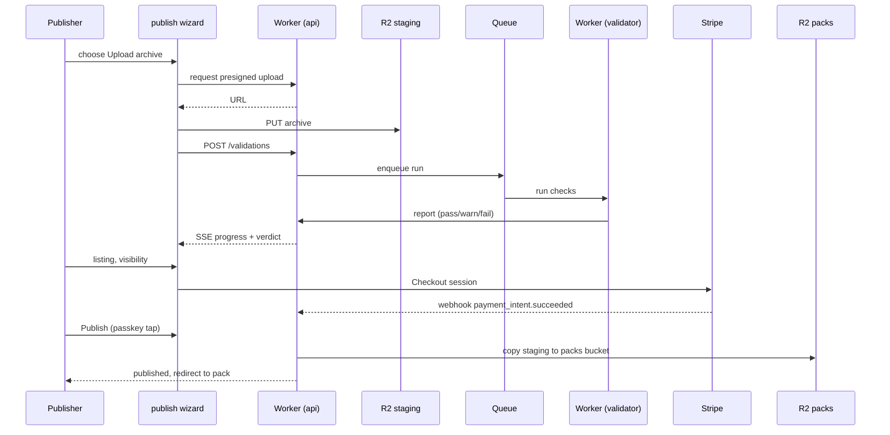

Failure / edge states:
- Upload interrupted → resumable multipart; draft persists on `dashboard` > Drafts.
- Validation fail → flow 7.
- Version already exists → hard error; versions are immutable (npm/crates.io).
- Name collides with a verified org's domain or a reserved word → blocked; suggest scoped name.
- Payment succeeded but publish step abandoned → credit held on account 30 days; dashboard alert "Finish publishing".
- Staging archive expired (24h) → re-upload required, validation re-run.

---

## 6. Publish via GitHub path with trusted publishing

**Goal**: a tag in a GitHub repo publishes `packs/gcp-ops/` with no long-lived secrets. Pattern: PyPI/npm trusted publishing (GitHub OIDC). PackServer never writes to GitHub; the workflow itself reports the result.

Setup (once, in `github`, each change confirmed with a passkey):
1. Add a trusted publisher: owner, repo, workflow file, optional environment, path, tag pattern (`v*`), target pack.
2. Choose release mode: publish automatically when validation passes, or stage for owner approval (default for verified orgs).
3. Copy the provided workflow YAML (`id-token: write`; it uploads the pack folder with the OIDC token). PackServer gets no write access to the repo.
   Alternative without a workflow: install the read-only PackServer GitHub App; a matching tag push webhook makes PackServer fetch that path's tarball and run the same validation. Results go to the dashboard and email only.

Per release:
4. Tag pushed → workflow runs → requests an OIDC token → `POST /api/publish/oidc` with the token and the pack archive built from the path at that ref.
5. Worker verifies the JWT against GitHub's JWKS and matches `repository`, `workflow_ref`, `environment` and `ref` claims to a trusted publisher → stores the archive in R2 staging, enqueues validation, returns a run id and status URL.
6. The workflow polls the status URL and prints the verdict and report link in its own job log; it exits non-zero on failure, so the GitHub run shows red or green without PackServer writing anything.
7. On pass: if the trusted publisher is in stage mode, the version becomes **Staged** and an owner approves it on `dashboard` with a passkey tap bound to that version. Otherwise, if the pack already has its credit (existing pack, new version) → publish directly. A new pack without a credit → "awaiting payment", dashboard alert and email; publisher completes flow 8.
8. Version live; the status URL now links to `pack`.

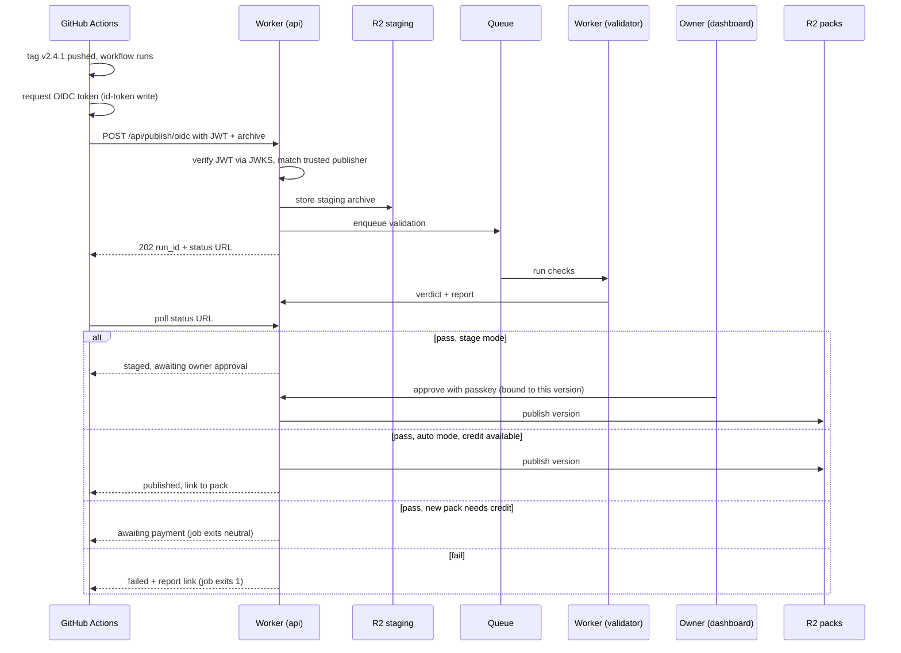

Failure / edge states:
- JWT claims mismatch (wrong workflow file, fork PR, environment missing) → 403 with the exact claim diff in the response, printed in the job log; nothing staged.
- Trusted publisher removed or disabled → 403 "No trusted publisher matches".
- Path has no manifest → validation fails with the expected file path in the report.
- Version in manifest ≠ tag → fail (prevents accidental republish); configurable "tag is source of truth".
- Workflow retries the upload → idempotent on (repo, sha, path).
- Staged version not approved in 14 days → expires; dashboard notice.
- Trusted publishing is preferred; a fallback "publish token" (scoped, 90-day expiry, shown once, minted with a passkey tap) exists for non-GitHub CI and is marked "less secure" in `github`.

---

## 7. Validation failure and resubmit

**Goal**: publisher understands what failed and resubmits quickly.

Check stages, in order (fail-fast on hard checks):

| Check | Hard fail | Warn |
|---|---|---|
| Archive & size limits (≤50 MB, ≤5k files, no symlinks out) | ✓ | |
| Manifest schema (`pack.json`/`pack.yaml`) | ✓ | |
| Manifest consistency (declared features exist on disk, version semver) | ✓ | |
| Secret scan (gitleaks-style rules) | ✓ | |
| Security scan (executables, shell hooks with network calls, path traversal) | ✓ for traversal / binaries | ✓ for network hooks |
| Prompt-injection heuristics on skill/agent prompts | | ✓ (human-readable excerpt) |
| Test run (pack-declared tests in sandboxed Worker/container, 10-min cap) | ✓ if declared tests fail | ✓ if no tests |
| License present | | ✓ |

1. `validation` shows verdict `fail`, failing checks first, each with file path, line, rule ID, and fix hint.
2. Publisher fixes source.
3. Upload path: re-upload in `publish` step 1 (draft retains listing fields). GitHub path: push a new tag (immutable tags; a tag cannot be reused).
4. New run; previous runs listed on `validation` for comparison.
5. Warnings do not block publish but are shown on `pack` as "Published with warnings" (public: names of warned checks only).

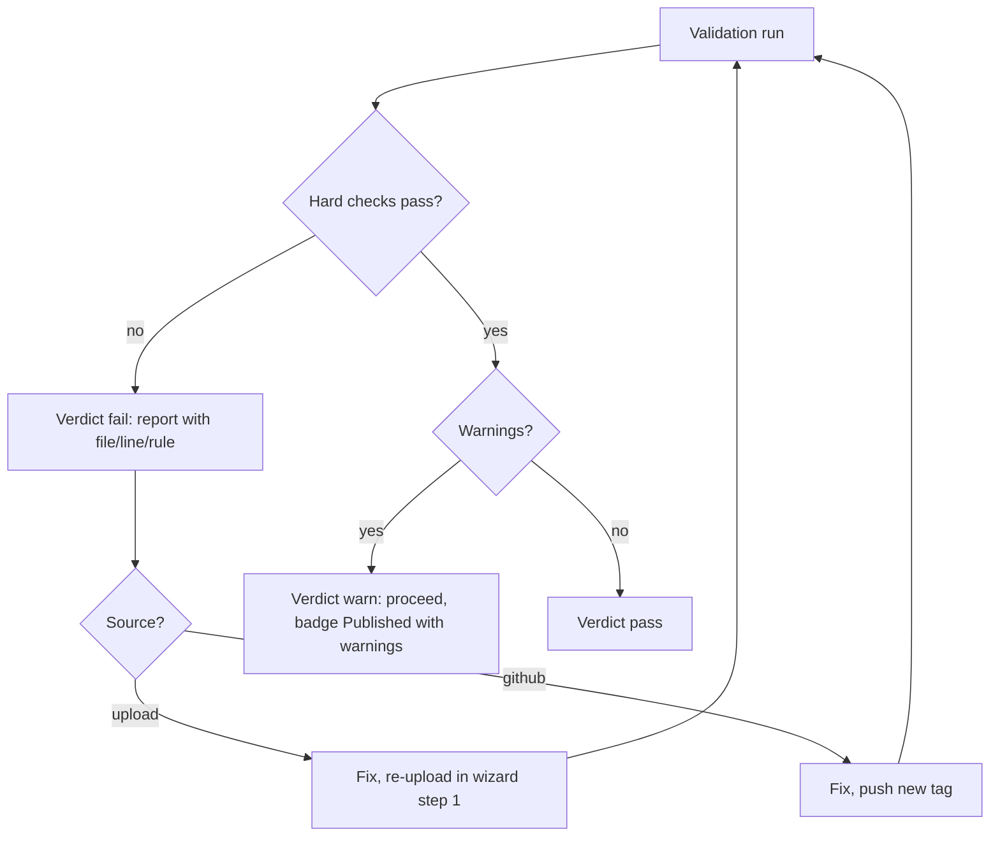

Failure / edge states:
- Validator timeout / infra error → verdict `error`, free automatic retry x2, then "Re-run" button; never counted against the publisher.
- Flaky declared tests → publisher can mark test as `allow_failure` in manifest (shown as warning).
- Secret found → secret is redacted in report (show rule + file + line, not value); publisher reminded to rotate it.
- Repeated fails (≥10/day) → soft rate limit on validation runs to protect capacity.

---

## 8. Payment via Stripe Checkout

**Goal**: collect $1 for a public pack (anti-spam), private-pack price TBD, without charging for packs that cannot be published.

**Decision: charge after validation passes, before publish.** Rationale: the fee is anti-spam, not revenue; charging on submit would require refunds for every failed run (Stripe keeps fees on refunds, support burden, bad first impression). Validation is cheap and rate-limited by account age + MFA + CAPTCHA, which already deters bulk spam. Payment is tied to the validated artifact hash, so a different archive cannot reuse it.

1. `publish` step 5: show line item (Public pack: $1.00 one-time / Private pack: TBD), pack name, artifact hash.
2. Click Pay → Worker creates Stripe Checkout Session with `client_reference_id = validation_run_id`, metadata `{pack, version, hash, user}`; redirect.
3. Stripe hosted page; card saved for future (optional "save for one-click").
4. Return URL → wizard step 5 shows "Confirming…" until webhook `checkout.session.completed` arrives (Durable Object notifies).
5. `payment` row marked paid; step 6 unlocked.
6. Receipt listed in `billing`; Stripe email receipt.

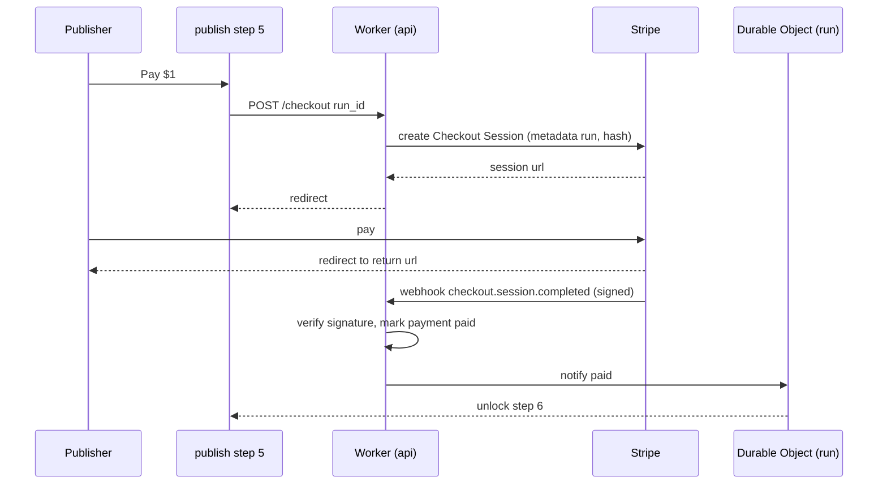

Failure / edge states:
- Webhook delayed > 60s → wizard shows "Still confirming, we'll email you"; draft stays; alert on `dashboard`.
- Payment succeeded, publish never completed → credit tied to hash valid 30 days; after that, refunded automatically.
- Chargeback → version yanked, publisher account flagged, further publishes require manual review.
- Private pack pricing TBD → wizard shows "Private packs: pricing coming, join waitlist" until decided.
- Re-publishing a new version of an already-paid public pack: free (decision). Alternative considered: $1 per version — rejected as it taxes good maintenance.
- Verified orgs: still pay $1 (keeps rules uniform); can be revisited.
- Publish credits (backend design): $1 buys one credit; bundles of credits can be bought up front so CI publishes of new packs don't stall on checkout. One credit is consumed per new pack, never per version.

---

## 9. Verify organization

**Goal**: an org proves control of a domain and/or GitHub org, earning a verified badge so "@google/gcp" is trustworthy.

1. `org` > Create org: handle, display name. Creator becomes `owner` (confirm with passkey).
2. Verification tab → "Add domain": enter `example.com` → shown TXT record `_packserver-challenge.example.com  TXT  "<signed token>"`, or the alternative file `https://example.com/.well-known/packserver-auth` (MCP Registry model).
3. Click "Check now" → Worker resolves via DNS-over-HTTPS (1.1.1.1), accepts if token matches. Re-checks every 30 days; badge removed after 2 failed re-checks with email warning.
4. "Verify GitHub org": either install the read-only PackServer GitHub App on the org, or sign in with GitHub and we confirm the user is an org admin via the API. The scope name defaults to the org login.
5. Badges state exactly what was proven: "github.com/google" for a GitHub org, "google.com ✓" for a domain. **Verified Publisher** additionally needs domain proof + linked GitHub org + MFA enforced for all members + manual review by PackServer.
6. Handle policy: a verified domain's label (e.g. `google`) can be claimed as handle even if squatted by an unverified user (user is renamed, notified; npm dispute-lite).

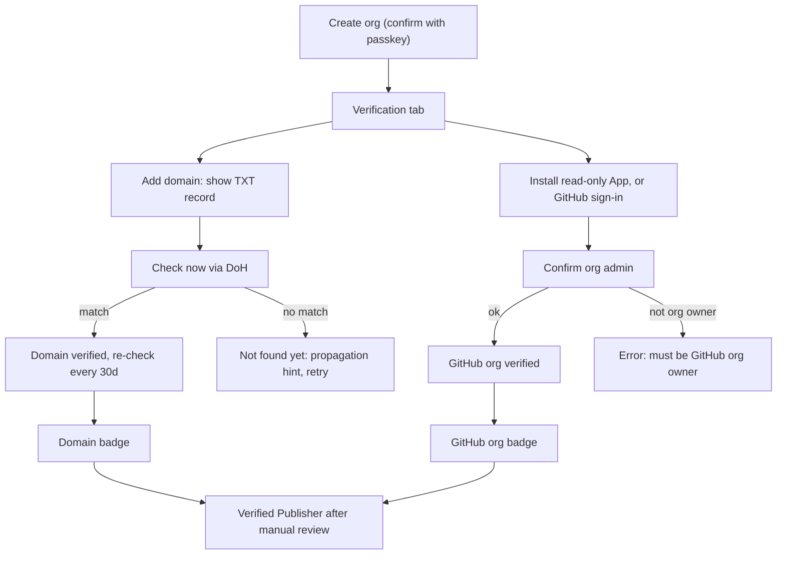

Failure / edge states:
- Domain already verified by another org → conflict; second org can trigger a re-check which revokes the first if the TXT now points to the second (domain owner wins).
- Public suffix (e.g. `github.io`) → rejected; subdomain allowed with warning (badge shows full host).
- GitHub App uninstalled and admin no longer confirmable → GitHub org badge revoked after 7 days, alert.
- Scope and pack names are never recycled after deletion (Hugging Face re-registration attack).
- Org deleted → packs must be transferred first (blocking).

---

## 10. Private pack access (options)

**Goal**: restrict who/what can discover and fetch a private pack. Not decided; UI must support switching models per pack.

Option A – Org members / teams:
1. `access`: model = "Org members"; optional team filter.
2. Members read via web (session) or via their personal `read:private` token for agents.
3. Removing a member revokes access immediately (tokens of that member stop resolving that pack).

Option B – Named allow-list:
1. `access`: add handles / org handles; invitee sees invitation on `account`; accept.
2. Same read mechanics as A.

Option D – Gated access requests (Hugging Face style, recommended by the registry research):
1. The private pack's listing is visible (name, summary, publisher) with a "Request access" button; contents and downloads stay gated.
2. Requester (signed in) fills the owner's form: name, org, intended use, accept terms.
3. Owner sees pending requests on `access` and approves or denies; or sets auto-approve.
4. For paid packs, a Stripe webhook calls the grant API after payment, so approval is automatic.
5. Grants are per user and revocable; the user's personal token then resolves the pack over MCP.

Option C – Scoped read tokens for agents:
1. `access`: "Create agent token" (confirm with passkey): name, scope `read:pack/{id}` (or `read:org/{org}/*`), expiry (max 1 year), optional CIDR allow-list.
2. Token shown once; copy into agent config as MCP `Authorization: Bearer`.
3. Audit log on `access`: token name, last used, fetch counts; revoke anytime.

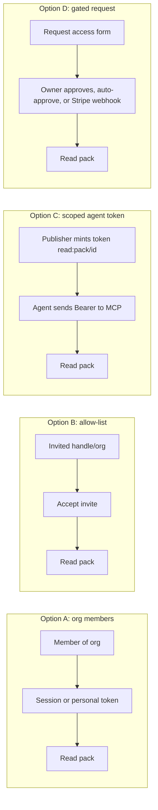

Edge states (all options):
- Under A, B and C, private packs are never indexed in `browse` or `search_packs` for unauthorized callers; 404 (not 403) to avoid existence leaks. Under D the owner chooses to list the pack publicly so people can request access; its contents still return 404 until granted.
- Downloads served through a Worker that checks authorization then streams from private R2 (never a public R2 URL); optional 5-min signed URLs for large archives.
- Making a private pack public: passkey confirmation, confirmation that all versions become public and permanent.
- Making a public pack private: only future versions; previously public versions remain fetchable by exact version.

---

## 11. Agent discovering & fetching a pack via MCP

**Goal**: an agent asks what packs exist for a kind of work and installs one. Documented on `agents`.

Tools: `list_categories()`, `search_packs(query, category?, feature_type?, verified_only?, limit)`, `get_pack(id, version?)` → metadata + contents summary + install instructions, `get_pack_manifest(id, version)`, `download_pack(id, version)` → signed URL or inline archive (size-capped).

Public:
1. Agent connects to `https://mcp.packserver.dev` (Streamable HTTP MCP), no auth.
2. `search_packs("deploy to GCP Cloud Run", category="cloud")` → ranked list of compact summaries: description (max 1024 chars, per the Agent Skills convention), contents counts by type, context cost in tokens, stars, rating, verified flag. Full content stays behind `get_pack` so a search costs the agent little context.
3. `get_pack("@google/gcp")` → summary, warnings, validation verdict, latest version.
4. `download_pack("@google/gcp", "1.2.0")` → R2 signed URL (public bucket behind cache) + sha256; agent installs locally.

Private (option C token or personal token):
5. Same with `Authorization: Bearer ps_rt_…`; `search_packs` now includes private packs the token can read.
6. Worker verifies token hash in D1/KV, checks scope and expiry, logs usage.

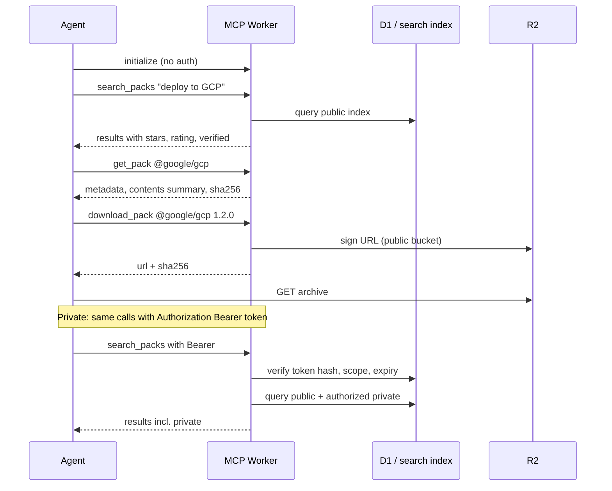

Failure / edge states:
- Invalid/expired token → 401 with `WWW-Authenticate` hint and docs link; never reveals whether pack exists.
- Rate limits: anonymous 60 req/min per IP; token 600 req/min; `download_pack` counted toward downloads metric once per (token/IP, version, day).
- Yanked version requested → `get_pack` returns it with `yanked: true` and reason; `download_pack` works only with exact version (never resolves "latest" to a yanked version).
- Agent asks for a category that doesn't exist → `list_categories` suggestion in error.
- Responses include `advisory` field when a public security advisory exists for the version.

---

## 12. Yank / deprecate a version

**Goal**: stop a bad version from being resolved without breaking reproducibility (crates.io yank + npm deprecate).

1. `pack` > Versions (publisher view) → version row menu → "Deprecate" (warning only) or "Yank" (hidden from resolution).
2. Enter reason (shown publicly) and, for yank, optional "security" flag (creates advisory stub).
3. Confirm with passkey (bound to this version).
4. Deprecate: version still resolvable; MCP/CLI show warning. Yank: `latest` moves to previous non-yanked version; exact-version fetch still works with `yanked: true`; search excludes it.
5. Notify users who starred the pack (opt-in digest) and open issues referencing the version.
6. Un-yank possible by owner (confirm with passkey), logged.

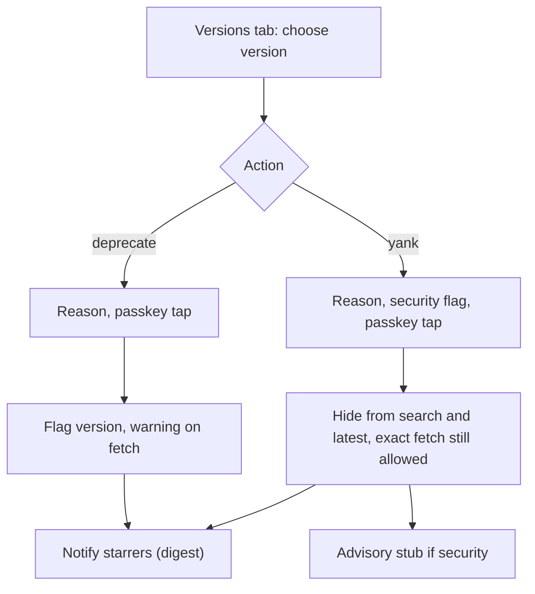

Failure / edge states:
- Yanking the only version → pack shows "No available versions", stays listed with reason.
- Delete is not offered for public packs after 72h (npm unpublish rule); within 72h and zero downloads, full delete allowed.
- Private packs: delete allowed any time (confirm with passkey), with 7-day soft-delete.
- Yank initiated by moderation → reason prefixed "Removed by PackServer".

---

## 13. Report abuse / moderation

**Goal**: anyone can flag malicious or infringing packs, reviews or users; moderators act quickly with an audit trail.

1. "Report abuse" link in `pack` header menu, on each review, on `publisher` profile. Anonymous allowed with Turnstile; members pre-filled.
2. Form: category (malware / prompt injection / secrets leak / impersonation / spam / IP infringement / other), details, evidence URL.
3. Severity routing: malware / prompt injection / secrets → auto-quarantine if ≥3 independent reports or 1 report from a verified org → pack shows "Under review", `download_pack` returns 451-style hold with reason; moderators notified immediately.
4. Moderator reviews (admin UI, out of scope): dismiss, hide pack/review, yank versions, suspend publisher, revoke verification.
5. Publisher notified with reason and appeal link; reporter notified of outcome (no details).
6. Audit log entries immutable; counts surfaced on publisher's `dashboard` alerts.

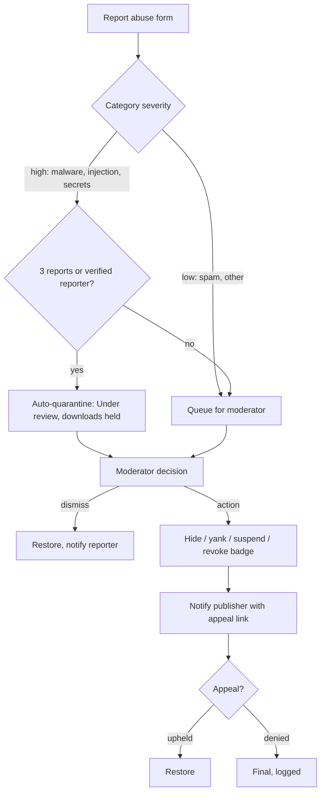

Failure / edge states:
- Report brigading → quarantine requires independent accounts (age > 7d, distinct IdPs) or a verified org; mass identical reports collapse into one.
- Quarantined pack already installed by agents → MCP `get_pack` returns `status: under_review` so agents can warn users.
- Impersonation claims from a verified org (e.g. "google" squatting) → fast lane: handle reassigned per flow 9 step 6.
- Reporter identifies themselves as the copyright owner → DMCA-style counter-notice path (legal, out of scope).
