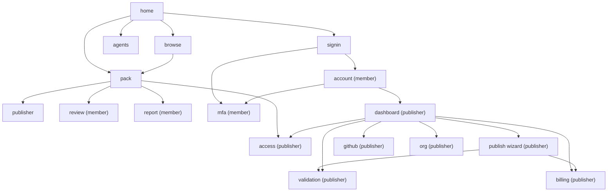

# PackServer UI Sitemap

Information architecture for the PackServer registry website. Page IDs below are the canonical anchors used by the wireframes (`docs/ui/wireframes/`) and by `flows.md`.

## Personas

| Persona | Who | Can do |
|---|---|---|
| **Anonymous visitor** | Anyone, incl. crawlers and agents without a token | Browse, search, filter, read pack pages, read reviews/issues, read MCP docs, call public MCP tools |
| **Member** | Signed-in individual (passkey or GitHub; email code for sign-up and recovery only) | Everything above + star, rate (1-5), write reviews, file bug reports and private security reports, manage profile, MFA (optional), sessions, personal read tokens |
| **Publisher** | Member who has enrolled as publisher (MFA required, payment method on file) | Everything above + publish/yank/deprecate packs, see validation reports, connect GitHub auto-publish, create orgs, verify domains/GitHub orgs, manage private-pack access, billing |
| **Org roles** (within a Publisher org) | `owner` / `maintainer` | Owner: all org actions incl. members, billing, transfer, delete. Maintainer: publish/yank versions, edit listing, manage access lists; no billing/members/transfer |
| **Moderator** (internal) | PackServer staff | Act on abuse reports: hide/remove packs, suspend accounts, revoke verifications (admin UI is out of scope for v1 wireframes) |

Pattern sources: npm (member vs. publisher with 2FA levels), PyPI (trusted publishing, org roles), crates.io (owners vs. team owners), Docker Hub (org member roles), JFrog Artifactory (permission targets per repo/path).

## Sitemap tree

```
/                                  home
├── /browse                        browse (search results + filters)
├── /packs/{publisher}/{pack}      pack
│   ├── ?tab=overview              pack.overview
│   ├── ?tab=contents              pack.contents
│   ├── ?tab=versions              pack.versions
│   ├── ?tab=reviews               pack.reviews
│   └── ?tab=issues                pack.issues
├── /@{publisher}                  publisher (user or org profile)
├── /agents                        agents (MCP endpoint docs)
├── /signin                        signin (sign in / sign up)
│
├── /account                       account  [member]
│   ├── /account/mfa               mfa      [member]
│   ├── /account/stars
│   ├── /account/reviews
│   ├── /account/reports
│   ├── /account/security          (MFA, sessions, API tokens)
│   └── /account/tokens
├── /packs/{p}/{pack}/review       review   [member]
├── /packs/{p}/{pack}/report       report   [member]
│
├── /dashboard                     dashboard  [publisher]
├── /publish                       publish (wizard)  [publisher]
│   ├── /publish/source            step 1
│   ├── /publish/validate          step 2
│   ├── /publish/listing           step 3
│   ├── /publish/visibility        step 4
│   ├── /publish/pay               step 5
│   └── /publish/done              step 6
├── /validation/{run_id}           validation (report)  [publisher]
├── /dashboard/github              github (auto-publish config)  [publisher]
├── /orgs/{org}/settings           org  [publisher, org owner/maintainer]
├── /packs/{p}/{pack}/access       access (private pack access)  [publisher]
└── /billing                       billing  [publisher]
```



## Page-by-page

| ID | URL | Purpose | Persona | Key components | Key actions |
|---|---|---|---|---|---|
| `home` | `/` | Entry point: search, discovery, pitch "for agents" | Anon+ | Hero search box; category grid (e.g. Cloud, Data, Testing, Security, Docs, DevOps); Trending / Recently updated / Top rated rails; "For agents" panel with MCP endpoint URL + one-line config snippet (VS Code Marketplace-style "Install" affordance); footer | Search, pick category, open pack, open `agents`, sign in |
| `browse` | `/browse?q=&category=&feature=&verified=&repo=&sort=` | Search results | Anon+ | Left filter rail: category (multi), contains feature type (skills / checks / tasks / hooks / commands / agents / MCP servers), verified publisher toggle, has public repo toggle; sort: stars / rating / recent / downloads; result cards (name, publisher + badge, one-liner, feature-type chips, stars, rating, downloads, updated); pagination | Filter, sort, open pack. URL is the state (crates.io / npm pattern) |
| `pack` | `/packs/{publisher}/{pack}` | Pack detail | Anon+ (actions gated) | Header: name, publisher + verified badge, latest version + visibility chip, star button + count, rating stars + count, downloads; **Install panel** with tabs MCP / CLI / manifest snippet (copy); **Repo link** or prominent **"No public repo"** badge; **Contents summary** by feature type with counts; **Validation status** chip (passed / warnings) linking to public summary; tabs: Overview (README), Contents (tree by feature type, each with name + description), Versions (list, yanked/deprecated markers, changelog), Reviews (rating histogram + reviews), Issues (bug reports, severity, status) | Star, rate/review (-> `review`), report (-> `report`), copy install snippet, switch version, publisher-only: Manage menu (edit listing, access, yank, new version) |
| `publisher` | `/@{handle}` | User or org public profile | Anon+ | Avatar, display name, handle, verified badge with list of verified domains / GitHub org; member since; pack list with status; links | Open packs, (owner) edit profile |
| `agents` | `/agents` | MCP endpoint docs | Anon+ | Endpoint URL; tool reference: `search_packs`, `get_pack`, `list_categories`, `get_pack_manifest`, `download_pack`; auth section (public = none, private = scoped read token in `Authorization`); example transcripts; config snippet for Claude / Ant; rate limits | Copy config, create token (-> `account`) |
| `signin` | `/signin` | Sign in or sign up | Anon | Buttons: Sign in with a passkey (default), Sign in with GitHub; email one-time code for sign-up and "Lost your passkey?" recovery only; "What you get" blurb; after first login: handle + display name step | Sign in, sign up, continue to `mfa` if required |
| `mfa` | `/account/mfa` | MFA enrollment & management | Member | Passkey (WebAuthn) primary; TOTP fallback with QR + manual key; recovery codes (download/print once); list of enrolled factors with last-used; "MFA required for publishers" banner | Add passkey, add TOTP, regenerate recovery codes, remove factor (confirm with passkey) |
| `review` | `/packs/{p}/{pack}/review` | Rate + write review | Member | Version selector (defaults latest); 1-5 star input; title; body (markdown); "I used this with" checkboxes (Claude / Ant); edit existing review notice | Submit, edit, delete own review |
| `report` | `/packs/{p}/{pack}/report` | File bug report | Member | Version selector; severity (low / medium / high / critical); type (bug / docs / security); repro steps; environment; attachments; **Private security report** toggle (not public, goes to publisher security contact + PackServer); "Report abuse instead" link | Submit; see on `account` > My reports |
| `account` | `/account` | Member settings | Member | Tabs: Profile (avatar, handle, display name, bio, links), Starred packs, My reviews, My reports, Security (MFA status -> `mfa`, active sessions w/ revoke, API tokens: name, scopes `read:private`, expiry, last used), Become a publisher CTA | Edit profile, revoke session, create/revoke token (confirm with passkey), delete account |
| `dashboard` | `/dashboard` | Publisher home | Publisher | Context switcher (personal / each org); alerts strip (failed validations, pending payments, expiring domain verification, security reports); My packs table (name, visibility, latest version, status: published / draft / validating / failed / yanked, stars, downloads, open issues); Drafts; Private packs section; quick links to `github`, `org`, `billing` | New pack (-> `publish`), open pack manage, resume draft |
| `publish` | `/publish` | 6-step wizard | Publisher | Stepper: 1 Source (GitHub repo + path (trusted publishing workflow, or the read-only GitHub App), or upload archive drag-drop with size limit) → 2 Validate (live log, links to `validation`) → 3 Listing details (name, slug, category, tags, summary, README preview, repo link / "no public repo" confirm, icon) → 4 Visibility & price (Public $1 one-time / Private: price TBD, access model picker) → 5 Pay (Stripe Checkout redirect, or "payment method on file" one-click) → 6 Publish (confirm with passkey, publish) | Next/back, save draft, cancel |
| `validation` | `/validation/{run_id}` | Validation report | Publisher (public summary visible on `pack`) | Overall verdict (pass / warn / fail); check list with status + expandable detail: schema, manifest, security scan, secret scan, prompt-injection heuristics, test run (logs), size limits, license; duration; "Re-run" / "Resubmit" buttons; link to source commit/archive hash | Re-run, resubmit, download log |
| `github` | `/dashboard/github` | GitHub auto-publish config | Publisher | Trusted publishers and (optional) read-only GitHub App repos; per-pack row: repo, path (e.g. `packs/gcp/`), trigger (tag pattern `v*` / release), trusted publishing config (owner, repo, workflow file, environment) in PyPI style; recent runs with PackServer status (nothing is written back to GitHub); "Copy workflow YAML" | Connect repo, add/edit mapping, disable, view run |
| `org` | `/orgs/{org}/settings` | Org management | Publisher (owner/maintainer) | Tabs: General (name, handle, avatar); Verification (domain via DNS TXT with record shown + "Check now"; GitHub org via read-only App install or GitHub sign-in as org admin); Members (list with role, invite by handle/email, pending invites); Security (require MFA for all members: on by default); Danger (transfer packs, delete org) | Create org, verify, invite, change role, remove |
| `access` | `/packs/{p}/{pack}/access` | Private pack access (OPTIONS, not decided) | Publisher (owner/maintainer) | Visibility chip; access model panel with the 2-3 options below; audit log of grants/fetches | Grant/revoke per chosen model, change visibility (confirm with passkey) |
| `billing` | `/billing` | Payments | Publisher | Plan (Free publisher / Private packs plan TBD); payment method via Stripe (customer portal link); receipts table (date, item, pack, amount, invoice PDF); upcoming charges | Update card, download receipt, cancel plan |

## Navigation / header states

| State | Left | Center | Right |
|---|---|---|---|
| Anonymous | Logo | Search box | `Browse` · `For agents` · **Sign in** button |
| Member | Logo | Search box | `Browse` · `For agents` · `Become a publisher` · avatar menu: Account, Starred, My reviews, My reports, Security, Sign out |
| Publisher | Logo | Search box | `Browse` · `For agents` · **New pack** (primary) · avatar menu: Dashboard, Account, Billing, Orgs (list), Security, Sign out |
| Publisher inside dashboard pages | Logo + context switcher (personal / org) | Search box | same as Publisher; secondary sidebar: Packs, Drafts, GitHub, Org settings, Access, Billing |

Mobile: hamburger with the same items; search collapses to icon. Alert badge on avatar when `dashboard` has alerts.

## Permission matrix

Legend: ✓ allowed · S = allowed, each time confirmed with a passkey tap bound to that action (fresh TOTP code for TOTP-only members) · ✗ not allowed · (own) = only own items

| Action | Anon | Member | Publisher (personal) | Org maintainer | Org owner |
|---|---|---|---|---|---|
| Browse / search / read public pack | ✓ | ✓ | ✓ | ✓ | ✓ |
| Call public MCP tools | ✓ | ✓ | ✓ | ✓ | ✓ |
| Read private pack | ✗ | granted only | own | org's | org's |
| Star | ✗ | ✓ | ✓ | ✓ | ✓ |
| Rate / review | ✗ | ✓ | ✓ (not own packs) | ✓ (not org packs) | ✓ (not org packs) |
| Edit / delete review | ✗ | own | own | own | own |
| File bug report / private security report | ✗ | ✓ | ✓ | ✓ | ✓ |
| Report abuse | ✓ (captcha) | ✓ | ✓ | ✓ | ✓ |
| Manage MFA / sessions | ✗ | S | S | S | S |
| Create read token (`read:private`) | ✗ | S | S | S | S |
| Enroll as publisher (MFA + payment method) | ✗ | S | — | — | — |
| Create pack / publish version | ✗ | ✗ | S | S | S |
| Edit listing details | ✗ | ✗ | own | ✓ | ✓ |
| Yank / deprecate version | ✗ | ✗ | S | S | S |
| Change visibility (public ↔ private) | ✗ | ✗ | S | ✗ | S |
| Manage private-pack access grants | ✗ | ✗ | own | ✓ | ✓ |
| Configure GitHub auto-publish | ✗ | ✗ | own | ✓ | ✓ |
| Respond to bug reports / close issues | ✗ | ✗ | own | ✓ | ✓ |
| Create org | ✗ | ✗ | S | — | — |
| Verify domain / GitHub org | ✗ | ✗ | — | ✗ | S |
| Invite / remove members, change roles | ✗ | ✗ | — | ✗ | S |
| Transfer pack ownership | ✗ | ✗ | S | ✗ | S |
| Billing / payment method / receipts | ✗ | ✗ | own | ✗ | ✓ |
| Delete org / delete pack | ✗ | ✗ | S (own pack) | ✗ | S |

Note: publishing a public pack is a one-way "public forever" promise for already-downloaded versions (npm/crates.io model): a public version can be yanked (hidden from resolution) but files stay retrievable by exact version for reproducibility. Taking a pack private after being public only affects future versions.

## Private pack access: options (not decided)

| Option | How it works | Pros | Cons | Sources |
|---|---|---|---|---|
| A. Org members / teams | Anyone with a role in the owning org (or named team) can read. Agents use a personal read token of a member. | Simplest mental model; mirrors npm private packages / Docker Hub private repos | Requires everyone to be in the org; no fine-grained external sharing | npm orgs, Docker Hub, GitHub Packages |
| B. Named users / orgs allow-list | Pack has an allow-list of handles and orgs; invitees accept. | Works across orgs (Google shares with a partner) | Allow-list management burden; invitation spam vector | crates.io does not do this; Artifactory permission targets; Google Drive-style sharing |
| C. Scoped read tokens for agents | Publisher mints tokens scoped to `read:pack/{id}` with expiry and optional IP/CIDR; distributed out-of-band; agents send them to MCP. | Best fit for "agents grow their skill set" in CI/fleets; no PackServer account needed for the consumer | Secret distribution and rotation on the publisher; audit by token not by person | PyPI/npm granular tokens, Artifactory access tokens, Cloudflare API tokens |
| D. Gated access requests | Pack page shows "Request access"; requester fills a form (name, org, intended use, accept terms). Owner approves or denies, or turns on auto-approve. A grant/revoke API lets a Stripe webhook approve paid access. | Works for strangers without pre-knowing them; natural fit for paid private packs; per-user grants are auditable | Owner has to triage requests; needs anti-spam on the form | Hugging Face gated repos (see `research/registry-research.md`) |

Recommended combination: A as the default, C as an add-on for agents, D for paid or partner access (it subsumes most of B), B deferred. Model the permissions underneath as resource × principal × action (JFrog permission targets) so any of these is a policy, not a redesign. Pricing for private packs TBD; the research shows per-seat pricing is the norm (npm $7, HF Team $20, PyPI orgs $5 per member per month).

## Open decisions

1. **Stars vs. rankings**: proposal is stars (bookmark/popularity) + 1-5 rating with written review (VS Code Marketplace / Docker Hub pattern). Alternative: stars only (crates.io / npm) or thumbs-up/down. Decide.
2. **Private pack access model**: A (org members), B (allow-list), C (scoped tokens), D (gated access requests) or combination. Decide, and decide private pricing.
3. **Charge timing**: proposal is charge-after-validation-passes (see `flows.md` > Payment). Alternative: charge-on-submit with refund on fail.
4. **MFA scope**: proposal is required for publishers, optional for members. Decide whether org owners must re-verify MFA for all members (npm "enforce 2FA" style).
5. **Namespace model**: scoped `@<scope>/<pack>`, matching the backend design. A scope belongs to a user or an org; its badge states what was proven (GitHub org, domain). Names are never recycled. Scoped names remove name-squatting disputes.
6. **Validation gate strictness**: which checks are hard-fail (schema, secrets, size) vs. warn (prompt-injection heuristics, missing tests). Proposal in `validation` page.
7. **Public validation detail**: show full report publicly vs. only verdict + check names. Proposal: verdict + check list public, logs publisher-only.
8. **Rating eligibility**: anyone signed-in vs. only accounts that fetched the pack (download-gated, Docker Hub-like). Proposal: any member, with "verified fetch" badge on reviews from accounts that pulled the pack.
9. **Review moderation**: publisher reply only vs. publisher can flag; proposal: reply + flag, never delete.
10. **Anonymous abuse reports**: allow with captcha vs. require sign-in. Proposal: allow with captcha (Turnstile).
11. **Category taxonomy**: fixed curated list vs. free tags. Proposal: fixed top-level categories + free tags.
12. **Org verification method** (settled by the backend design): GitHub org proof (read-only App install or GitHub sign-in as org admin) and domain proof (DNS TXT or `.well-known` file) each give their own badge; Verified Publisher needs both plus scope-wide MFA and manual review.
