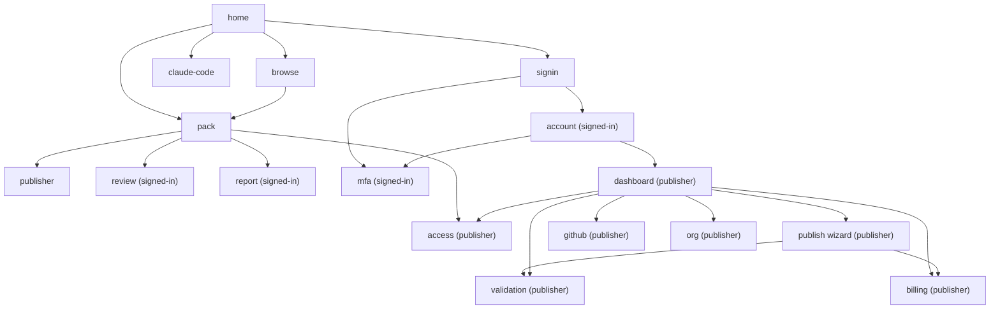

# PackServer UI Sitemap

Information architecture for the PackServer registry website. PackServer serves Claudinite packs; vocabulary and pack anatomy follow `/mnt/project-files/claudinite/claudinite-primer.md`. Page IDs below are the canonical anchors used by the wireframes (`docs/ui/wireframes.html`, `docs/ui/wireframes-v2.html`) and by `flows.md`.

## Roles

Site roles, by what the site lets them do. A Claudinite *member* is a repo running Claudinite; this document uses *signed-in user* (or *account*) for a person with a session, and "member" only for repos (settled, see the end of Open decisions).

| Role | Who | Can do |
|---|---|---|
| **Anonymous visitor** | Anyone, incl. crawlers and Claude Code sessions over MCP | Browse, search, filter, read pack pages, read reviews/issues, read MCP docs, call public MCP tools |
| **Signed-in user** | Signed-in individual (passkey or GitHub; email code for sign-up and recovery only) | Everything above + star, rate (1-5), write reviews, file bug reports and private security reports, manage profile, MFA (optional), sessions |
| **Publisher** | Signed-in user who has enrolled as publisher (MFA required, payment method on file) | Everything above + publish/revoke versions, see validation reports, connect GitHub auto-publish, create orgs, verify domains/GitHub orgs, manage private-pack access, billing |
| **Org roles** (within a Publisher org) | `owner` / `maintainer` | Owner: all org actions incl. org members, billing, transfer, delete. Maintainer: publish/revoke versions, edit listing, manage access lists; no billing/org members/transfer |
| **Moderator** (internal) | PackServer staff | Act on abuse reports: hide/remove packs, suspend accounts, revoke verifications (admin UI is out of scope for v1 wireframes) |

### Personas

Who each role serves (primer §Personas). Anonymous and signed-in users are Claudinite's buyers, each with a trust demand: Marcus (platform engineer, 300 engineers; org allow list and internal mirror), Dana (engineering manager), Jordan (startup CTO), Grace (agency owner, client repos), Elena (indie, 15 repos), Sam (AppSec approver; a pre-adoption manifest of what a pack does to a repo, signed versions, a soak before `stable`). Publishers are Rafael (OSS maintainer; publishes only if the format is open and OSS publishing is free) and Carmen (publishes her company's packs).

Pattern sources: npm (user vs. publisher with 2FA levels), PyPI (trusted publishing, org roles), crates.io (owners vs. team owners), Docker Hub (org roles), JFrog Artifactory (permission targets per repo/path).

## Sitemap tree

```
/                                  home
├── /browse                        browse (search results + filters)
├── /packs/{publisher}/{pack}      pack
│   ├── ?tab=overview              pack.overview
│   ├── ?tab=contents              pack.contents
│   ├── ?tab=versions              pack.versions
│   ├── ?tab=reviews               pack.reviews
│   └── ?tab=issues                pack.issues
├── /@{publisher}                  publisher (user or org profile)
├── /claude-code                   claude-code ("For Claude Code": MCP endpoint docs)
├── /signin                        signin (sign in / sign up)
│
├── /account                       account  [signed-in]
│   ├── /account/mfa               mfa      [signed-in]
│   ├── /account/stars
│   ├── /account/reviews
│   ├── /account/reports
│   ├── /account/security          (MFA, sessions, API tokens)
│   └── /account/tokens
├── /packs/{p}/{pack}/review       review   [signed-in]
├── /packs/{p}/{pack}/report       report   [signed-in]
│
├── /dashboard                     dashboard  [publisher]
├── /publish                       publish (wizard)  [publisher]
│   ├── /publish/source            step 1
│   ├── /publish/validate          step 2
│   ├── /publish/listing           step 3
│   ├── /publish/visibility        step 4
│   ├── /publish/pay               step 5
│   └── /publish/done              step 6
├── /validation/{run_id}           validation (report)  [publisher]
├── /dashboard/github              github (auto-publish config)  [publisher]
├── /orgs/{org}/settings           org  [publisher, org owner/maintainer]
├── /packs/{p}/{pack}/access       access (private pack access)  [publisher]
└── /billing                       billing  [publisher]
```



## Page-by-page

| ID | URL | Purpose | Role | Key components | Key actions |
|---|---|---|---|---|---|
| `home` | `/` | Entry point: search, discovery; the pitch leads with checks ("the Stripe pack exists and I can pin it") | Anon+ | Hero search box; category grid (e.g. Cloud, Data, Testing, Security, Docs, DevOps); Recently published / Verified publishers rails and a "Trending" rail; "For Claude Code" panel with the MCP endpoint URL and the one-line adoption (`cn adopt <id>`, lands as a PR); footer | Search, pick category, open pack, open `claude-code`, sign in |
| `browse` | `/browse?q=&category=&feature=&verified=&repo=&sort=` | Search results | Anon+ | Left filter rail: category (multi), contains pack content type (rules / skills / checks / guards / tasks), "checks only (no tasks, no skills)", verified publisher toggle, has public repo toggle; sort: relevance / age / publisher tier; result cards (name, publisher + badge, one-liner, manifest line "4 checks · 1 guard · 4 tasks (monthly) · 6 skills", publisher tier, updated); pagination | Filter, sort, open pack. URL is the state (crates.io / npm pattern) |
| `pack` | `/packs/{publisher}/{pack}` | Pack detail | Anon+ (actions gated) | Header: name, publisher + verified badge, newest version + publish date + visibility chip, star button + count, rating stars + count; **Manifest of effects** (above the README): guards added, tool calls guarded, tasks and cadence, forced skills, GitHub actions requested, `minEngineVersion`, `requires`; **Adopt panel**: `cn adopt <id>` and the Claudinite settings declaration (`packs.declared`, with optional `version:` freeze), muted line "Lands as a pull request; updates arrive the same way" (copy); **Repo link** or prominent **"No public repo"** badge; **Contents summary** by pack content type with counts (rules, skills, declared / coded checks, guards, tasks); **Validation status** chip (passed / warnings) linking to public summary; tabs: Overview (README), Contents (tree by content type, each with name + description; every file readable), Versions (list, publish date, revoked marker, sha256, minEngineVersion, requires, changelog), Reviews (rating histogram + reviews), Issues (bug reports, severity, status) | Star, rate/review (-> `review`), report (-> `report`), copy adopt snippet, switch version, publisher-only: Manage menu (edit listing, access, revoke, new version) |
| `publisher` | `/@{handle}` | User or org public profile | Anon+ | Avatar, display name, handle, verified badge with list of verified domains / GitHub org; publishing since; pack list with status; links | Open packs, (owner) edit profile |
| `claude-code` | `/claude-code` | "For Claude Code": MCP endpoint docs | Anon+ | Endpoint URL; tool reference: `search_packs`, `get_pack`, `list_categories`, `get_pack_manifest`, `fetch_pack`; how a session uses them (discover and inspect, then propose `cn adopt <id>`, which lands a PR; nothing is fetched at session time); auth section (none: MCP lists public packs only; a private pack is fetched from the member repo's GitHub Actions workflow with its OIDC token, see Private pack access); example transcripts; MCP client config snippet; rate limits | Copy config |
| `signin` | `/signin` | Sign in or sign up | Anon | Buttons: Sign in with a passkey (default), Sign in with GitHub; email one-time code for sign-up and "Lost your passkey?" recovery only; "What you get" blurb; after first login: handle + display name step | Sign in, sign up, continue to `mfa` if required |
| `mfa` | `/account/mfa` | MFA enrollment & management | Signed-in | Passkey (WebAuthn) primary; TOTP fallback with QR + manual key; recovery codes (download/print once); list of enrolled factors with last-used; "MFA required for publishers" banner | Add passkey, add TOTP, regenerate recovery codes, remove factor (confirm with passkey) |
| `review` | `/packs/{p}/{pack}/review` | Rate + write review | Signed-in | Version selector (defaults to newest version); 1-5 star input; title; body (markdown); edit existing review notice | Submit, edit, delete own review |
| `report` | `/packs/{p}/{pack}/report` | File bug report | Signed-in | Version selector; severity (low / medium / high / critical); type (bug / docs / security); repro steps; environment; attachments; **Private security report** toggle (not public, goes to publisher security contact + PackServer); "Report abuse instead" link | Submit; see on `account` > My reports |
| `account` | `/account` | Account settings | Signed-in | Tabs: Profile (avatar, handle, display name, bio, links), Starred packs, My reviews, My reports, Security (MFA status -> `mfa`, active sessions w/ revoke), Become a publisher CTA | Edit profile, revoke session, create/revoke token (confirm with passkey), delete account |
| `dashboard` | `/dashboard` | Publisher home | Publisher | Context switcher (personal / each org); alerts strip (failed validations, pending payments, expiring domain verification, security reports); My packs table (name, visibility, newest version, status: published / draft / validating / failed / revoked, stars, member repos holding it, open issues); Drafts; Private packs section; quick links to `github`, `org`, `billing` | New pack (-> `publish`), open pack manage, resume draft |
| `publish` | `/publish` | 6-step wizard | Publisher | Stepper: 1 Source (GitHub repo + path, read from the repo (trusted publishing workflow running `cn vendor`, or the read-only GitHub App), or upload archive drag-drop with size limit; an upload is marked "No public repo", decision 14) → 2 Validate (live log, links to `validation`) → 3 Listing details (name, slug, category, tags, summary, README preview, repo link / "no public repo" confirm, icon) → 4 Visibility (Public / Private with its GitHub org allowlist) → 5 Pay ($1 per new pack, skipped for Verified Publishers; Stripe Checkout redirect, or "payment method on file" one-click) → 6 Publish (confirm with passkey) | Next/back, save draft, cancel |
| `validation` | `/validation/{run_id}` | Validation report | Publisher (public summary visible on `pack`) | Overall verdict (pass / warn / fail); check list with status + expandable detail: schema, manifest (version is semver `x.y.z`, `minEngineVersion`, `requires`), effects manifest (derived), security scan, SDK-only imports, secret scan, prompt-injection heuristics on `RULES.md` and `SKILL.md`, test run (logs), size limits, license; duration; "Re-run" / "Resubmit" buttons; link to source commit/archive hash | Re-run, resubmit, download log |
| `github` | `/dashboard/github` | GitHub auto-publish config | Publisher | Trusted publishers and (optional) read-only GitHub App repos; per-pack row: repo, path (e.g. `packs/gcp/`), trigger (tag = version, e.g. `1.61021.1`, or release), trusted publishing config (owner, repo, workflow file, environment) in PyPI style; recent runs with PackServer status (nothing is written back to GitHub); "Copy workflow YAML" (runs `cn vendor` before upload) | Connect repo, add/edit mapping, disable, view run |
| `org` | `/orgs/{org}/settings` | Org management | Publisher (owner/maintainer) | Tabs: General (name, handle, avatar); Verification (domain via DNS TXT with record shown + "Check now"; GitHub org via read-only App install or GitHub sign-in as org admin); Org members (list with role, invite by handle/email, pending invites); Security (require MFA for all org members: on by default); Danger (transfer packs, delete org) | Create org, verify, invite, change role, remove |
| `access` | `/packs/{p}/{pack}/access` | Private pack access | Publisher (owner/maintainer) | Visibility chip; allowlist of GitHub orgs (org, added by, when, last fetch); audit of fetches by org and repo, and denied attempts | Add / remove an org, change visibility (confirm with passkey) |
| `billing` | `/billing` | Payments | Publisher | Plan (Publisher: $1 per new pack / Verified Publisher: $99 per year, no per-pack fee); payment method via Stripe (customer portal link); receipts table (date, item, pack, amount, invoice PDF); upcoming charges | Update card, download receipt, cancel plan |

## Navigation / header states

| State | Left | Center | Right |
|---|---|---|---|
| Anonymous | Logo | Search box | `Browse` · `For Claude Code` · **Sign in** button |
| Signed-in | Logo | Search box | `Browse` · `For Claude Code` · `Become a publisher` · avatar menu: Account, Starred, My reviews, My reports, Security, Sign out |
| Publisher | Logo | Search box | `Browse` · `For Claude Code` · **New pack** (primary) · avatar menu: Dashboard, Account, Billing, Orgs (list), Security, Sign out |
| Publisher inside dashboard pages | Logo + context switcher (personal / org) | Search box | same as Publisher; secondary sidebar: Packs, Drafts, GitHub, Org settings, Access, Billing |

Mobile: hamburger with the same items; search collapses to icon. Alert badge on avatar when `dashboard` has alerts.

## Permission matrix

Legend: ✓ allowed · S = allowed, each time confirmed with a passkey tap bound to that action (fresh TOTP code for TOTP-only accounts) · ✗ not allowed · (own) = only own items

| Action | Anon | Signed-in | Publisher (personal) | Org maintainer | Org owner |
|---|---|---|---|---|---|
| Browse / search / read public pack | ✓ | ✓ | ✓ | ✓ | ✓ |
| Call public MCP tools | ✓ | ✓ | ✓ | ✓ | ✓ |
| Read private pack | ✗ | granted only | own | org's | org's |
| Star | ✗ | ✓ | ✓ | ✓ | ✓ |
| Rate / review | ✗ | ✓ | ✓ (not own packs) | ✓ (not org packs) | ✓ (not org packs) |
| Edit / delete review | ✗ | own | own | own | own |
| File bug report / private security report | ✗ | ✓ | ✓ | ✓ | ✓ |
| Report abuse | ✓ (captcha) | ✓ | ✓ | ✓ | ✓ |
| Manage MFA / sessions | ✗ | S | S | S | S |
| Enroll as publisher (MFA + payment method) | ✗ | S | — | — | — |
| Create pack / publish version | ✗ | ✗ | S | S | S |
| Edit listing details | ✗ | ✗ | own | ✓ | ✓ |
| Revoke version | ✗ | ✗ | S | S | S |
| Change visibility (public ↔ private) | ✗ | ✗ | S | ✗ | S |
| Manage private-pack access grants | ✗ | ✗ | own | ✓ | ✓ |
| Configure GitHub auto-publish | ✗ | ✗ | own | ✓ | ✓ |
| Respond to bug reports / close issues | ✗ | ✗ | own | ✓ | ✓ |
| Create org | ✗ | ✗ | S | — | — |
| Verify domain / GitHub org | ✗ | ✗ | — | ✗ | S |
| Invite / remove org members, change roles | ✗ | ✗ | — | ✗ | S |
| Transfer pack ownership | ✗ | ✗ | S | ✗ | S |
| Billing / payment method / receipts | ✗ | ✗ | own | ✗ | ✓ |
| Delete org / delete pack | ✗ | ✗ | S (own pack) | ✗ | S |

Note: publishing a public pack is a one-way "public forever" promise for already-vendored versions: a public version can be revoked (never selected by an update) but the archive stays retrievable by exact version, since member repos already vendor it. Taking a pack private after being public only affects future versions.

## Private pack access

Settled by the owner (2026-10-22): each private pack has an **allowlist of GitHub orgs**. `cn`, running in a member repo's GitHub Actions workflow, proves the repo's org with the Actions OIDC token, so no read token is stored anywhere. The `access` page manages the allowlist (add or remove an org, each with a passkey tap) and shows fetches by org and repo. Callers outside the allowlist get 404. See `flows.md` §10.

## Open decisions

1. **Stars vs. rankings**: proposal is stars (bookmark/popularity) + 1-5 rating with written review (VS Code Marketplace / Docker Hub pattern). Alternative: stars only (crates.io / npm) or thumbs-up/down. Input from the persona study: never rank by stars or installs; a score is accepted only from verifiable facts with a published formula. See decision 15.
2. **Private pack access model** (settled, owner 2026-10-22): an allowlist of GitHub orgs per private pack, proven by the GitHub Actions OIDC token; see Private pack access.
3. **Charge timing**: proposal is charge-after-validation-passes (see `flows.md` > Payment). Alternative: charge-on-submit with refund on fail.
4. **MFA scope**: proposal is required for publishers, optional for signed-in users. Decide whether org owners must re-verify MFA for all org members (npm "enforce 2FA" style).
5. **Namespace model**: scoped `@<scope>/<pack>`, matching the backend design. A scope belongs to a user or an org; its badge states what was proven (GitHub org, domain). Names are never recycled. Scoped names remove name-squatting disputes. See decision 13.
6. **Validation gate strictness**: which checks are blocking (schema, secrets, size) vs. advisory (prompt-injection heuristics, missing tests). Proposal in `validation` page.
7. **Public validation detail**: show full report publicly vs. only verdict + check names. Proposal: verdict + check list public, logs publisher-only.
8. **Rating eligibility**: anyone signed-in vs. only accounts whose repos hold the pack. Proposal: any signed-in user, with "verified adoption" badge on reviews from accounts whose repos fetched the pack.
9. **Review moderation**: publisher reply only vs. publisher can flag; proposal: reply + flag, never delete.
10. **Anonymous abuse reports**: allow with captcha vs. require sign-in. Proposal: allow with captcha (Turnstile).
11. **Category taxonomy**: fixed curated list vs. free tags. Proposal: fixed top-level categories + free tags.
12. **Org verification method** (settled by the backend design): GitHub org proof (read-only App install or GitHub sign-in as org admin) and domain proof (DNS TXT or `.well-known` file) each give their own badge; Verified Publisher needs both plus scope-wide MFA and manual review.

Raised by the Claudinite alignment review (`/mnt/project-files/claudinite/reviews/ui.md`). PackServer replaces the engine's current repo-and-R2 pack serving, so the engine's layout, channels and `packs.sources` are prior art, not constraints; `cn adopt` will adapt to PackServer's ids.

13. **Pack ids** (review D1). Settled: scoped `@scope/name` (owner, 2026-10-22); `cn adopt` takes PackServer's ids.
14. **Publish from a repo vs. upload** (review D2; settled, owner 2026-10-22). Both stay open to every pack, public included. A pack without a public repo is marked down: a "No public repo" marker on cards and the pack page, a Partial trust mark, and a lower pack score once the score ships.
15. **Reputation signals** (review D3; settled, owner 2026-10-22). All stay: stars, 1-5 ratings with reviews, the "Trending" rail and fetch counts, beside the pack score (formula published with it) and section comments and votes in the reader.
16. **Update timing** (settled, owner 2026-10-22). Not a PackServer concern: PackServer serves a version once it passes validation and shows its publish time; how long a repo waits before taking it is a `cn` setting the repo owns.
17. **Private access model** (settled, owner 2026-10-22). An allowlist of GitHub orgs per private pack; `cn` proves its repo's org with the GitHub Actions OIDC token, so nothing is stored in CI secrets.
18. **Version format.** Settled: publishers choose their own scheme; PackServer accepts any semver `x.y.z` and orders by semver precedence (owner, 2026-10-22). Claudinite's own `1.YMMDD.n` is ordinary semver with a date as the minor and gets no special treatment.
19. **Pre-install manifest** (settled, owner 2026-10-22). Every pack page carries it above the README from v1: guards and the tool calls they judge, scheduled tasks and cadence, forced skills, GitHub actions requested. It renders as one bottom-line line with the full list one click away, and a version that widens it is flagged.

Fees (settled, owner 2026-10-22): $1 per new pack for every publisher, open source included, waived for Verified Publishers ($99/year); new versions are free.

Settled: the site is called **Claudinite Packs** (review D4); a person is *signed in*, never a *member*, since a Claudinite member is a repo (review D7).
